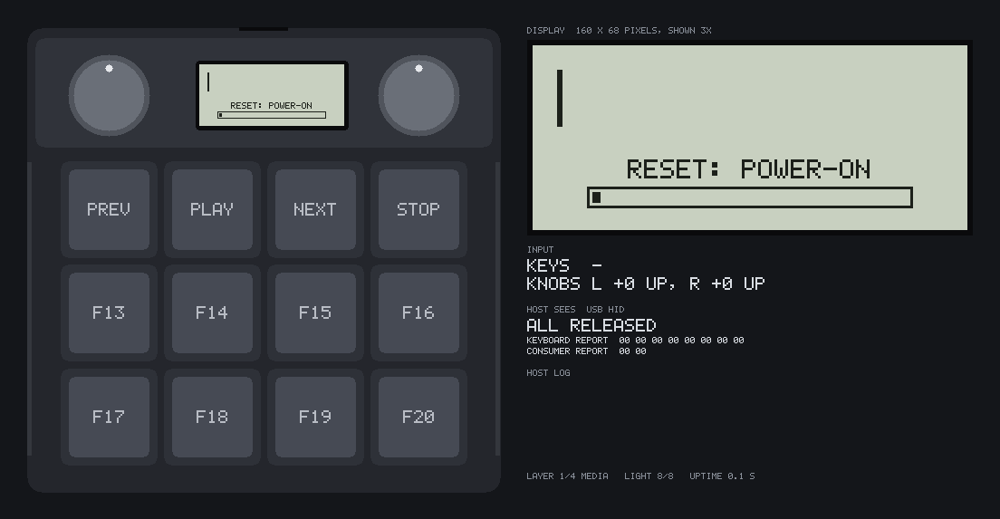
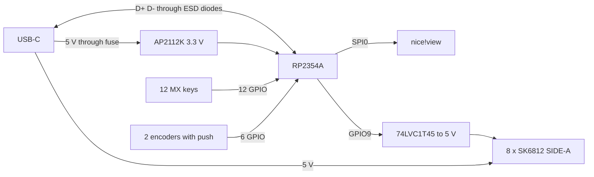
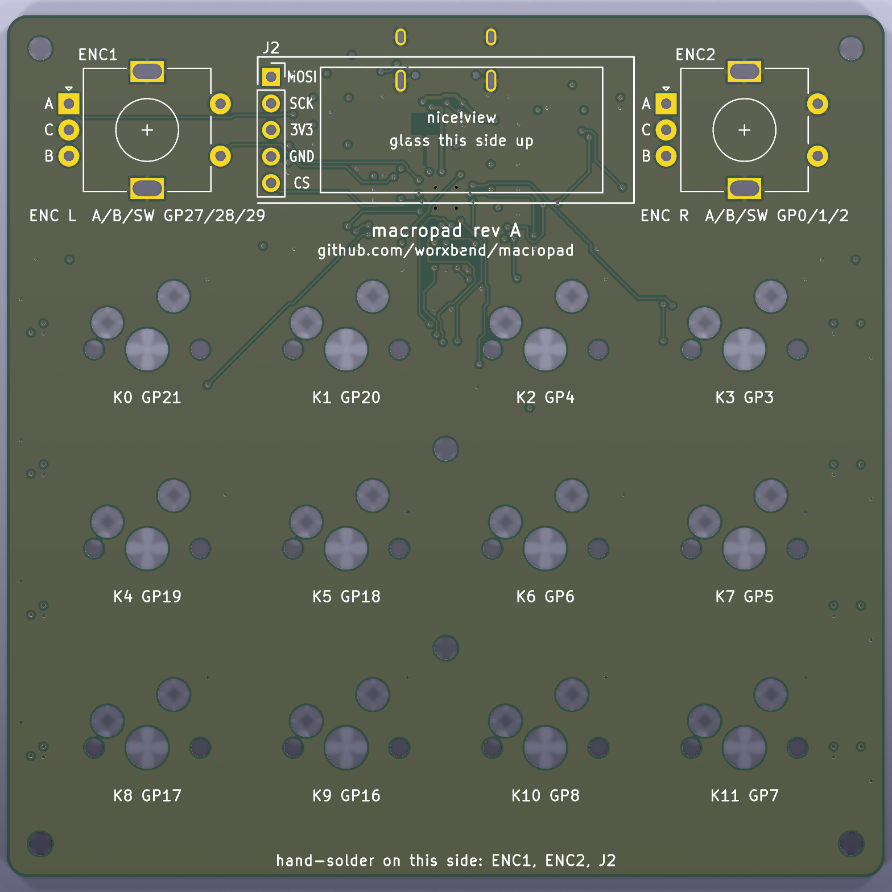
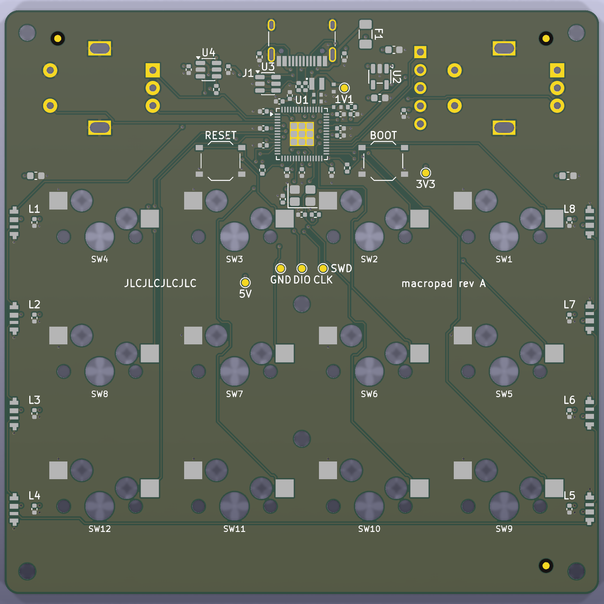
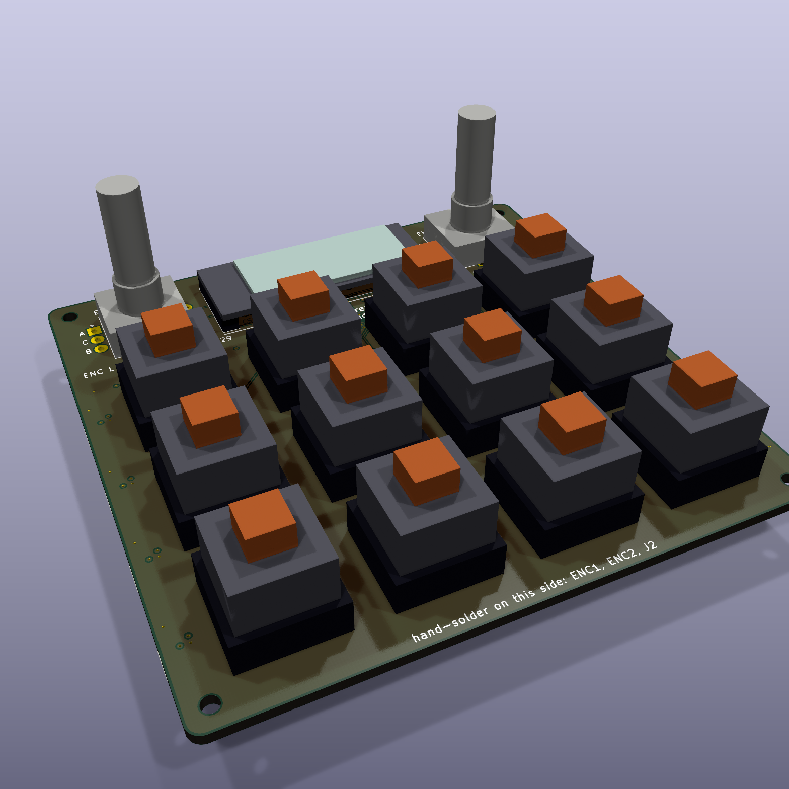
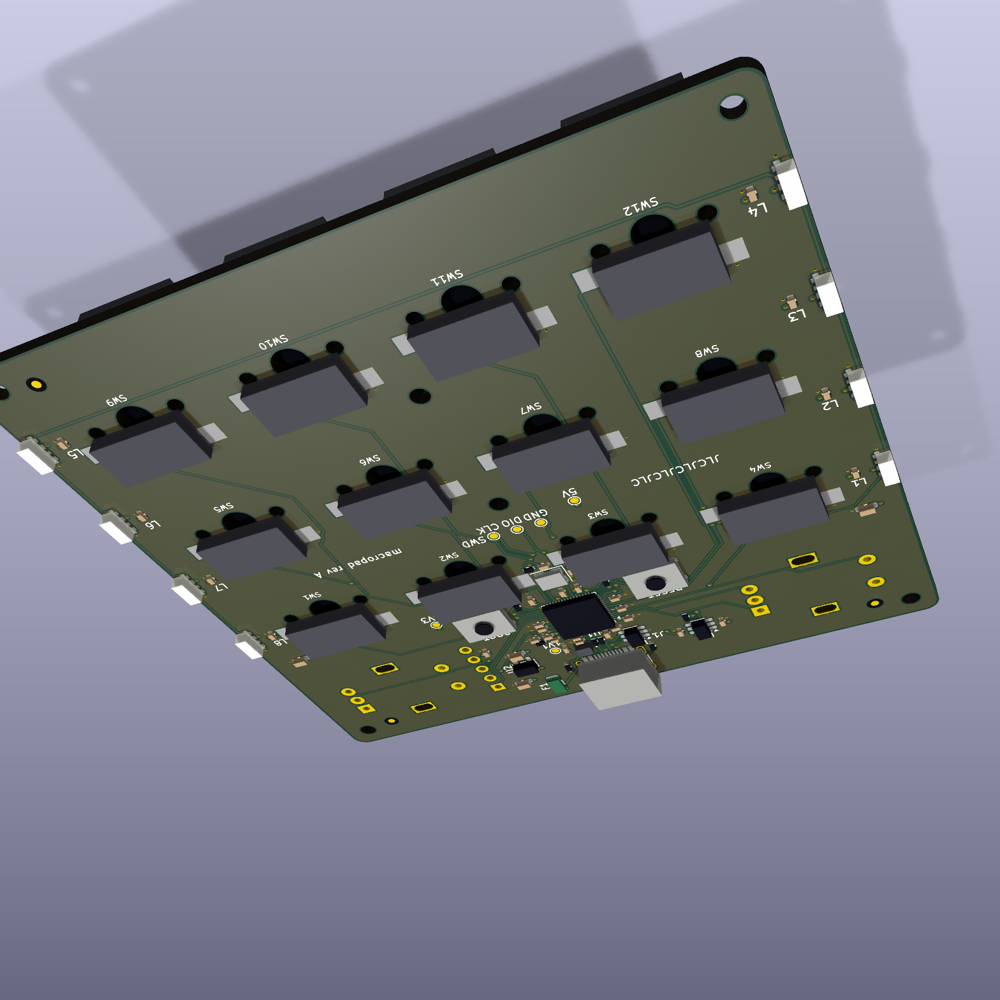
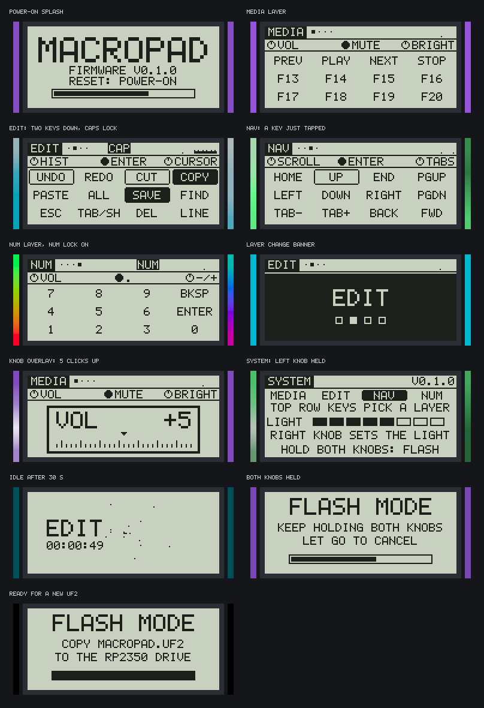
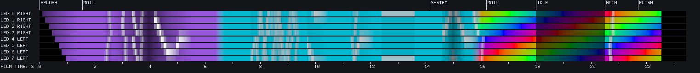

# macropad

A 12-key macropad on its own 4-layer PCB. Two rotary encoders, an always-on memory display,
light bars in the case sides, one USB-C port. Board, case and firmware are all generated from
code in this repository and checked against one shared file, [`board.toml`](board.toml).

It is the small, PCB-based sibling of [macropad-nyxilab](https://github.com/worxbend/macropad-nyxilab):
90 x 90 mm instead of 159 x 98 mm, and no hand wiring.

*Top: a render of the case model, not a photo. Bottom: the firmware running in its simulator, not a
recording of a device. The display in the render shows the simulator's own picture.*

> **Status: design files only. Nothing has been built.**
> No board has been ordered. No case has been printed or milled. The firmware has never run on a chip.
> Every claim below is what the design files and their automatic checks say. Read
> [Before you order](#before-you-order) first.

## Contents

1. [Status](#status)
2. [What it is](#what-it-is)
3. [Gallery](#gallery)
4. [Build one](#build-one)
5. [Stock keymap](#stock-keymap)
6. [Work on the design](#work-on-the-design)
7. [What is checked](#what-is-checked)
8. [Where things are](#where-things-are)
9. [Before you order](#before-you-order)
10. [License](#license)

## Status

Checked on 2026-11-13 by running the commands in the last column on this repository.

| Part | State | How it was checked |
|---|---|---|
| Circuit | Done. 52 nets, 72 machine-placed parts. | `make pcb-test`: netlist self-check, 34 unit tests pass |
| Schematic | Done. Generated KiCad 9 sheet. ERC: 0 errors, 0 warnings. | `make pcb-place` (report in `pcb/.build/erc.rpt`) |
| PCB layout | **Fully routed.** 802 tracks, 161 vias, 0 unrouted pads. DRC: 0 violations, 0 unconnected, 0 differences from the schematic. | `make pcb-check` |
| Order files | Written: 11 Gerbers, 2 drill files, BOM, placement list. They agree with the board and with each other. | `make pcb-fab` |
| Case | Done. 659 part pairs per variant, 0 clashes. Every named clearance and measurement inside its limit. Printed and milled variant. | `make test` |
| Firmware | Builds. 220 tests pass. UF2 in `firmware/dist/`. | `make test`, `make firmware` |
| Real hardware | **None.** No board, no print, no flash. | - |

One accepted DRC warning remains: the USB-C footprint differs from its library copy, because its
silkscreen is cut at the board edge. It is named in `pcb/gen/build.py` and explained in
[pcb/README.md](pcb/README.md).

A clean DRC does not make a working board. The list of things a person still has to look at is in
[Before you order](#before-you-order).

## What it is

| | |
|---|---|
| MCU | RP2354A: the Pico 2 chip (RP2350) with 2 MB flash inside the package |
| Keys | 12 x MX, HanElectricity hot-swap sockets (Kailh CPG151101S11 compatible), one GPIO per key (no matrix, no diodes) |
| Knobs | 2 x Alps EC11E18244AU with push switch, 36 clicks per turn |
| Display | nice!view (Sharp memory LCD, 160 x 68, monochrome, readable in sunlight), soldered on a 5-pin male header |
| Light | 8 x SK6812 SIDE-A side-emitting RGB LEDs on the PCB edges, behind two light bars that show as a line in the gap round the case |
| USB | One USB-C port for power, data and flashing. ESD diodes, 500 mA resettable fuse |
| Debug | Six test pads on the bottom face: SWCLK, SWDIO, GND, 5V, 3V3, 1V1. BOOT and RESET buttons reached through the case floor |
| PCB | 84 x 82.5 mm, 4 layers, 1.6 mm. Every machine-placed part is on the bottom face |
| Case | Base and top with a lap joint and a shadow gap between them, flush lens over the display, 2 light bars, 2 knobs, 2 foot strips and a centre pad that hide the screws, optional 6° tilt bar. 3D-print or CNC variant |
| Size | 90.0 x 90.0 x 17.5 mm, 35.5 mm from the underside to the top of the knobs. The foot strips add 1.2 mm |
| Firmware | Rust ([embassy](https://embassy.dev)). 4 layers, macros, tap-hold keys, per-layer knob functions, animated display, reactive lighting |
| Host | Shows up as a USB keyboard plus media keys. No driver, no host software |

How the pieces connect:

More detail: [docs/hardware.md](docs/hardware.md).

## Gallery

Every picture is generated by the code in this repository. None is a photo.

### Case

 

 

 

 

 

The case is a 90 mm square slab with one flat top face. The printed variant has R 7.0 arc corners; the
milled variant has continuous-curvature corners. The gap between the two shells runs all round, but it
lights only along two 46.5 mm stretches, one per side. The glow colour and the brightness in the
light-line picture are guesses: no optical simulation was done. The colours are proposals.
More views, the print orientation and the design notes: [cad/README.md](cad/README.md).

### PCB

 

 

The parts on the populated board are block models with nominal heights. They show where things
are. They are not the makers' 3D models.

Schematic as [PDF](docs/images/pcb/schematic.pdf). Copper layers:
[top](docs/images/pcb/copper-top.svg), [ground](docs/images/pcb/copper-ground.svg),
[power](docs/images/pcb/copper-power.svg), [bottom](docs/images/pcb/copper-bottom.svg).
Assembly drawings: [top](docs/images/pcb/assembly-top.svg), [bottom](docs/images/pcb/assembly-bottom.svg).
Routing notes and the full check list: [pcb/README.md](pcb/README.md).

### Display and lighting

The 8 LEDs over the demo session, one row per LED. Colours are brightened for the screen.
Screens, controls and timing: [firmware/README.md](firmware/README.md).

### Drawings

 

The sheets are in `cad/exports/drawings/` as SVG and PDF. Dimension texts are computed from the model.
The two CNC sheets carry part numbers, revision A, one finish (bead blast and clear anodise), ISO
2768-m with the critical fits toleranced, the M2 thread callout, a USB opening detail and, on the base,
the laser-mark note. `make cad` reads every exported STEP and STL back: one closed solid per part, no
free edges, volumes within 0.1 %.

## Build one

Nobody has done this yet. The guides are written from the design files. Expect to find mistakes,
and please report them.

1. **Read [Before you order](#before-you-order).** Decide whether you accept the open points.
2. **Order the board.** [docs/ordering.md](docs/ordering.md): JLCPCB step by step, with the files
   in `pcb/fab/`. Buy the parts JLCPCB does not place: [docs/parts.md](docs/parts.md).
3. **Make the case.** Print or mill the files in `cad/exports/`. Orientation, settings and CNC notes
   are in [cad/README.md](cad/README.md#printing).
4. **Assemble.** [docs/assembly.md](docs/assembly.md): solder the two encoders and the display
   header, test the bare board, then close the case with six screws.
5. **Flash.** [docs/flashing.md](docs/flashing.md): hold BOOT, plug in, copy
   `firmware/dist/macropad.uf2` to the `RP2350` drive. The same page lists what to check first when
   something does not work.

To change what the keys do: [docs/keymap.md](docs/keymap.md).

## Stock keymap

Four layers. Tap the left knob for the next layer. The display always shows the active layer's labels.

| Layer | Keys, row by row | Left knob | Right knob | Right knob press |
|---|---|---|---|---|
| MEDIA | PREV PLAY NEXT STOP / F13 F14 F15 F16 / F17 F18 F19 F20 | Volume | Screen brightness | Mute |
| EDIT | UNDO REDO CUT COPY / PASTE ALL SAVE FIND / ESC TAB-or-Shift DEL LINE | Undo, redo | Cursor left, right | Enter |
| NAV | HOME UP END PGUP / LEFT DOWN RIGHT PGDN / TAB- TAB+ BACK FWD | Up, down arrow | Previous, next tab | Enter |
| NUM | 7 8 9 BKSP / 4 5 6 ENTER / 1 2 3 0 | Volume | Minus, plus | Period |

| Gesture | Does |
|---|---|
| Hold the left knob + a top-row key | Jump to layer 1, 2, 3 or 4 |
| Hold the left knob + turn the right knob | LED brightness, 8 steps down to off |
| Hold both knobs for 1 s | Restart as a USB drive for a new firmware file |

## Work on the design

### Tools

| For | You need |
|---|---|
| Firmware | Rust (stable) with `rustup target add thumbv8m.main-none-eabihf`, Python 3.11 or newer, `make` |
| Simulator pictures | The above plus ImageMagick (`magick`) |
| Case | Python 3.12 and a virtual environment in `cad/.venv` (set-up in [cad/README.md](cad/README.md#build)). `rsvg-convert` for the PDF and PNG drawings |
| PCB | Docker. All KiCad work runs in the pinned image `kicad/kicad:9.0.9` through `pcb/kicad.sh` |

### Commands

Run `make help` for this list.

| Command | Does | Needs | Time |
|---|---|---|---|
| `make test` | Everything that can be checked without Docker or hardware | Rust, `cad/.venv` | about 2 minutes |
| `make firmware` | Tests, lints, board and HID checks, `firmware/dist/macropad.uf2` | Rust | under 1 minute |
| `make ui-images` | Redraws `docs/images/ui/` and the demo GIF from the simulator | Rust, ImageMagick | about 1 minute |
| `make cad` | Case self-test, checks, STEP/STL exports, renders, drawings | `cad/.venv` | about 3 minutes |
| `make pcb` | `pcb-place`, `pcb-check`, `pcb-fab` in order | Docker | about 2 minutes |
| `make pcb-place` | Schematic, placed and routed board, 3D models, pictures | Docker | about 1 minute |
| `make pcb-check` | KiCad design-rule check, board against schematic | Docker | seconds |
| `make pcb-fab` | Gerbers, drill files, BOM, placement list into `pcb/fab/` | Docker | seconds |
| `make pcb-test` | Netlist self-check and the PCB generator's unit tests | Python | seconds |
| `make docs-check` | Every file and picture named in a Markdown file exists | Python | seconds |

### One file drives three builds

`board.toml` holds the positions and the GPIO numbers. The PCB generator, the case model and the
firmware's board check all read it.

1. Change a position or a pin in `board.toml`.
2. Run `make pcb cad firmware`.
3. If parts or pins moved on the PCB, the routing order may need a new search:
   `pcb/kicad.sh python3 pcb/gen/build.py order` (about 10 minutes; it can fail).

Nothing in `pcb/kicad/` is drawn by hand. Hand edits are lost on the next `make pcb-place`.
Change `pcb/gen/circuit.py` or `pcb/gen/route.py` instead.

## What is checked

No check here replaces a prototype. They catch the mistakes a computer can catch.

| Area | Check | Result on 2026-11-13 |
|---|---|---|
| PCB | Netlist self-check in `circuit.py` | 52 nets, passes |
| PCB | Router and schematic-writer unit tests | 34 pass |
| PCB | `circuit.py` pins against KiCad's own RP2354A, regulator, ESD and level-shifter symbols | match |
| PCB | Schematic ERC, every severity | 0 errors, 0 warnings |
| PCB | DRC with board-against-schematic compare | 0 violations, 0 unconnected, 0 parity issues |
| PCB | Length limits on the USB pair, crystal and regulator nets; no via on the sensitive ones | pass (D+ 14.93 mm, D- 14.08 mm) |
| PCB | Order files agree: Gerbers newer than the board, one drill hit per via, BOM = placement list = circuit | 72 parts, pass |
| Case | Self-test: the measuring checks must catch 31 known-bad and sound shapes | 31 of 31 |
| Case | Interference, every part against every other, both variants | 659 pairs each, 0 clashes |
| Case | Every part one sound solid; wall thickness, screw bosses, light bar retention and insertion, lap joint, lens seat and stiffness, key and knob travel, knob seat on its shaft, square outline, corner curvature, frame swell, foot bearing, shell seat, text strokes, USB symmetry | all inside limits |
| Case | CNC: 3 mm tool reaches every pocket within 3 diameters, no sharp internal corner, no undercut beyond the USB opening's rounds | pass |
| Case | Exports read back: 11 STEP files, each part file one closed valid solid and the assembly 81, 0 free edges, volume within 0.1 % of the model and of its STL; no sliver faces in the CNC parts | 11 of 11 |
| Case | Print: layer-by-layer bridge and overhang check for every printed part, faces on the 0.2 mm layer grid, show faces of the top at 45° or less, engraving on the bed 0.7 mm wide | pass |
| Firmware | Unit tests: `core` 164, `sim` 38, `uf2` 18 | 220 pass |
| Firmware | `tools/check_pins.py`: GPIOs, knob type, key grid, LED and simulator positions against `board.toml` | match |
| Firmware | `tools/check_hid.py`: the USB report descriptors, parsed as a host would | match |
| Firmware | UF2 converter refuses an image the chip could not boot | current image passes |
| Docs | `make docs-check`: files and pictures named in Markdown exist | pass |

CI ([`.github/workflows/ci.yml`](.github/workflows/ci.yml)) runs the checks that need neither Docker
nor a long case build: `make pcb-test`, `make docs-check` and the firmware tests with both board
checks. The workflow has not run on GitHub yet.

## Where things are

| Path | What |
|---|---|
| [`board.toml`](board.toml) | Positions and GPIOs. The single source of truth for PCB, case and firmware. |
| [`pcb/`](pcb/README.md) | The board. `gen/` is the generator (`circuit.py` is the circuit), `kicad/` the generated KiCad 9 project, `fab/` the order files, `lib/` footprints and block models. |
| [`cad/`](cad/README.md) | Parametric case (build123d). `macropad_case/` is the model and its checks, `exports/` holds STEP, STL, drawings and `checks.json`. |
| [`firmware/`](firmware/README.md) | Rust workspace: `core` logic, `fw` binary, `sim` simulator, `uf2` converter. `dist/macropad.uf2` is the built image. [`KEYMAP.md`](firmware/KEYMAP.md) is the keymap reference. |
| `tools/` | `check_pins.py` and `check_hid.py`: firmware against `board.toml` and against the HID rules. |
| [`docs/hardware.md`](docs/hardware.md) | Circuit in words, pin map, layer stack, test pads, mechanical stack. |
| [`docs/parts.md`](docs/parts.md) | Every part, its JLCPCB number, what to buy elsewhere, substitutions. |
| [`docs/ordering.md`](docs/ordering.md) | Ordering the assembled board from JLCPCB, step by step. |
| [`docs/assembly.md`](docs/assembly.md) | Soldering, bare-board tests, case assembly. |
| [`docs/flashing.md`](docs/flashing.md) | First flash, updates, troubleshooting. |
| [`docs/keymap.md`](docs/keymap.md) | Changing what the keys, knobs and lights do. |
| `docs/images/` | Generated pictures: `cad/`, `pcb/`, `ui/`. |

## Before you order

These are open. None is hidden by a green check.

**Electrical**

- **Crystal.** Raspberry Pi's reference part, the Abracon ABM8-272-T3, with the reference 15 pF
  capacitors and 1 kΩ. Not measured. If USB does not enumerate, look here first.
  See [docs/parts.md](docs/parts.md).
- **USB pair.** Two short tracks, 14.9 and 14.1 mm, not a tuned differential pair. No impedance was
  calculated. Normal for full-speed USB over this length; nobody measured it.
- **Regulator inductor.** Its dot goes on the +1V1 pad, as in Raspberry Pi's datasheet and reference
  board. The part sits on the bottom face, mirrored against that board, and Abracon's drawing labels
  the dot "+": confirm against the Abracon drawing and in JLCPCB's preview. Not verified.
- **Pin orders from community footprints.** The nice!view header order and the SK6812 SIDE-A pad
  order are tagged `MEASURE`. No KiCad library symbol covers them, so nothing checks them.
- **Placement rotations.** `pcb/fab/cpl-jlcpcb.csv` carries KiCad's angles, also for the bottom-side
  parts. Whether JLCPCB wants those or (180 - r) is not settled. Check every part in their preview
  before you pay; [docs/ordering.md](docs/ordering.md) has the checklist.
- **Suspend current.** The LEDs go off when the host sleeps, but the MCU keeps running, above the
  2.5 mA a suspended USB device may draw.

**Mechanical**

- **`MEASURE` dimensions.** The nice!view's pixel window, its height on a plain male header (glass 4.4 mm
  above the PCB) and its header position, and the encoder heights (shaft end 24.5 mm, from the Alps
  drawing), come from drawings and community footprints, not from a caliper. The full table is in
  [cad/README.md](cad/README.md#assumptions-to-measure).
- **Fits are guesses.** Lap joint 0.2 mm, deepest unsupported ledge 1.5 mm, sag of a printed bridge
  0.2 mm, printed screw holes 0.15 mm small, lens 1.0 mm cover glass on 0.13 mm tape. Print one copy
  and measure before a batch or before paying for machining.
- **The light line is a guess.** The LEDs shine into a bar that shows only through a 1.4 mm slit in the
  gap. How bright and how even that is has not been simulated or tried.
- **The top prints standing on its side wall**, 10.6 times taller than its footprint is wide. Tipping
  and warping are not modelled.

**Firmware**

- **Display orientation, knob direction, LED colour order** are one-line settings and are guesses
  until a board exists. [docs/flashing.md](docs/flashing.md) says where each one is.
- **USB IDs** are the pid.codes test pair `1209:0001`. Get your own before you give boards to others.
- Settings are not stored: brightness and layer reset at power-on.

**Review**

- The schematic and the layout are generated and machine-checked. No engineer has reviewed them.

## License

No license file yet. Until one is added, nobody else has the right to reuse this.
The side-LED footprint comes from another project under the MIT License; see `pcb/lib/SOURCES.txt`.
