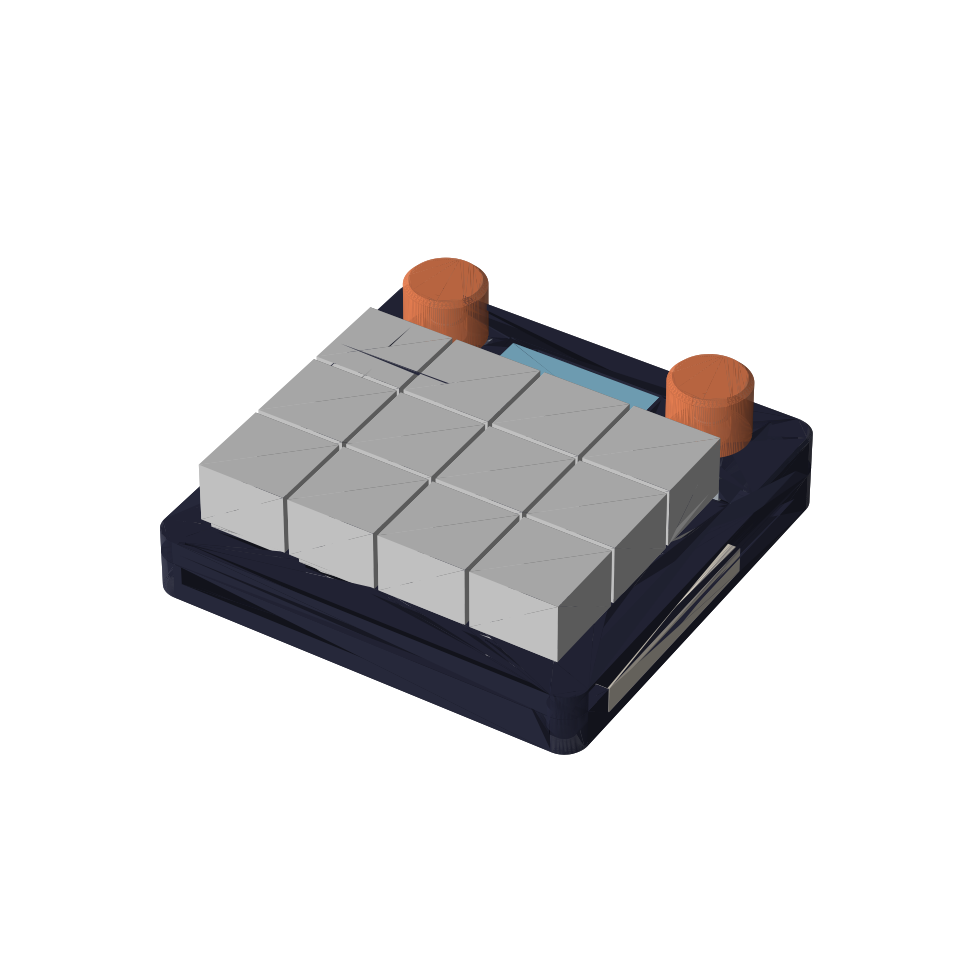
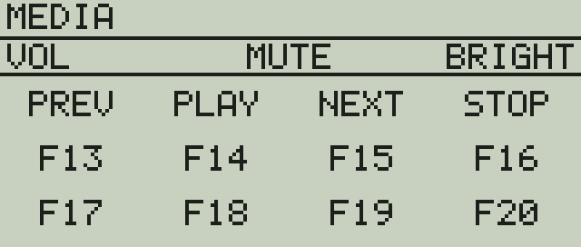

# macropad

A 12-key macropad on a custom PCB. Two rotary encoders, a nice!view display, RGB light bars in the
case sides, one USB-C port. It is the small, PCB-based sibling of
[macropad-nyxilab](https://github.com/worxbend/macropad-nyxilab): 89.6 x 88.1 mm instead of 159 x 98 mm, and no hand wiring.

 

## Status: design files, nothing built yet

| Part | State |
|---|---|
| Circuit and part placement | Done. Netlist self-check and placement checks pass. |
| PCB routing | **Not done.** One command left to run: `make pcb-route` (see below). |
| Gerbers | Not generated. They need the routed board. |
| JLCPCB BOM and placement list | Generated: `pcb/fab/`. Every part number checked against JLCPCB stock on 2026-11-12. |
| Case | Done. 255 interference pairs checked, 0 clashes, for both the printed and the milled variant. |
| Firmware | Builds. 79 tests pass. UF2 in `firmware/dist/`. |
| Real hardware | No board made, no case printed, firmware never run on a chip. |

Do not order boards from this repository before the routing step is done and `make pcb-check` reports zero errors.

## What it is

| | |
|---|---|
| MCU | RP2354A: the Pico 2 chip (RP2350) with 2 MB flash inside the package |
| Keys | 12 x MX, Kailh hot-swap sockets, one GPIO per key (no matrix, no diodes) |
| Knobs | 2 x Alps EC11E with push switch |
| Display | nice!view (Sharp memory LCD, 160 x 68), plugs into a 5-pin socket |
| Light | 8 x SK6812 SIDE-A side-emitting RGB LEDs on the PCB edges, behind translucent strips in the case sides |
| USB | One USB-C port for power, data and flashing. ESD protection and a 500 mA resettable fuse |
| PCB | 84 x 82.5 mm, 4 layers, all machine-placed parts on the bottom face |
| Case | Base, top (switch plate and display deck in one part), 2 diffuser strips, 2 knobs. 3D-print or CNC variant |
| Firmware | Rust (embassy). 4 layers, macros, per-layer knob functions, layer colours, live key legend on the display |

## Finish the PCB

The autorouter is a third-party Java program (Freerouting 2.5.0). The Makefile downloads it, checks its
SHA-256 against the release digest, and runs it in a container. Docker is required.

1. `make pcb-route` routes the board and pours ground.
2. `make pcb-check` runs KiCad's design-rule check. It must report zero errors.
3. `make pcb-fab` writes the Gerbers and drill files to `pcb/fab/`.
4. Open `pcb/kicad/macropad.kicad_pcb` in KiCad 9 and look at the USB pair, the crystal and the
   regulator loop around L1. An autorouter does not know these are sensitive.
5. Upload `pcb/fab/macropad-gerbers.zip`, `bom-jlcpcb.csv` and `cpl-jlcpcb.csv` to JLCPCB.
   Check every part's rotation in their placement preview before you pay.

## Build the rest

```bash
make firmware   # tests, lints, UF2 -> firmware/dist/macropad.uf2
make cad        # case checks and STEP/STL exports (needs cad/.venv, see cad/README.md)
make test       # everything that can be checked without hardware
```

Flash: hold BOOT (hole in the case floor) while plugging in, then copy `macropad.uf2` to the `RP2350`
drive. After the first flash, holding both knobs down for one second reboots into the bootloader.

## Where things are

| Path | What |
|---|---|
| `board.toml` | Positions and GPIOs. The PCB, the case and the firmware pin check all read it. |
| `pcb/gen/` | The board generator. `circuit.py` is the circuit; there is no hand-drawn schematic. |
| `pcb/kicad/` | Generated KiCad 9 board. |
| `pcb/fab/` | Files for the board house. |
| `cad/` | Parametric case (build123d) and its exports. |
| `firmware/` | Rust workspace: `core` logic, `fw` binary, `sim` display renderer, `uf2` converter. |
| `docs/` | [Parts and sourcing](docs/parts.md), [hardware notes](docs/hardware.md), images. |

## Known gaps

- No KiCad schematic file. The netlist is `pcb/netlist.txt`, generated from `pcb/gen/circuit.py`.
- The crystal is not Raspberry Pi's reference part (that one had 1 piece in stock). See `docs/parts.md`.
- Dimensions tagged `MEASURE` in `board.toml` come from community footprints, not from a caliper:
  the nice!view header position and pin order, its glass window, its height on sockets.
- Display orientation, knob direction and LED colour order are one-line settings in
  `firmware/fw/src/board.rs`. They are guesses until a board exists.
- USB IDs are the pid.codes test pair `1209:0001`. Get your own before you give boards to others.
- No license file yet. Until one is added, nobody else has the right to reuse this.
