# Case

Parametric case for the macropad, written with [build123d](https://build123d.readthedocs.io).
Board dimensions come from [`board.toml`](../board.toml); the case-only dimensions are in
[`macropad_case/spec.py`](macropad_case/spec.py).

**Nothing here has been printed or milled yet.** The model passes its own checks, and that is all.
Print one copy and measure before you order a batch or pay for machining.

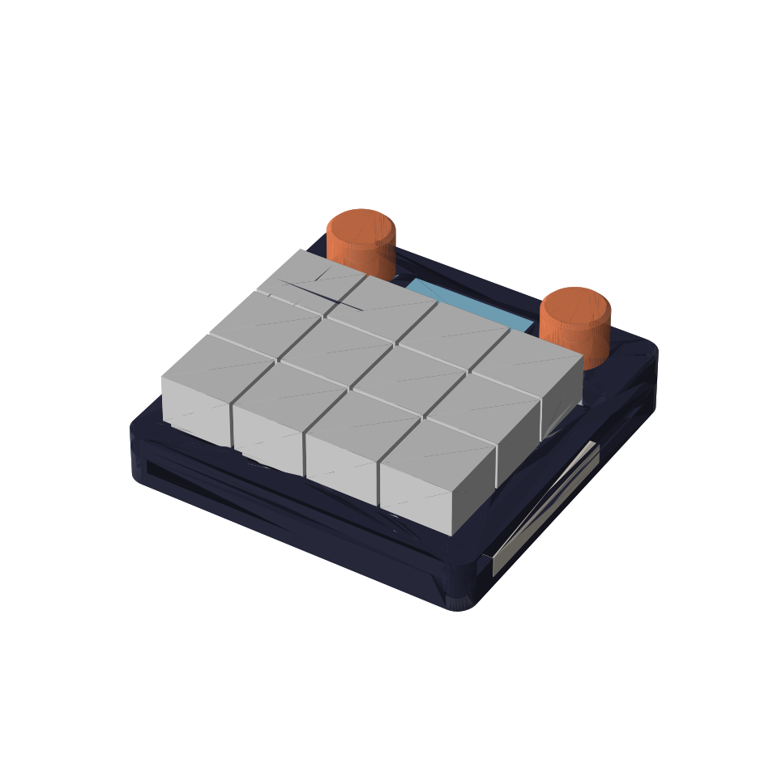

| | |
| --- | --- |
| 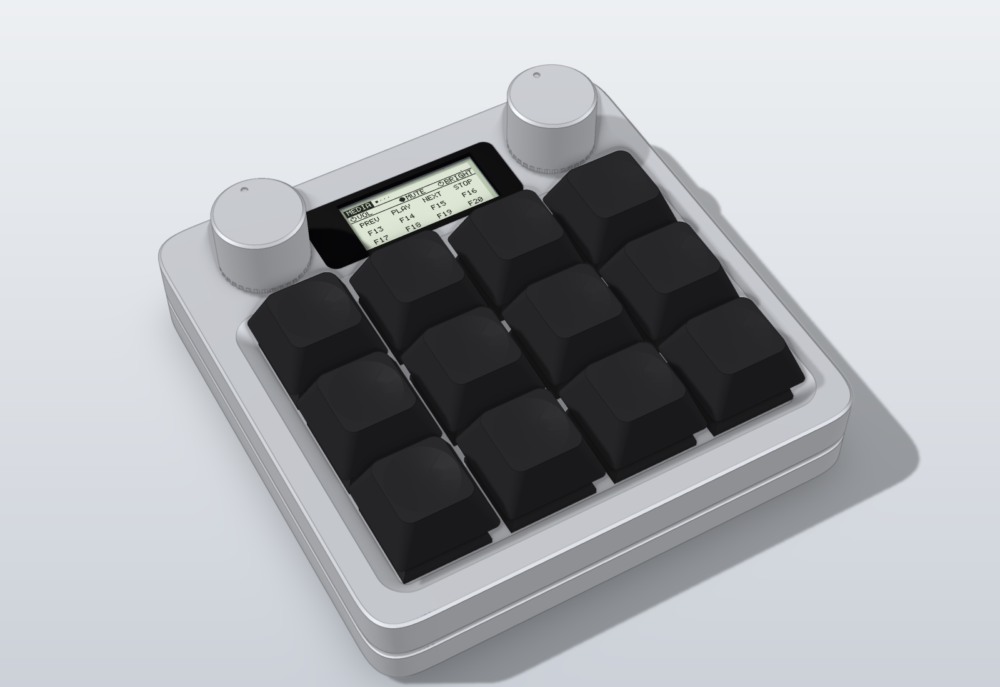 | 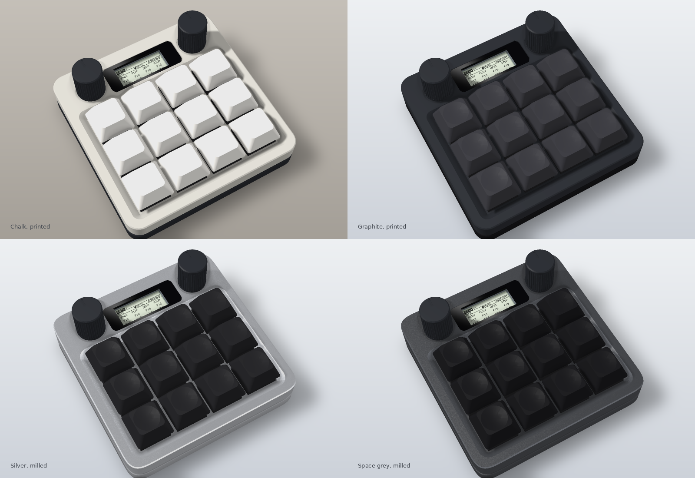 |
| The CNC variant, drawn as silver anodised aluminium. Its corners have continuous curvature. | Chalk and Graphite are the printed variant. Silver and Space grey are the milled one. |
| 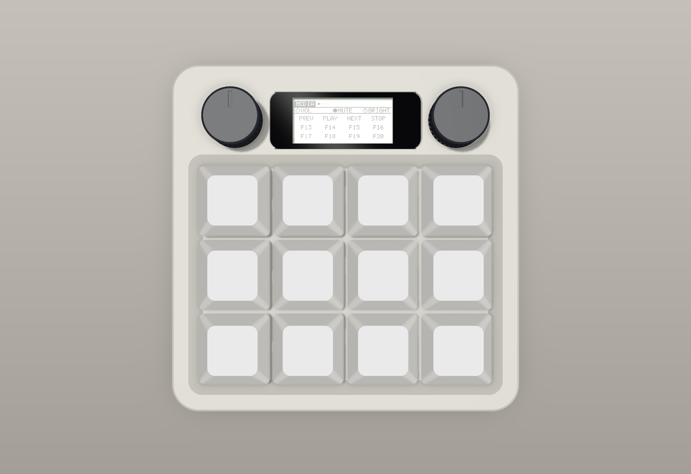 | 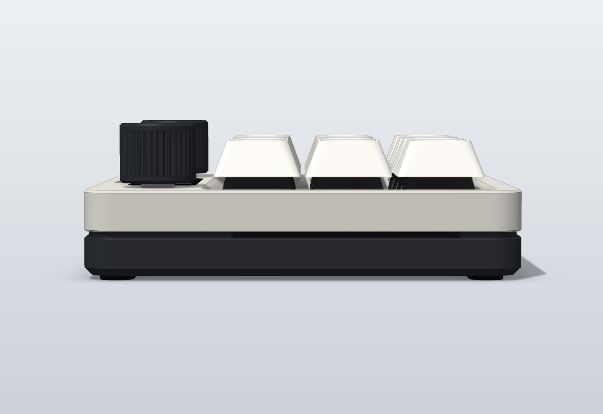 |
| From above: a 90 mm square, the same 4.775 mm frame left, right and in front of the keys. | From the left: light top over dark base, the gap between them, the strips that lift the body 1 mm. |
| 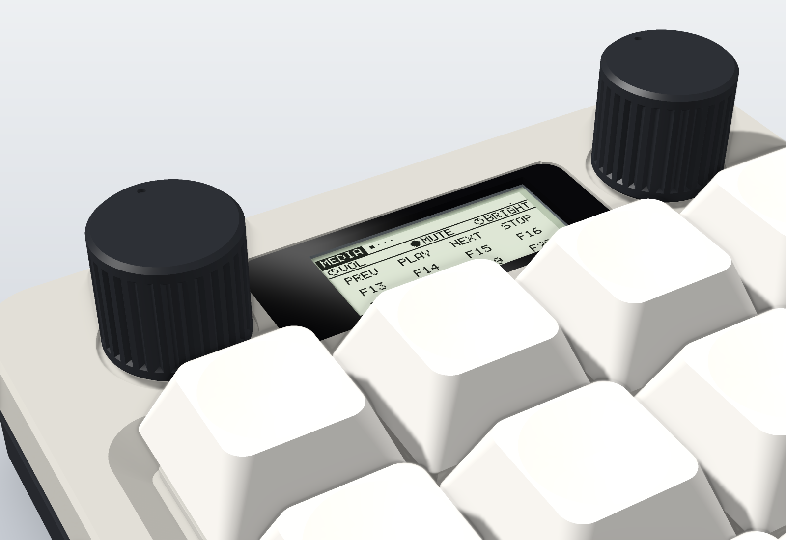 | 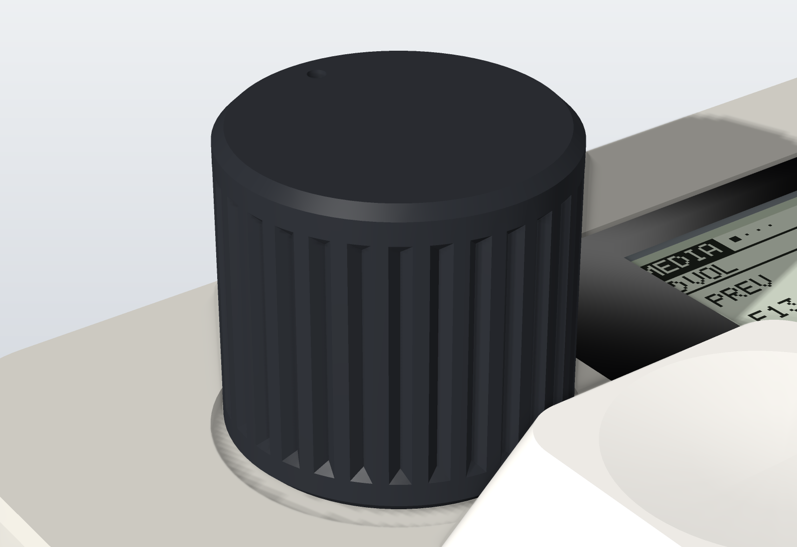 |
| The lens lies flush in the top face between the two knobs. | A knob, drawn in silver so the 36 grooves show: plain bands above and below, flat top, one dimple. |
| 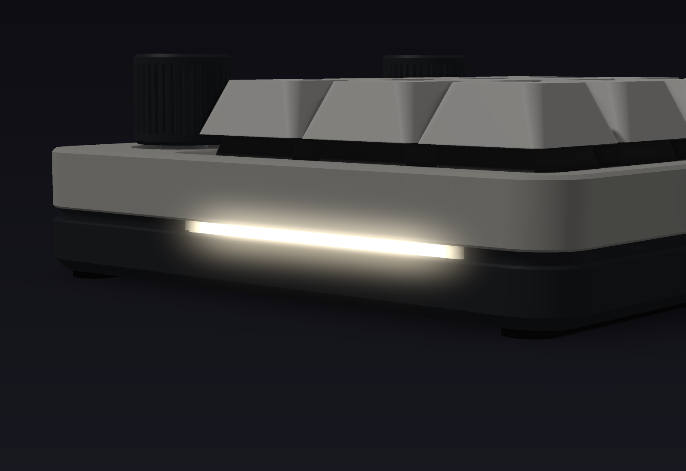 | 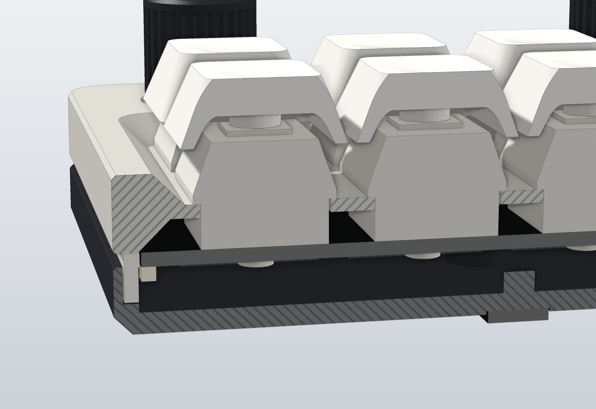 |
| The left light line, drawn glowing. Its colour and brightness are guesses; the LEDs are RGB. | Cut across the pad through one LED: the bar stands in the wall behind the outer skin and shows in the gap. |
| 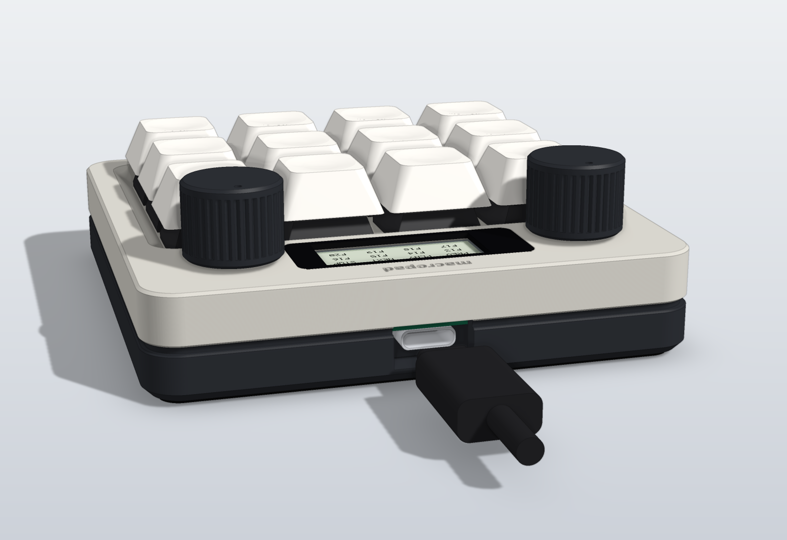 | 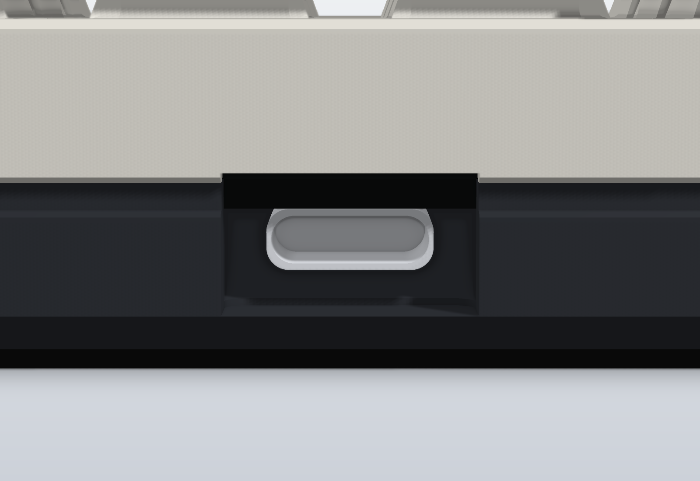 |
| Back, with the plug drawn pulled out. | The USB-C opening with its 0.5 mm lead-in. The gap runs into it on both sides. |
| 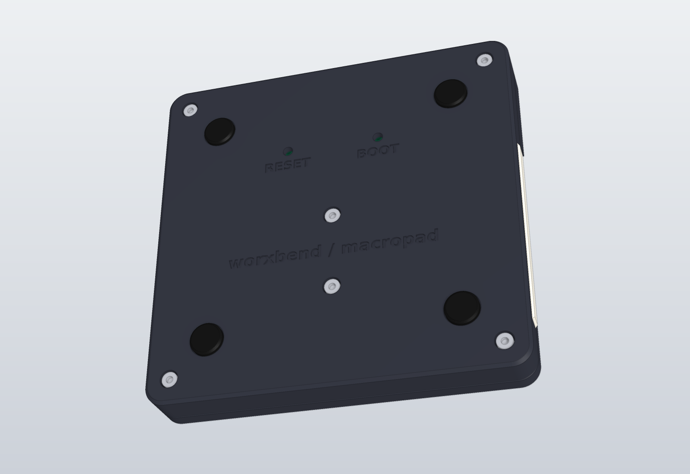 | 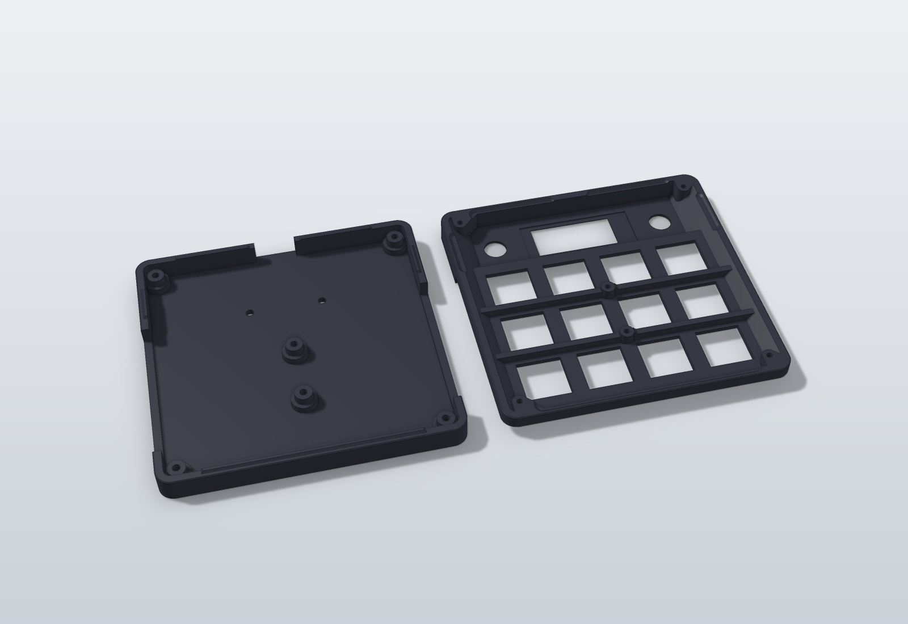 |
| Underside: two foot strips, the centre pad, the label field, BOOT and RESET. No screw shows. | Both shells from inside: lap ridges and light channels in the base, ribs and screw bosses under the plate. |
| 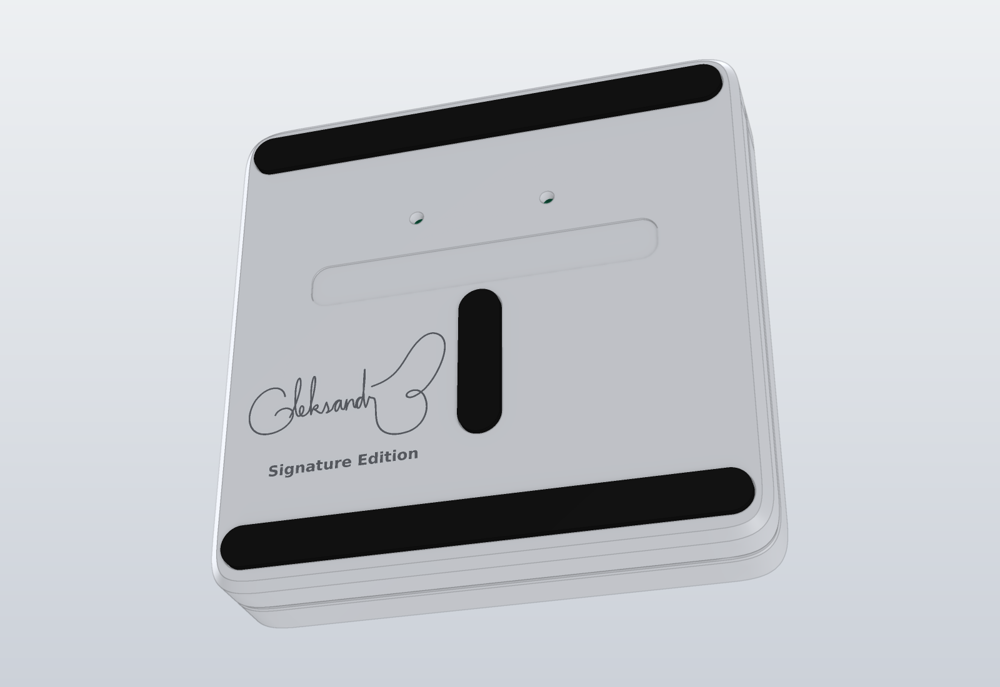 | |
| Underside of the milled base, with the laser-marked signature beside the centre pad. | |

The pictures come from the same solids as the exports. The display shows `docs/images/ui/media.png`,
the firmware simulator's own picture, laid on the lit area of the glass (25.2 x 10.7 mm, a datasheet value
to measure). The renderer has no clear material, so only the masked part of the lens is drawn and the
display shows through its window; the two cut views draw the whole lens. Cut faces are lighter, and
hatched on the two shells. Colours and finishes are proposals. Keycaps, switches, encoders, the display,
the USB parts and the screws are reference shapes drawn from datasheets, not vendor models.

## What the design is

- **One slab with one line round it.** 90.0 x 90.0 mm, 17.5 mm tall, one flat top face. The base rim
  steps in 1.0 mm over its top 1.2 mm, so a shadow gap runs all round the case at the joint. The two
  shells meet at the back of that gap; nothing is left to line up on the outside.
- **Corners.** The CNC outline has one quintic Bezier per corner (control points 10, 6 and 2 mm from the
  box corner on both sides): curvature is zero where the curve meets the straight side, and the
  smallest radius is 4.71 mm. The print outline has plain R 6.4 arcs through the same apex, **not
  continuous curvature**: the top prints standing on a side wall, and the Bezier corner starts so flat
  that it would hang 2.7 mm over the bed (the limit is 1.5; the arc hangs 1.1).
- **Edges.** 45° only. 0.5 mm on the top rim, the knob rims and the USB lead-in. 1.5 mm on the underside,
  so the base recedes. 0.3 mm on the three edges at the gap. Chamfers print without supports in any
  orientation and a mill cuts them with one tool; fillets do neither.
- **Key dish.** The keys stand in a dish: flat floor on the plate, 8.15 mm outside the outer key centres,
  and 45° walls up to the top face. The flat frame around it is 4.775 mm wide on the left, the right and
  in front. A vertical wall with a foot was tried first and does not print: the foot is a 55 mm bridge.
- **Lens.** A clear 39.0 x 14.6 x 1.0 mm lens lies in a recess in the top face, 0.02 mm under flush, taped
  on two end ledges. A black mask on its underside leaves a 27 x 12 mm window over the visible glass,
  1.5 mm off the lens centre as the glass is. The opening under the lens is larger than the whole
  display module.
- **Light line.** Each side wall of the base has a channel behind a 1.0 mm outer skin. A light bar stands
  in it, in front of the four side LEDs. In the gap the rim is cut away along the channel, so the top
  1.1 mm of the bar shows there, 1.0 mm back, 46.2 mm long. The gap runs all round, but it lights only
  along these two 46.5 mm stretches. The light reaches the slit indirectly: brightness and evenness are
  guesses. A printed base must be dark, or the 1.0 mm skin glows too.
- **Knobs.** 16 mm, 12.5 mm tall, 1.0 mm above the plain deck. 36 straight V grooves, 0.45 mm deep,
  between two plain bands; flat top; a 1.2 mm pointer dimple on the side of the D-shaft's flat.
- **Underside.** All six screws are hidden. Two foot strips, 84.6 x 7.0 mm with ends concentric to the
  corner screws, lie in 0.6 mm recesses and stand 1.0 mm proud. A centre pad covers the two centre
  screws and stands 0.8 mm proud, so the case never rocks on it. A 45° cone joins each recess to its
  screw counterbore: without it the recess roof is a bridge with a hole in it. The label field, 60 x 8 mm
  and 0.4 mm deep, holds the mark; BOOT and RESET sit behind it.
- **Lap joint.** Ridges 0.6 mm tall stand on the base rim, inside the wall, along the back, the front and
  the first part of each side. They enter grooves in the top's skirt. The joint centres the top on the base
  and closes the straight path for light through the joint. The ridges stop 10 mm short of the corners
  (where the screw bosses join the walls), at the USB opening and at the light channels. Flank and ends
  are 45°, so they print without support and a chamfer mill cuts them.
- **Structure.** Two ribs run under the plate between the key rows and pass through the two centre screw
  bosses. They start 1.0 mm above the PCB, above the lap grooves. In the print variant each corner boss has
  a web to the back or front wall with a 45° underside, and each centre boss has a small fin: without them
  a boss is a cylinder sticking out sideways while the top prints on its side. Each base boss is 5.5 mm
  wide next to the hot-swap sockets and 8 mm wide where it joins the floor.
- **Legends.** `macropad` on the top face behind the lens; `BOOT`, `RESET` and `worxbend / macropad` on the
  underside. Print variant only: the CNC parts stay plain, to be laser-marked or left blank. The
  underside mark is not sunk but left standing in its field, flush with the underside: sunk into the
  field's roof it would be holes in a bridge.
- **Signature.** A single-line signature reading "Oleksandr B" (34 x 19 mm, line 0.3 mm) and the caption `Signature Edition`
  are laser-marked on the underside of the base, beside the centre pad (`macropad_case/signature.py`).
  It is flat artwork, not geometry: the solids and the STEP/STL files do not contain it. Send
  `exports/drawings/engraving_underside.dxf` to the laser shop; it holds the signature at its place,
  drawn as seen from above (mirrored, because it is read from below). Two clearance rows check that
  it stays clear of the feet and the label field and that the line is wide enough for a laser.
- **Tilt.** An optional bar under the back of the base tilts the pad by 6°. It needs no change to the case.

Walls: 2.7 mm at the sides, 3.175 mm at the back, 3.725 mm at the front. Floor 2.4 mm.

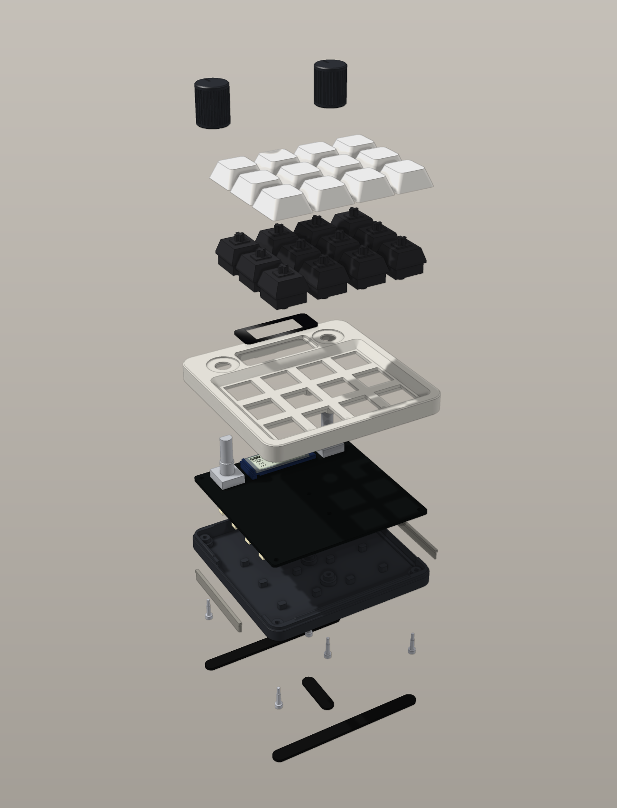

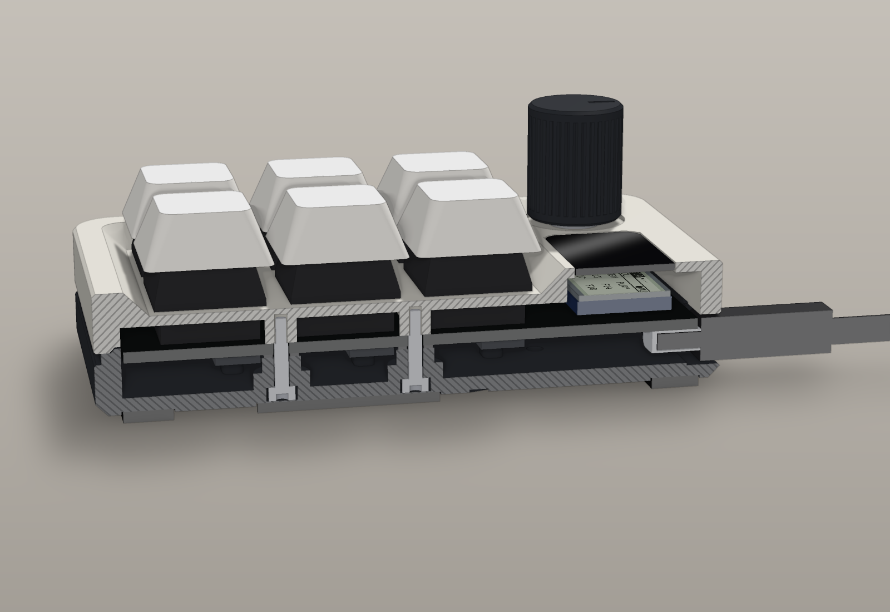

The cut passes through the USB port, the lens, the display and the two centre screws under the pad.

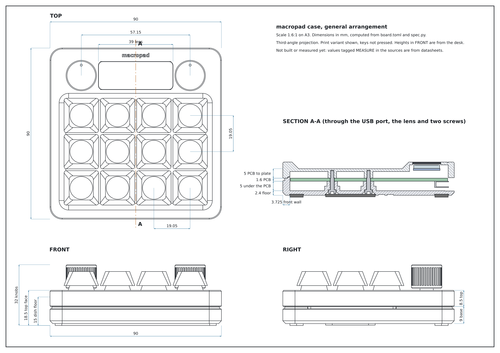

The drawing is also in [`exports/drawings/`](exports/drawings) as SVG and PDF (A3, 1.6:1). Its dimension
texts are computed from the model.

Two more sheets are for the machine shop: the CNC base and the CNC top, each with a plan from above and
from below, section B-B through the centre screws, the gap and the lap joint at 8:1 and a table of holes
and recesses from datum A. The tolerance note on them (ISO 2768-m) is a proposal, not a tested requirement.

| | |
| --- | --- |
| 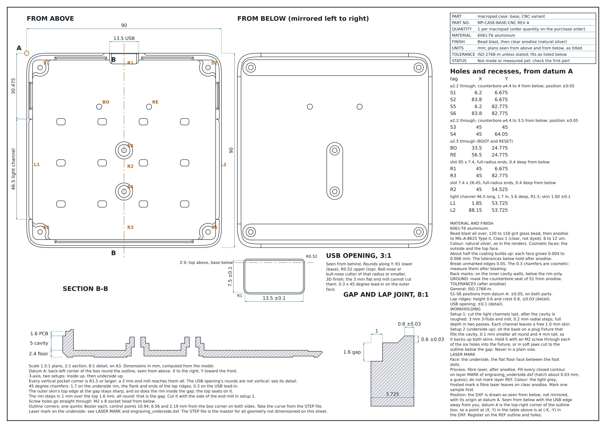 | 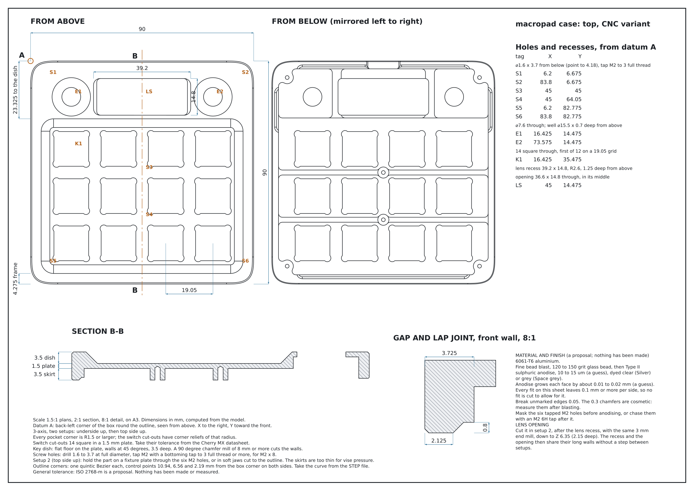 |

`exports/drawings/` also holds four DXF outlines. `engraving_top.dxf` and `engraving_underside.dxf` are
the text of the print variant, for laser-marking the milled parts; the underside file is drawn as seen
from above (mirrored). `lens.dxf` is the lens and `lens_mask.dxf` its black mask.

## Parts

| Part | Count | Material | Files |
| --- | --- | --- | --- |
| `base` | 1 | PLA, PETG or aluminium | `exports/print/base.*`, `exports/cnc/base.*` |
| `top` (switch plate, deck and skirt in one piece) | 1 | PLA, PETG or aluminium | `exports/print/top.*`, `exports/cnc/top.*` |
| `diffuser` (light bar) | 2 | smoke-grey translucent PETG (a guess) | `exports/diffuser.*` |
| `knob` | 2 | any | `exports/knob.*` |
| `lens` | 1 | clear cast acrylic, 1.0 mm, black mask on the underside (thickness is a guess) | `exports/lens.step`, `exports/drawings/lens.dxf`, `lens_mask.dxf` |
| `foot_strip` | 2 | TPU, printed or cut from 1.6 mm sheet (a guess) | `exports/foot_strip.*` |
| `centre_pad` | 1 | as the strips, 1.4 mm | `exports/centre_pad.*` |
| `tilt_bar` (optional) | 1 | any | `exports/tilt_bar.*` |

Size: 90.0 x 90.0 mm, 17.5 mm tall, 31.0 mm from the underside to the top of the knobs. The foot strips
add 1.0 mm.

The left and right light bar are the same part, turned around. The two foot strips are identical.

A smoke-grey bar disappears in the gap when the LEDs are off. A clear or natural bar passes more light,
but shows as a pale stretch in the gap by day. Which is better is a guess until one is printed.

Hardware:

- 6 x M2 x 10 socket-head cap screw (ISO 4762, 3.8 mm head)
- Double-sided tape, 0.13 mm thick, for the lens: two pieces of about 1 x 14 mm (the thickness is a guess)
- Thin double-sided tape or glue for the foot strips and the centre pad
- The M7 nuts and washers of the encoders are **not** used: the encoders are held by the PCB

## Build

```bash
cd cad
uv venv --python 3.12 .venv
uv pip install --python .venv/bin/python -e .
.venv/bin/python build.py all       # check, export, render, draw
.venv/bin/python build.py check     # checks only; exits non-zero on any failure
.venv/bin/python build.py render    # pictures -> docs/images/cad/
.venv/bin/python build.py draw      # three sheets and four DXF -> exports/drawings/ (PDF and PNG need rsvg-convert)
```

| Module | Holds |
| --- | --- |
| `spec.py` | Every dimension, and the heights derived from `board.toml` |
| `solids.py` | Small helpers, and the two outlines of the case |
| `parts.py` | Base and top |
| `signature.py` | The signature laser-marked on the underside: flat artwork, exported as DXF |
| `small_parts.py` | Light bars, knobs, lens, foot strips, centre pad, tilt bar |
| `components.py` | Reference shapes of the bought parts |
| `checks.py`, `measure.py` | The checks below |
| `printsim.py` | The layer-by-layer print check |
| `selftest.py` | Known-bad shapes that every measuring check must catch |
| `raster.py`, `render.py` | A numpy software renderer and its views |
| `drawings.py` | The three drawing sheets and the DXF outlines |

## Checks

`check` writes `exports/checks.json` and runs five groups.

0. **Self-test.** Before the case is judged, the measuring checks are run on 23 small solids: a sheet
   thinner than the minimum wall, a pocket with sharp corners, a pocket with too small a radius, a slot
   narrower than the tool, a groove in a side wall, a bridge that is too long, a shelf, a wall leaning 60°,
   an outline with arc corners, two loose boxes, a foot recess with a screw hole in its roof, a 1 mm ledge
   58 mm long between two posts, and sound versions of each. A check that misses its fault, or flags a
   sound shape, fails the run.
1. **Interference.** Every part against every bought component and every other part, for both variants:
   582 pairs each. Any shared volume over 0.05 mm³ fails. Keycaps are blocks that cover the whole key travel.
   The tilt bar against the back foot strip is skipped, because the bar takes that strip's recess.
2. **Named clearances.** 47 gaps computed from the dimensions: USB plug to its opening, keycap to the
   dish rim, lens to the glass, screw engagement, screw head under the strip recess, floor under each
   recess and each engraving, and more.
3. **Measurements on the finished solids.** These do not trust how the model was built.
   - Every part is one valid solid with a volume. A boolean that went wrong shows up here first.
   - Thinnest wall of every part: 3000 surface points per part, a ray through the material from each.
     Minimum 0.8 mm. A sample can miss a very small thin spot. Engraved text is checked by depth only.
   - Silhouette: width equals depth, and the frame beside the key dish equals the frame in front of it,
     both within 0.01 mm. On the CNC shells the curvature where a corner curve meets a straight side
     must stay under 0.01 per mm, and the smallest corner radius must be 4.66 mm or more.
   - Wall around every screw hole, measured on a horizontal cut.
   - Light bar retention: the bar is pushed 0.6 mm in six directions and must hit the base, the PCB
     or the top each time.
   - Lens: pushed 0.3 mm down it must hit its ledges, and its top must not stand above the top face.
   - Feet: every counterbore mouth lies under a strip or the pad. The mark keeps 1.0 mm to the edge
     of its field.
   - Pressed keycap to the top, keycap to knob, pressed knob to the top, as distances between solids.
   - Lap joint: ridge to groove at least 0.1 mm apart, and the top pushed 0.5 mm left, right, back and
     front must hit a ridge each time. Both variants.
   - CNC variant, tool run: a 3 mm flat end mill is lowered over a 0.1 mm height map of each shell, from
     above and from below. Any place where it stops more than 0.1 mm short of the surface is a corner too
     tight or a slot too narrow. Chamfers and holes smaller than the tool are left out (chamfer mill, drill).
     This check made the lap joint what it is: a ridge all the way round needed a 1 mm groove behind every
     rib end and corner boss, which a 3 mm tool cannot cut.
   - CNC variant: no vertical internal edge without a radius (probe points around every vertical edge),
     smallest concave wall radius at least 1.5 mm, and no face hidden from a tool coming straight down
     or straight up (two height maps). Full round holes are left out of the radius check: they are drilled.
4. **Printability.** Each printed part in its bed orientation, two ways.
   - Faces: overhanging faces are grouped into patches; a patch passes if it is 15 mm or narrower in one
     direction. The part must also put at least 100 mm² on the bed. This alone does not tell a bridge
     from a cantilever.
   - Layers: the part is cut into 0.2 mm layers on a 0.1 mm grid. A layer may rest on the one below up to
     0.3 mm past its edge (about 56° from vertical; the 45° faces of the design need 0.2), or bridge in a
     straight line between two places that rest. What is left hangs from one side. The longest bridge
     must stay under 15 mm and the deepest cantilever under 1.5 mm. The 1.5 mm is a guess: about three
     0.45 mm lines.

Faults these checks found while the case was drawn, all fixed in the model:

- The top's corner screw bosses hung 4.4 mm from the plate. They are webbed to the walls now.
- The USB tunnel cut a 0.13 mm step into the floor with two sharp corners. Its inner end is rounded now.
- A light channel with rounded ends, cut through the rim at the gap, left a feather edge 0.03 mm thick
  on the rim. In the gap the rim is cut straight through now.
- The mark sunk into the roof of the label field was a 59 mm bridge with holes in it. It stands in the
  field now.
- A tilt bar tongue round the screw holes was a ring 0.75 mm wide. The tongue lies between the screws now.

### Checks that changed their meaning

Four checks from the earlier case measure something else now, because the part they were about is gone.
Their limits are the same or stricter.

| Check | Measures now | Value, minimum |
| --- | --- | --- |
| `keycap_to_deck` | back edge of the back keycaps to the rim of the key dish | 2.6, 0.4 |
| `display_glass_under_deck` | display glass to the underside of the lens | 0.48, 0.2 |
| `bezel_land_under_chamfer`, now `lens_ledge_thickness` | thickness of the two ledges that carry the lens | 1.0, 0.8 (was 0.2) |
| `tilt_bar_to_screw_counterbore` | wall of the bar's 5.6 mm hole around the 4.4 mm counterbore under it | 0.6, 0.5 |

`foot_below_underside` is now how far a foot strip stands proud (1.0 mm). `knob_to_well_floor_when_pressed`
and `skin_under_knob_well` read the plain deck: the knob wells are gone.

## Printing

The STL files already lie the way they print. No supports.

| Part | Orientation | Notes |
| --- | --- | --- |
| `base` | floor down | Print it dark. The foot recesses, the label field and the counterbores are short bridges; the cones under the screws need none. |
| `top` | standing on its **left side wall** | Use an 8 mm brim: the part is 10.6 times taller than its footprint is wide. |
| `diffuser` | outer face down | The face on the bed is the one you see in the gap. 100 % infill. |
| `knob` | open end down | The grooves are vertical. The land between two grooves is 0.5 mm wide: one line of a 0.4 mm nozzle (a guess). |
| `foot_strip`, `centre_pad` | flat | TPU. Or cut them from sheet. |
| `tilt_bar` | sloped face down | The top comes out 6° off level and shows layer steps; it is hidden under the base. |

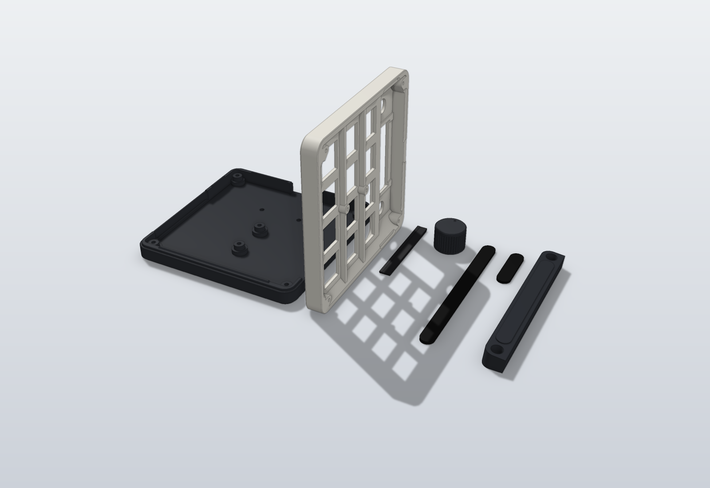

The top stands on its side so that the top face and the walls of the key dish print as walls, not as
a first layer or a ceiling. The ribs print as vertical walls too, the switch cut-outs are 14 mm bridges
and the lens opening is a 14.8 mm one. The print variant has 45° fillers under both side walls so the
upper wall does not start in mid-air, webs under the screw bosses, and a filler beside each lens rib,
all for the same reason. The lower rounded corners touch the bed on a curve and may look rough; the
brim helps.

Settings: 0.2 mm layers, 3 walls, 0.4 mm nozzle.

The engraved text is 0.4 mm deep. The smallest strokes are about 0.5 mm wide (a guess from the font);
they may fill in on a 0.4 mm nozzle. The mark in the label field stands on the bed as separate letters:
they need a clean first layer.

The screws cut their own thread in the 1.7 mm holes of the top. Do not overtighten.

## CNC

`exports/cnc/base.step` and `exports/cnc/top.step` are for 3-axis milling, two setups each.

- The outline corners are free curves, not arcs. Take them from the STEP file.
- Every pocket is opened with a 1.5 mm radius, so a 3 mm end mill reaches every internal corner.
  Gaps narrower than 3 mm are left solid: the corner bosses are joined to the walls.
- The switch cut-outs have dog-bone reliefs in the corners. The 14.0 mm square is still clear.
- No undercuts. The print variant's 45° fillers, boss webs and text are not in the CNC variant.
- The lap grooves in the top open toward the cavity. A flat end mill clears them; a chamfer mill cuts the
  45° outer wall and leaves the conical ends drawn in the model.
- A 90° chamfer mill cuts everything that is at 45°: the three rims, the edges at the gap, the walls of
  the key dish (3.5 mm deep, so in several passes), the six cones under the foot recesses and the USB
  lead-in. Where two faces of the dish or of a lead-in meet, the tool leaves a small radius instead of
  the sharp mitre in the model.
- Top, setup 1 (underside up): the cavity levels around the ribs and the lens ribs, all through cuts,
  the six screw holes, the lower rim chamfer. Setup 2 (top side up): the key dish, the lens recess,
  the top rim chamfer.
- Base, setup 1 (inside up): the cavity in three levels, the USB opening, the light channels, the through
  holes, the rim step that makes the gap and its two chamfers. Setup 2: counterbores, cones, foot
  recesses, label field, underside chamfer.
- The screw holes in the top are 1.7 mm for plastic. For aluminium drill 1.6 mm and tap M2.
- The plate is 1.5 mm thick, which MX switches need to clip in.

The light bars, the knobs, the foot strips and the tilt bar stay printed. The pictures draw the knobs of
the milled variant in silver; a turned aluminium knob to the same drawing is possible but not checked.

## Assembly

1. Stand a light bar in each side channel of the base, lip up and toward the inside.
2. Lower the assembled PCB onto the six bosses. Its edges now hold the bars in.
3. Stick the two tape pieces on the lens ledges of the top and press the lens in, mask down, window
   toward the right knob.
4. Put the top on. The lap ridges find their grooves and centre it. Fit the six screws from below.
5. Press the switches into the plate, then the keycaps and the knobs. The pointer dimple goes on the
   side of the shaft's flat.
6. Stick the two foot strips and the centre pad into their recesses, last. They cover the screws.
   To open the case again, peel them off first.

The nice!view is held only by its header. Put a foam pad under its free end if it rattles.

### Tilt bar

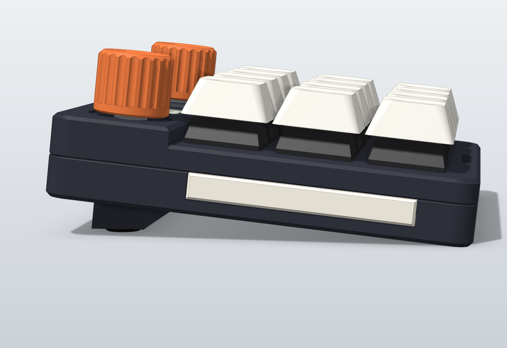

Leave the back foot strip off the base. Glue or tape the bar's tongue into the empty back recess, with
the bar's ends level with the flat of the underside, then stick that strip into the recess on the bar.
The two holes in the bar keep the back corner screws reachable once the strip is peeled off, and the
bar leaves the BOOT and RESET holes free. The pad then rests on its front strip and on the bar.

## Assumptions to measure

These came from datasheets, footprints and photos, not from parts on a desk. Each is one number in
`board.toml` (first three), in `macropad_case/spec.py`, in `macropad_case/components.py` or, for the
picture colours, in `macropad_case/render.py`.

| What | Value | Where |
| --- | --- | --- |
| nice!view glass top above the PCB | 7.0 mm | `stack.display_glass_top` |
| nice!view header position and pin order | 1.27 mm from the short edge | `display.header_x` |
| Visible glass area and its offset | 27 x 12 mm, 1.5 mm off centre | `display.window_*` |
| nice!view module thickness | 2.9 mm | `display_thickness` |
| nice!view glass outline and board thickness (pictures only) | 30 x 13.6 mm, 1.0 mm | `display_glass`, `display_board_thickness` |
| Encoder body footprint | 12.4 x 13.4 mm | `encoder_body` |
| Encoder threaded bushing length | 7.0 mm | `bushing_length` |
| Encoder D-shaft, across the flat | 4.5 mm | `shaft_flat` |
| Encoder terminal positions | from the KiCad EC11E footprint | `components.ENCODER_PINS` |
| Side LED body | 4.0 x 1.6 x 1.6 mm | `led_body` |
| Keycap: skirt above the plate when pressed, top above the plate | 2.0 mm, 14.5 mm | `keycap_*` |
| Keycap shape in the pictures | DSA: 12.7 mm top, 7.4 mm tall | `keycap_profile` |
| MX switch housing above the plate | 15.6 mm rim, 6.6 mm tall, stem to 10.2 mm | `components.MX_*` |
| MX plate clips clear the 2 mm ribs | 1.5 mm from cut-out to rib | `rib_width` |
| USB-C plug overmould | 12.5 x 6.5 mm | `usb_plug` |
| USB-C plug tip (pictures only) | 8.25 x 2.4 x 6.5 mm | `components.USB_PLUG_TIP` |
| Lit area of the display (pictures only) | 25.2 x 10.71 mm | `components.DISPLAY_ACTIVE_AREA` |
| Deepest ledge that prints without support | 1.5 mm | `max_cantilever` |
| Lap joint fit | 0.2 mm on the size, 0.13 mm between the flanks | `lap_fit` |
| Lens sheet (a guess) | clear cast acrylic, 1.0 mm thick | `lens` |
| Lens tape (a guess) | 0.13 mm thick | `lens_tape` |
| Foot strips and centre pad (a guess) | TPU, 1.6 mm and 1.4 mm thick | `foot_strip`, `centre_pad_thickness` |
| Knob grooves (a guess for a 0.4 mm nozzle) | 36 grooves, 0.45 mm deep, 0.5 mm land | `knob_grooves`, `knob_groove_depth` |
| Light bar material (a guess) | smoke-grey translucent PETG | parts table above |
| Light through the slit (a guess, nothing was simulated) | enough to read as a line | `gap_height`, `light_channel_reach` |
| Glow colour and brightness in `light_line.png` (a guess) | warm white | `render.GLOWING_DIFFUSER` |
| Colours and finishes in the pictures (proposals) | Chalk, Graphite, Silver, Space grey | `render.COLOURWAYS` |

A pressed keycap with a square skirt comes within 0.1 mm of the dish wall at the four dish corners; the
reference keycap, with 1.2 mm corners, keeps 0.43 mm there and 0.78 mm along the sides. Check your keycaps.

Not modelled: the MCU and the small parts on the PCB bottom (all under 1 mm, with 5 mm of room), cables,
the two pieces of lens tape and the mask on the lens.
