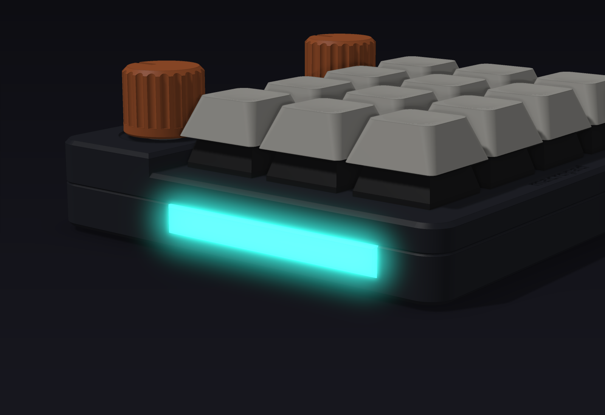
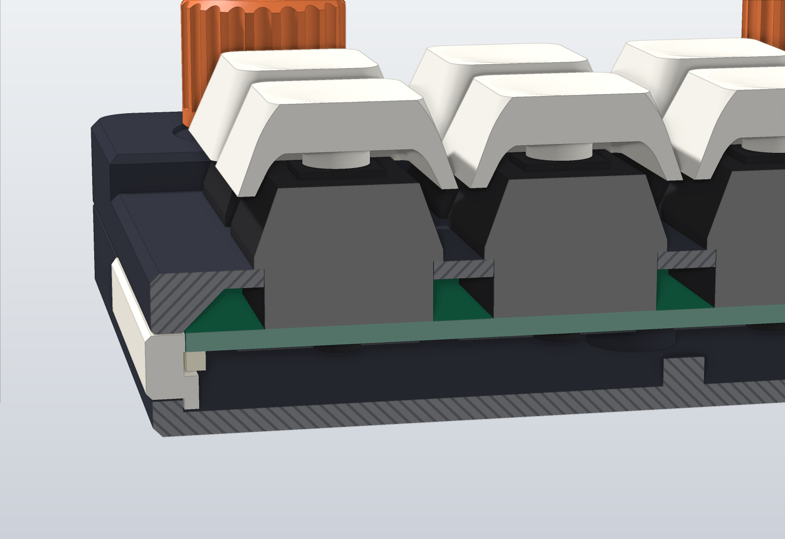

# Case

Parametric case for the macropad, written with [build123d](https://build123d.readthedocs.io).
Board dimensions come from [`board.toml`](../board.toml); the case-only dimensions are in
[`macropad_case/spec.py`](macropad_case/spec.py).

**Nothing here has been printed or milled yet.** The model passes its own checks, and that is all.
Print one copy and measure before you order a batch or pay for machining.


| | |
| --- | --- |
|  |  |
| Back: the USB-C opening with its 45° lead-in. The plug is drawn pulled out. | Left light strip, drawn glowing. The colour is a guess; the LEDs are RGB. |
|  |  |
| Deck: knob wells, chamfered display window, pointer grooves. | Underside: six screws, four foot recesses, BOOT and RESET holes with engraved names. |
|  |  |
| Both shells from inside: lap ridges on the base rim, ribs and screw bosses under the plate. | Cut across the pad through one LED: diffuser, LED under the PCB edge, 45° filler under the side wall. |

The pictures come from the same solids as the exports. The display shows `docs/images/ui/media.png`,
the firmware simulator's own picture, laid on the lit area of the glass (25.2 x 10.7 mm, a datasheet value
to measure). Cut faces are lighter, and hatched on the two shells. Keycaps, switches, encoders, the display, the
USB parts, screws and feet are reference shapes drawn from datasheets, not vendor models.

## What the design is

- **Two shells, one seam.** The base holds the PCB on six bosses. The top is the switch plate, the raised
  deck and the skirt in one piece. Both sides of the joint have a 0.3 mm chamfer, so the seam is a V groove
  that hides a small mismatch between two prints.
- **Lap joint.** Ridges 0.6 mm tall stand on the base rim, inside the wall, along the back, the front and
  the first part of each side. They enter grooves in the top's skirt. The joint centres the top on the base
  and closes the straight path for light through the seam. The ridges stop 10 mm short of the corners
  (where the screw bosses join the walls), at the USB opening and at the light-strip slots. Flank and ends
  are 45°, so they print without support and a chamfer mill cuts them.
- **Edges.** Every outer top and bottom edge has a 0.8 mm chamfer. Chamfers print without supports in any
  orientation and a mill cuts them with one tool; fillets do neither.
- **Deck.** Each knob sits 0.5 mm down in a round well. The display window has a 45° lead-in, so the glass
  is visible from a low angle.
- **Light strips.** Each diffuser stands 0.5 mm out of the side wall with its edges cut back at 45°.
- **Knobs.** 16 mm, 20 flutes, a smooth band at the bottom, and a pointer groove on the same side as the
  flat of the D-shaft.
- **Structure.** Two ribs run under the plate between the key rows and pass through the two centre screw
  bosses. They start 1.0 mm above the PCB, above the lap grooves. In the print variant each corner boss has
  a web to the back or front wall with a 45° underside, and each centre boss has a small fin: without them
  a boss is a cylinder sticking out sideways while the top prints on its side. Each base boss is 5.5 mm wide next to the hot-swap sockets and 8 mm wide where it joins the floor.
- **Legends.** `macropad` on the front lip; `BOOT`, `RESET` and `worxbend / macropad` on the underside.
  Print variant only: the CNC parts stay plain, to be laser-marked or left blank.
- **Tilt.** An optional bar under the back feet tilts the pad by 6°. It needs no change to the case.


The cut passes through the USB port, the display window and the two centre screws.


The drawing is also in [`exports/drawings/`](exports/drawings) as SVG and PDF (A3, 1.6:1). Its dimension
texts are computed from the model.

Two more sheets are for the machine shop: the CNC base and the CNC top, each with a plan from above and
from below, section B-B through the centre screws, the lap joint at 8:1 and a hole table from datum A.
The tolerance note on them (ISO 2768-m) is a proposal, not a tested requirement.

| | |
| --- | --- |
|  |  |

`exports/drawings/engraving_top.dxf` and `engraving_underside.dxf` hold the text of the print variant as
outlines, for laser-marking the milled parts. The underside file is drawn as seen from above (mirrored).

## Parts

| Part | Count | Material | Files |
| --- | --- | --- | --- |
| `base` | 1 | PLA, PETG or aluminium | `exports/print/base.*`, `exports/cnc/base.*` |
| `top` (switch plate, deck and skirt in one piece) | 1 | PLA, PETG or aluminium | `exports/print/top.*`, `exports/cnc/top.*` |
| `diffuser` | 2 | clear or natural PETG | `exports/diffuser.*` |
| `knob` | 2 | any | `exports/knob.*` |
| `tilt_bar` (optional) | 1 | any | `exports/tilt_bar.*` |

Size without feet: 89.6 x 88.1 mm (90.6 mm over the light strips), 13.6 mm tall at the keys,
17.1 mm at the deck, 30.6 mm to the top of the knobs. The feet add 1.0 mm.

The left and right diffuser are the same part, turned around.

Hardware:

- 6 x M2 x 10 socket-head cap screw (ISO 4762, 3.8 mm head)
- 4 x stick-on foot, 8 mm wide, 1.6 mm tall
- The M7 nuts and washers of the encoders are **not** used: the encoders are held by the PCB

## Build

```bash
cd cad
uv venv --python 3.12 .venv
uv pip install --python .venv/bin/python -e .
.venv/bin/python build.py all       # check, export, render, draw: about four minutes
.venv/bin/python build.py check     # checks only, about one and a half minutes; exits non-zero on any failure
.venv/bin/python build.py render    # pictures -> docs/images/cad/
.venv/bin/python build.py draw      # three sheets and two DXF -> exports/drawings/ (PDF and PNG need rsvg-convert)
```

| Module | Holds |
| --- | --- |
| `spec.py` | Every dimension, and the heights derived from `board.toml` |
| `parts.py` | Base and top |
| `small_parts.py` | Diffusers, knobs, tilt bar |
| `components.py` | Reference shapes of the bought parts |
| `checks.py`, `measure.py` | The checks below |
| `printsim.py` | The layer-by-layer print check |
| `selftest.py` | Known-bad shapes that every measuring check must catch |
| `raster.py`, `render.py` | A numpy software renderer and the eleven views |
| `drawings.py` | The three drawing sheets and the engraving outlines |

## Checks

`check` writes `exports/checks.json` and runs five groups.

0. **Self-test.** Before the case is judged, the measuring checks are run on 15 small solids: a sheet
   thinner than the minimum wall, a pocket with sharp corners, a pocket with too small a radius, a slot
   narrower than the tool, a groove in a side wall, a bridge that is too long, a shelf, a wall leaning 60°,
   and sound versions of each. A check that misses its fault, or flags a sound shape, fails the run.
1. **Interference.** Every part against every bought component and every other part, for both variants:
   383 pairs each. Any shared volume over 0.05 mm³ fails. Keycaps are blocks that cover the whole key travel.
   The tilt bar against the two back feet is skipped, because the bar takes their place.
2. **Named clearances.** 25 gaps computed from the dimensions: USB plug to its opening, keycap to deck,
   display glass under the deck, screw engagement, skin under the knob wells and the engraving, and more.
3. **Measurements on the finished solids.** These do not trust how the model was built.
   - Thinnest wall of every part: 3000 surface points per part, a ray through the material from each.
     Minimum 0.8 mm. A sample can miss a very small thin spot. Engraved text is checked by depth only.
   - Wall around every screw hole, measured on a horizontal cut.
   - Diffuser retention: the strip is pushed 0.6 mm in six directions and must hit the base, the PCB
     or the top each time.
   - Pressed keycap to the top, keycap to knob, pressed knob to the top, as distances between solids.
   - Lap joint: ridge to groove at least 0.1 mm apart, and the top pushed 0.5 mm left, right, back and
     front must hit a ridge each time. Both variants.
   - CNC variant, tool run: a 3 mm flat end mill is lowered over a 0.1 mm height map of each shell, from
     above and from below. Any place where it stops more than 0.1 mm short of the surface is a corner too
     tight or a slot too narrow. Chamfers and holes smaller than the tool are left out (chamfer mill, drill).
     This check made the lap joint what it is: a ridge all the way round needed a 1 mm groove behind every
     rib end and corner boss, which a 3 mm tool cannot cut.
   - CNC variant: no vertical internal edge without a radius (probe points around every vertical edge),
     smallest concave wall radius at least 1.5 mm, and no face hidden from a tool coming straight down
     or straight up (two height maps). Full round holes are left out of the radius check: they are drilled.
4. **Printability.** Each printed part in its bed orientation, two ways.
   - Faces: overhanging faces are grouped into patches; a patch passes if it is 15 mm or narrower in one
     direction. The part must also put at least 100 mm² on the bed. This alone does not tell a bridge
     from a cantilever.
   - Layers: the part is cut into 0.2 mm layers on a 0.1 mm grid. A layer may rest on the one below up to
     0.3 mm past its edge (about 56° from vertical; the 45° faces of the design need 0.2), or bridge in a
     straight line between two places that rest. What is left hangs from one side. The longest bridge
     must stay under 15 mm and the deepest cantilever under 1.5 mm. The 1.5 mm is a guess: about three
     0.45 mm lines.

   The layer check found three faults the face check had passed, all fixed in the model: the top's corner
   screw bosses hung 4.4 mm from the plate (now webbed to the walls), the pocket over the display was a
   15.4 mm bridge (now 14.4), and the diffuser flange hung 1.7 mm (now 1.2).

The measured CNC check found one real fault in the first run: the USB tunnel cut a 0.13 mm step into the
floor with two sharp corners. The tunnel's inner end is now rounded.

## Printing

The STL files already lie the way they print. No supports.

| Part | Orientation | Notes |
| --- | --- | --- |
| `base` | floor down | The screw counterbores, the foot recesses and the engraved text are short bridges. |
| `top` | standing on its **left side wall** | Use an 8 mm brim: the part is 10.5 times taller than its footprint is wide. |
| `diffuser` | outer face down | The face on the bed is the one you see. |
| `knob` | open end down | The flutes are vertical. |
| `tilt_bar` | sloped face down | The top comes out 6° off level and shows layer steps; it is hidden under the base. |


The top stands on its side because the deck and the key plate are at different heights, so neither face
can lie flat on the bed without supports. Standing up, the plate and the deck print as vertical walls,
the ribs print as vertical walls too, and the switch cut-outs are 14 mm bridges. The print variant has
45° fillers under both side walls so the upper wall does not start in mid-air, and webs under the screw
bosses for the same reason. The lower rounded corners
touch the bed on a curve and may look rough; the brim helps.

Settings: 0.2 mm layers, 3 walls, 0.4 mm nozzle. Print the diffusers with 100 % infill.

The engraved text is 0.4 mm deep. The smallest strokes are about 0.5 mm wide (a guess from the font);
they may fill in on a 0.4 mm nozzle.

The screws cut their own thread in the 1.7 mm holes of the top. Do not overtighten.

## CNC

`exports/cnc/base.step` and `exports/cnc/top.step` are for 3-axis milling, two setups each.

- Every pocket is opened with a 1.5 mm radius, so a 3 mm end mill reaches every internal corner.
  Gaps narrower than 3 mm are left solid: the corner bosses are joined to the walls.
- The switch cut-outs have dog-bone reliefs in the corners. The 14.0 mm square is still clear.
- No undercuts. The print variant's 45° fillers, boss webs and engraved text are not in the CNC variant.
- The lap grooves in the top open toward the cavity. A flat end mill clears them; a chamfer mill cuts the
  45° outer wall and leaves the conical ends drawn in the model.
- All chamfers are 45°: a chamfer mill cuts the rims, the seam, the display lead-in and the USB lead-in.
  Where two lead-in faces meet, the tool leaves a small radius instead of the sharp mitre in the model.
- Top, setup 1 (underside up): the cavity levels around the ribs, the display relief, all through cuts,
  the six screw holes, the seam chamfer. Setup 2 (top side up): the step from the deck down to the key
  plate, the knob wells, the display lead-in, the rim chamfers.
- Base, setup 1 (inside up): the cavity in three levels, the USB opening, the diffuser slots, the through
  holes, the seam chamfer. Setup 2: counterbores, foot recesses, rim chamfer.
- The screw holes in the top are 1.7 mm for plastic. For aluminium drill 1.6 mm and tap M2.
- The plate is 1.5 mm thick, which MX switches need to clip in.

The diffusers, the knobs and the tilt bar stay printed.

## Assembly

1. Drop a diffuser into each side slot of the base, flange inside, behind the wall.
2. Lower the assembled PCB onto the six bosses. Its edges now hold the diffusers in.
3. Put the top on. The lap ridges find their grooves and centre it. Fit the six screws from below.
4. Press the switches into the plate, then the keycaps and the knobs. The pointer groove goes on the
   side of the shaft's flat.
5. Stick the four feet into their recesses.

The nice!view is held only by its header. Put a foam pad under its free end if it rattles.

### Tilt bar


Leave the two back feet off the base. Glue or tape the bar's two pegs into the empty back recesses, then
stick those two feet into the recesses on the bar. The bar leaves the back screws and the BOOT and RESET
holes free. The pad then rests on its two front feet and on the bar.

## Assumptions to measure

These came from datasheets, footprints and photos, not from parts on a desk. Each is one number in
`board.toml` (first three), in `macropad_case/spec.py` or in `macropad_case/components.py`.

| What | Value | Where |
| --- | --- | --- |
| nice!view glass top above the PCB | 7.0 mm | `stack.display_glass_top` |
| nice!view header position and pin order | 1.27 mm from the short edge | `display.header_x` |
| Visible glass area and its offset | 27 x 12 mm, 1.5 mm off centre | `display.window_*` |
| nice!view module thickness | 2.9 mm | `display_thickness` |
| nice!view glass outline and board thickness (pictures only) | 30 x 13.6 mm, 1.0 mm | `display_glass`, `display_board_thickness` |
| Encoder body footprint | 12.4 x 13.4 mm | `encoder_body` |
| Encoder threaded bushing length | 7.0 mm | `bushing_length` |
| Encoder D-shaft, across the flat | 4.5 mm | `shaft_flat` |
| Encoder terminal positions | from the KiCad EC11E footprint | `components.ENCODER_PINS` |
| Side LED body | 4.0 x 1.6 x 1.6 mm | `led_body` |
| Keycap: skirt above the plate when pressed, top above the plate | 2.0 mm, 14.5 mm | `keycap_*` |
| Keycap shape in the pictures | DSA: 12.7 mm top, 7.4 mm tall | `keycap_profile` |
| MX switch housing above the plate | 15.6 mm rim, 6.6 mm tall, stem to 10.2 mm | `components.MX_*` |
| MX plate clips clear the 2 mm ribs | 1.5 mm from cut-out to rib | `rib_width` |
| USB-C plug overmould | 12.5 x 6.5 mm | `usb_plug` |
| USB-C plug tip (pictures only) | 8.25 x 2.4 x 6.5 mm | `components.USB_PLUG_TIP` |
| Stick-on foot | 8 mm wide, 1.6 mm tall | `foot` |
| Lit area of the display (pictures only) | 25.2 x 10.71 mm | `components.DISPLAY_ACTIVE_AREA` |
| Deepest ledge that prints without support | 1.5 mm | `max_cantilever` |
| Lap joint fit | 0.2 mm on the size, 0.13 mm between the flanks | `lap_fit` |

Not modelled: the MCU and the small parts on the PCB bottom (all under 1 mm, with 5 mm of room) and cables.
