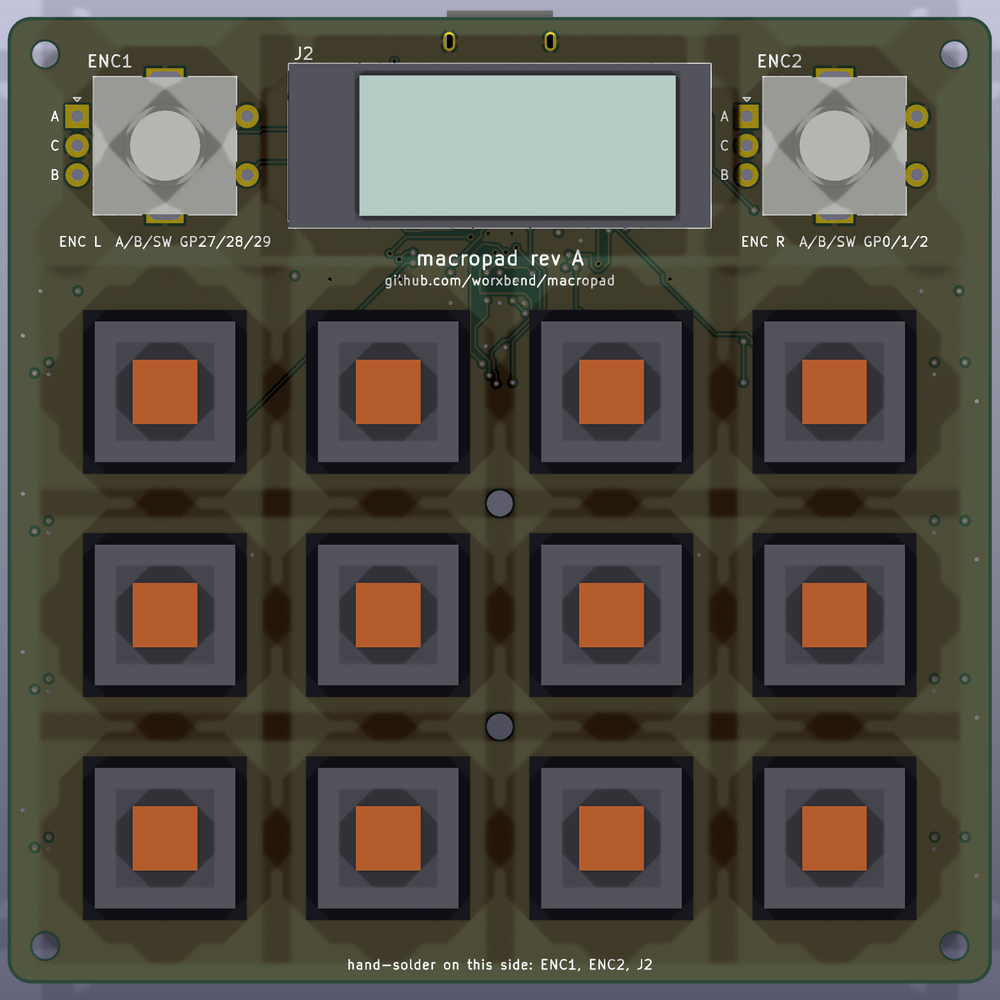
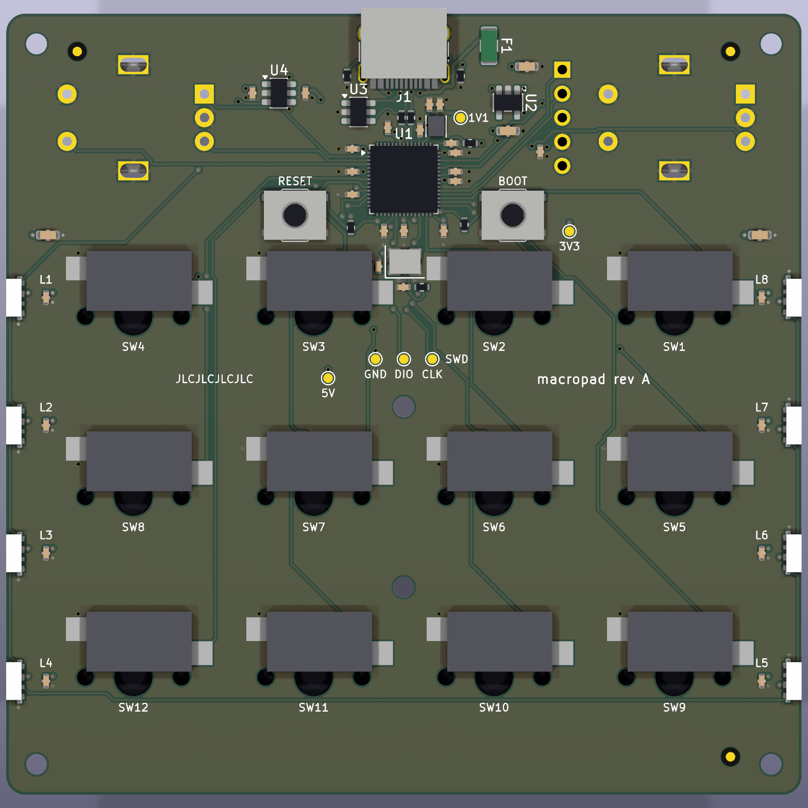

# Assembly

From an assembled board out of the factory to a closed pad.

**Nobody has built one yet.** These steps are written from the design files. The order is chosen so
that each step can be tested before the next one hides it. If a step does not work as described,
stop and look at [flashing.md](flashing.md#troubleshooting).

## What you need

Parts: see [parts.md](parts.md).

| Tool | For |
|---|---|
| Soldering iron and solder | 2 encoders, 1 socket, the display's header |
| Multimeter | Short-circuit and voltage checks |
| Metal tweezers | Testing the key sockets |
| 1.5 mm hex key | The six M2 socket-head screws |
| Flush cutters | Pins that stand too far out |
| USB-C cable with data lines | Power, flashing, use |

## What is already on the board

JLCPCB places all 71 parts on the bottom face. You solder three parts on the top face. The top
silkscreen says so: `hand-solder on this side: ENC1, ENC2, J2`.

 

The pictures show block models of the parts, not photos.

## 1. Check the bare board

Do this before you plug anything in.

1. Look at the bottom face. Compare with the picture above. Look for a part that is turned,
   missing or lifted, mainly U1 to U4, the LEDs and the USB-C port.
2. Set the multimeter to resistance. Measure between the `GND` test pad and each of `5V`, `3V3`
   and `1V1`. All six test pads are named in the bottom silkscreen; their positions are in
   [hardware.md](hardware.md#test-pads).
3. None of the three may read close to 0 Ω. A short here means: do not plug in. Look for a solder
   bridge. A low but non-zero reading that climbs is a capacitor charging; that is fine.

## 2. First power, first flash

Do this before you solder. A fault is easier to find on a bare board.

1. Plug the board into a computer. Do not hold a button.
2. Expected: a USB drive named `RP2350` appears. A chip with empty flash starts its built-in USB
   bootloader by itself. If no drive appears, hold BOOT (silkscreen `BOOT`, bottom face), tap RESET,
   release BOOT.
3. Measure against the `GND` pad: `5V` about 5 V, `3V3` about 3.3 V, `1V1` about 1.1 V.
4. Copy `firmware/dist/macropad.uf2` to the drive. The board restarts.
5. Expected: the eight side LEDs come on one after another, then breathe in purple.
   The computer sees a new keyboard named `macropad`.

No drive, wrong voltage, no LEDs: go to [flashing.md](flashing.md#troubleshooting).

## 3. Test the key sockets

1. Open a key tester or a text editor on the computer.
2. With the tweezers, bridge the two contacts of each hot-swap socket, one socket after another.
3. Expected on the stock MEDIA layer: the back row sends media keys (previous, play, next, stop),
   the other eight send F13 to F20. A text editor shows nothing for these; a key tester does.
4. Every bridge also starts a white ripple on the side LEDs. That is the quickest sign that a socket works.

## 4. Solder the encoders

Unplug the board first.

1. Put ENC1 and ENC2 into the top face. Each has five pins and two mounting lugs.
2. Press the body flat onto the board. The case assumes the body top 6.5 mm above the board.
3. Solder one pin, check that the encoder still sits flat and square, then solder the rest and
   both lugs.
4. Cut any pin that stands more than 3 mm out of the bottom face. The case floor is 5 mm below.
5. Plug in and test: turning the left knob changes the volume, pressing it changes the layer
   (the LED colour changes). Turning the right knob changes the screen brightness on hosts that
   support it; pressing it mutes.

A knob that works backwards is a firmware setting, not a soldering fault. See
[flashing.md](flashing.md#troubleshooting).

## 5. Solder the display socket and fit the display

Unplug the board first.

1. Solder the 5-pin socket J2 on the top face. Keep it square to the board.
2. If your nice!view came with a loose pin header, solder the header to the module. Guess: most
   shops ship it loose. Follow the shop's instructions for the low-profile pins. Trim the pins on
   the glass side to 1.5 mm above the module's board: the lens lies 0.78 mm above trimmed pins.
3. Check the pin order before you plug the display in. The board expects, from the back edge to the
   front: MOSI, SCK, 3V3, GND, CS. This order is a `MEASURE` value from a community footprint.
   Compare it with the labels on your module. A module with another order must not be plugged in.
4. Plug the display in. The silkscreen under it says `glass this side up`. The module lies between
   the knobs and reaches from the socket toward the right knob.
5. Plug in the USB cable. Expected: a splash screen with the firmware version, then the MEDIA
   layer with its key labels.

The display is held only by its header. Stick an open-cell foam pad, 10 x 10 mm and 5 mm thick (a
guess), on the PCB under the display's free end, between X 48 and 58 mm. The module squeezes it to
4.1 mm. It is not optional: without it one
degree of tilt lifts the free end 0.6 mm, and the case leaves 0.38 mm between the glass and the lens,
on the assumption that the glass is 7.0 mm above the board.

## 6. Prepare the case parts

Print or mill the parts first: [cad/README.md](../cad/README.md#printing).

1. Clean the six screw holes in the top and the two light channels in the base of strings and burrs.
   Printed base: cut the one-layer skin out of each of the six counterbores (a 2 mm drill by hand, or
   a knife). Printed top: a screw must start in each hole by hand; if one does not, run a 1.7 mm drill
   4.2 mm deep through all six. A milled top has tapped M2 holes.
2. Try the top on the base without the board. The lap ridges on the base rim must enter the grooves
   in the top without force. The 0.2 mm fit is a guess; a tight printer may need a light pass with
   a file on the ridges.
3. Try a light bar in its channel. It must drop in from above, lip up and toward the inside.
   Punch six foam rings, 5 mm across with a 2.4 mm hole, from 0.8 mm closed-cell foam tape (a guess).
4. Try a switch in one plate cut-out. It must clip in.
5. Try the lens in its recess. It must drop in and lie just under the top face. The lens is 1.0 mm
   cover glass cut to `cad/exports/drawings/lens.dxf`, with the black mask of `lens_mask.dxf`
   screen-printed on its underside. Measure its thickness: up to 1.1 mm still ends under flush with
   0.13 mm tape. A thinner sheet may take 0.2 mm tape.

## 7. Close the case

 

1. Put a foam ring on each of the six base bosses.
2. Lower the board onto the rings, USB port toward the opening at the back.
3. Drop one light bar into each side channel, between the board edge and the outer skin, lip up and
   toward the inside. It passes the board's edge with 0.15 mm to spare; the edge then holds it in.
4. Check through the base holes that the BOOT and RESET buttons sit behind their holes.
5. Stick a piece of thin double-sided tape (0.13 mm, a guess) on each of the two lens ledges in the
   top. Press the lens in, mask down, window toward the right knob.
6. Put the top on. The lap ridges centre it. The knob shafts must pass through their holes without
   touching, and the display must sit under the lens.
7. Turn the pad over. Fit the six screws from below: four in the corners, two in the middle. Printed
   case: **M2 x 10 only, never M2 x 12**: a 12 mm screw comes through the skin under the dish floor.
   Milled case: M2 x 8; a 10 mm screw bottoms in its tapped hole.
8. Tighten each screw until the head is seated, no further. The top seats on the base rim and the
   rings press the board up against it. In a printed top the screws cut their own thread in 1.8 mm
   holes and strip easily.

## 8. Switches, keycaps, knobs, feet

1. Check each switch for bent pins. Straighten them first; a bent pin folds under the switch.
2. Press each switch through the plate into its socket. Press straight down, near the middle of the
   board first. A post under each socket carries the board, 0.15 mm under it; still, do not use force.
3. Fit the keycaps.
4. Push the knobs onto the shafts until each stops on the end of its shaft. The pointer line goes on
   the side of the shaft's flat. Three ribs in the bore press on the shaft; they need a firm push. A
   pressed knob stops 0.7 mm above the floor of its well.
5. Run the final test below before the next step.
6. Stick the two foot strips and the centre pad into their recesses on the underside, last. They
   cover all six screws.

Optional tilt bar: leave the back foot strip off, glue or tape the bar's tongue into the back recess,
and stick that strip onto the bar. Details in [cad/README.md](../cad/README.md#tilt-bar).

## 9. Final test

1. Plug in. Splash screen, then the MEDIA layer. LEDs wipe on, then breathe.
2. Press every key. Its label on the display fills while the key is down.
3. Turn and press both knobs.
4. Hold both knobs for one second. The display shows `FLASH MODE` and the `RP2350` drive appears.
   Unplug and plug in again to return to normal.

## To open it again

1. Pull the knobs and the keycaps.
2. Pull the switches with a switch puller.
3. Peel the two foot strips and the centre pad off the underside. Keep them flat; fresh tape holds
   them again.
4. Remove the six screws and lift the top.

Next: [flashing.md](flashing.md) and [keymap.md](keymap.md).
