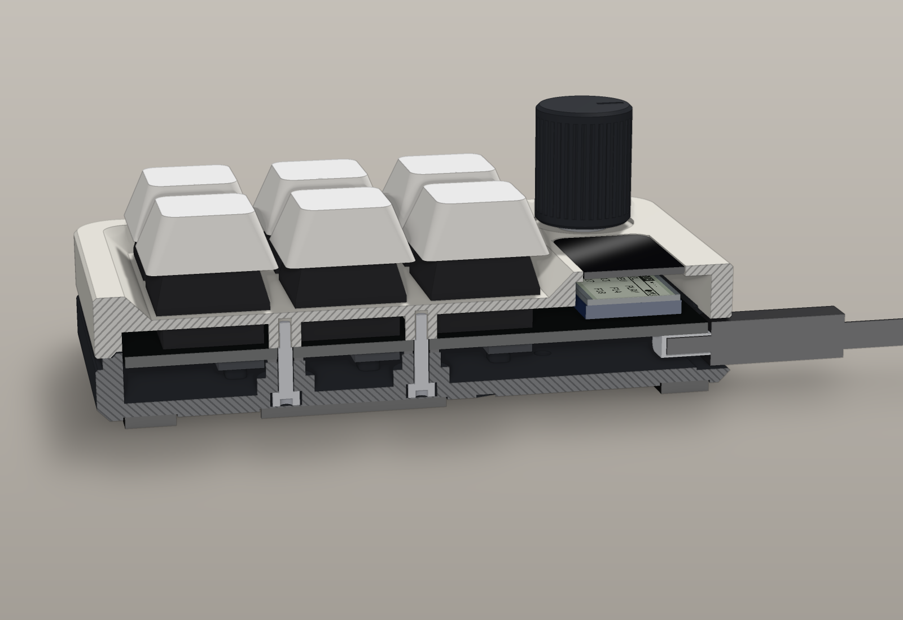
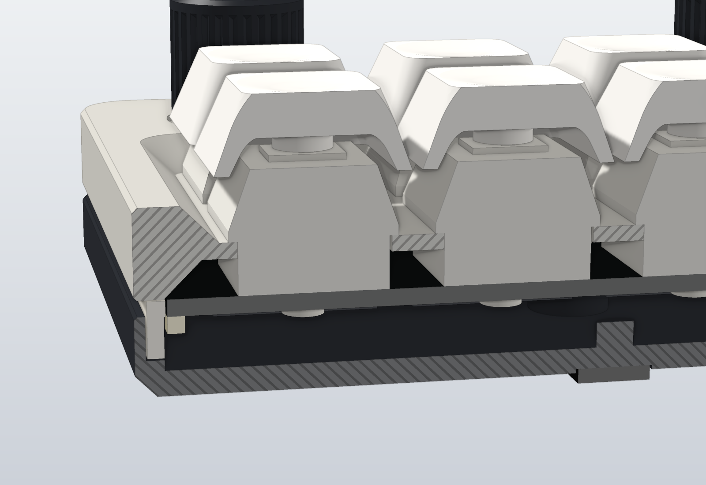
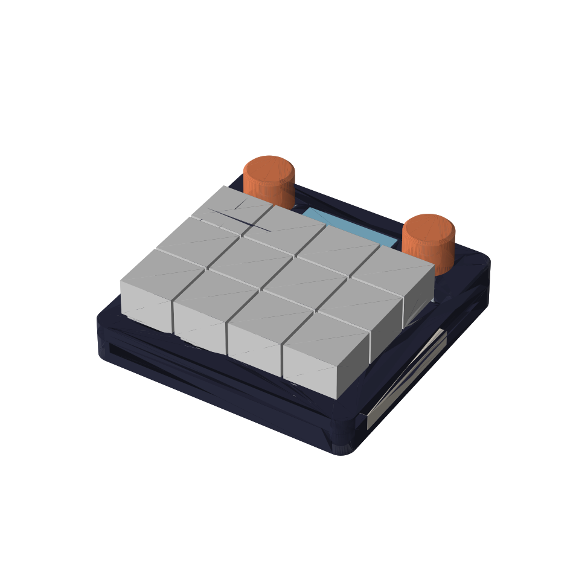
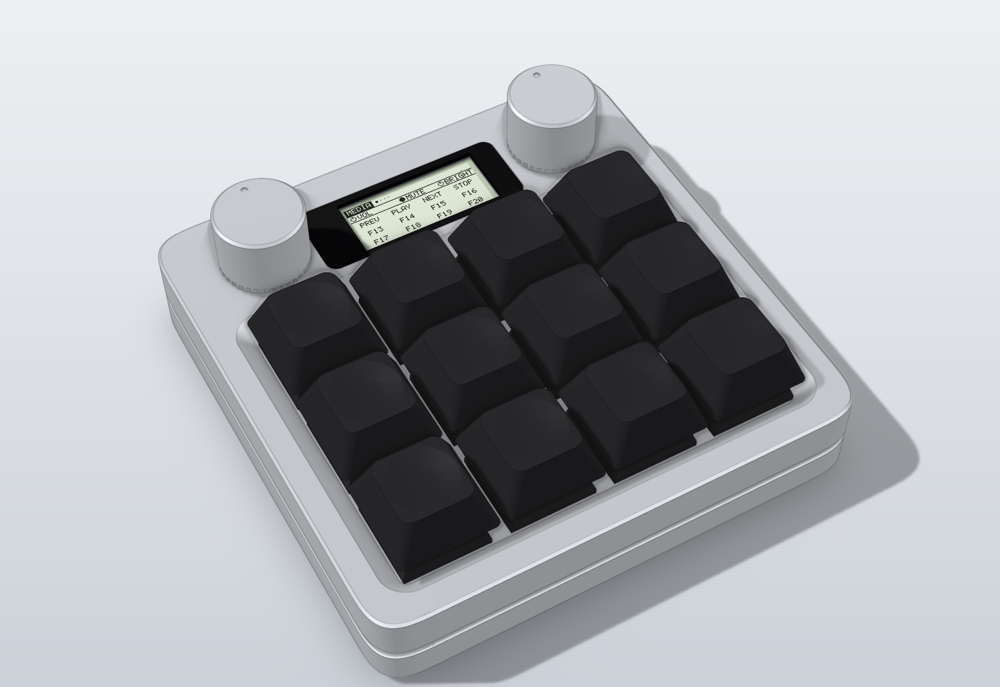
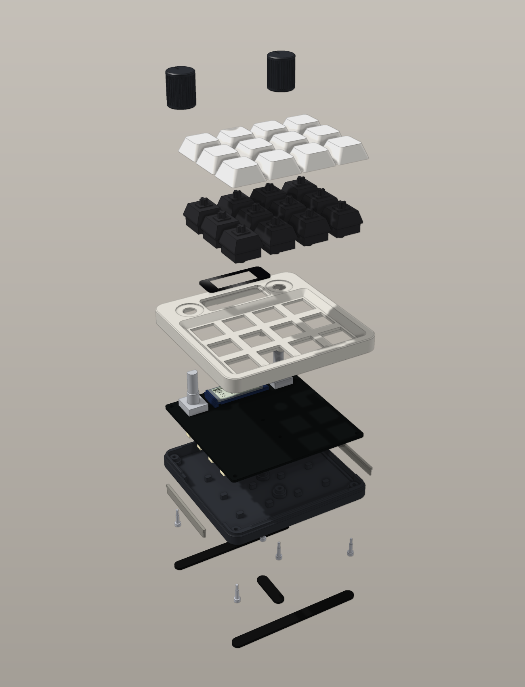
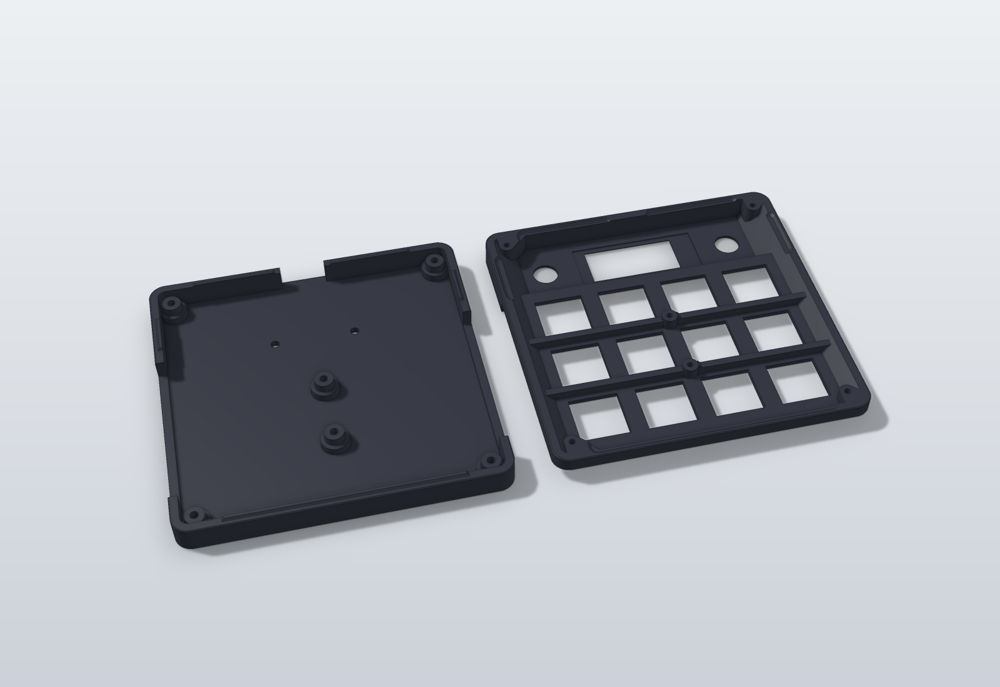
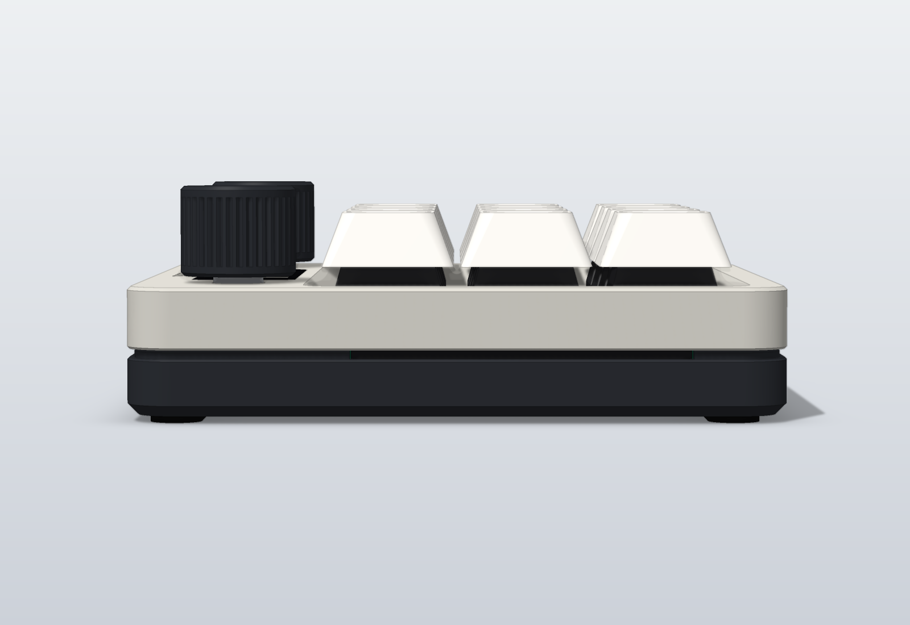
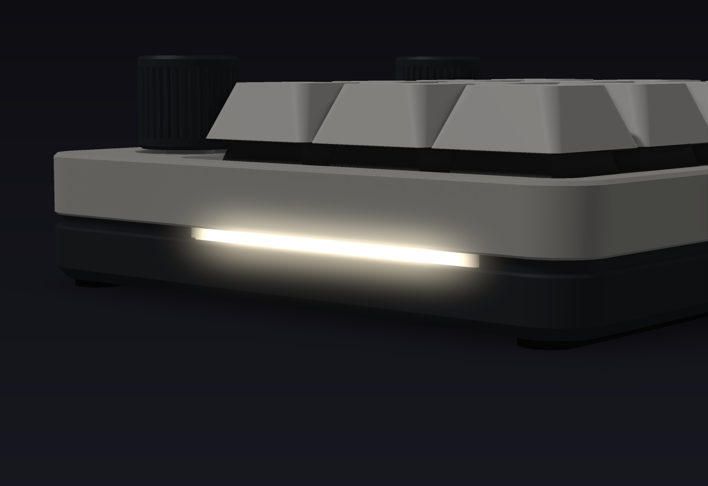

# Hardware notes

What the board and the case are, in one place. Nothing here has been built or measured.
Values tagged `MEASURE` come from community footprints, not from a caliper.

Related pages: [parts](parts.md), [ordering](ordering.md), [assembly](assembly.md),
[PCB details](../pcb/README.md), [case details](../cad/README.md).

## How it compares to macropad-nyxilab

| | nyxilab | this board |
|---|---|---|
| Size | 159 x 98 mm | 90.0 x 90.0 mm |
| Wiring | Hand-wired matrix with diodes | 4-layer PCB, one GPIO per key |
| Brain | Pico 2 board | Bare RP2354A on the PCB |
| Keys | 12 MX | 12 MX, hot-swap |
| Centre control | Thumbstick or one knob | Two knobs |
| Screens | Two colour ST7789 | One nice!view (monochrome, always-on, sunlight readable) |
| Light | 16 LEDs on the base | 8 side-emitting LEDs behind two light bars in the case sides |
| Firmware | C++ / PlatformIO | Rust / embassy |

## Layout

Top view, USB at the back:

```
+---------------------------------------------+
|  (knob)   [   nice!view    ]      (knob)    |   back zone, 22 mm deep
|  [K0]     [K1]     [K2]     [K3]            |
|  [K4]     [K5]     [K6]     [K7]            |   19.05 mm pitch
|  [K8]     [K9]     [K10]    [K11]           |
+---------------------------------------------+
   LEDs on both side edges, four per side
```

 

- **Top face:** the two encoders and the 5-pin display socket. These three are soldered by hand.
  The switches plug into their sockets through the board.
- **Bottom face:** everything else. The MCU, USB-C port, regulator, crystal and both buttons sit
  under the display. The hot-swap sockets sit under the keys. The LEDs sit on the left and right
  edges and shine outward.

Positions are in `board.toml`. The origin is the top-left corner of the PCB seen from the key side.
X grows to the right, Y toward the front.

## Circuit, in words

<a href="images/pcb/schematic.pdf"></a>

The schematic is generated from `pcb/gen/circuit.py` and checked against it pin by pin.
The KiCad file is `pcb/kicad/macropad.kicad_sch`.

- **USB-C.** 5.1 kΩ on both CC pins, USBLC6 ESD diodes, 27 Ω series resistors (R7, R8) right at the
  MCU pins, 500 mA resettable fuse. From the resistors to the chip the pair runs on the bottom layer
  with no via: D+ 15.43 mm and D- 14.26 mm from connector to MCU. No impedance was calculated.
- **Power.** VBUS through the fuse is the 5 V rail (LEDs, level shifter). An AP2112K makes 3.3 V.
  The RP2354A makes its own 1.1 V core supply with the on-chip switching regulator and L1.
  About 7.5 µF sits on the 5 V rail; USB 2.0 allows 10 µF at plug-in.
- **Clock.** 12 MHz crystal with a 1 kΩ series resistor on XOUT and 15 pF load capacitors.
  The crystal is a substitute with the reference load rating (10 pF); see [parts](parts.md).
- **Flashing.** BOOT pulls QSPI_SS low through 1 kΩ, which starts the ROM USB bootloader.
  RESET pulls RUN low. Both buttons are on the bottom face and reached through holes in the case floor.
- **Keys and knobs.** Each switch connects one GPIO to ground. The firmware turns on the internal
  pull-ups. No matrix, no diodes, no ghosting.
- **Knobs.** Alps EC11E18244AU: 36 detents and 18 pulses per turn, so one click is half a quadrature
  cycle. The firmware decodes two clicks per cycle. The detent count is read from the Alps product
  page, not from a part on a desk.
- **Display.** SPI0 (SCK GPIO22, MOSI GPIO23), chip select GPIO24, active high. Header order
  from the back edge to the front: MOSI, SCK, 3V3, GND, CS. `MEASURE`: check it against your module.
- **LEDs.** GPIO9, through a 74LVC1T45 to 5 V logic, then eight SK6812 SIDE-A in a chain: right side
  back to front, then left side front to back. The firmware caps total LED current at about 200 mA
  and turns the LEDs off when the host sleeps.

The full netlist is `pcb/netlist.txt`. Track length and via count per net are in `pcb/routing.txt`.

## Pin map

`board.toml` is the source of truth. `tools/check_pins.py` fails when the firmware disagrees with it.

| Function | GPIO |
|---|---|
| Keys K0 to K3 (back row) | 21, 20, 4, 3 |
| Keys K4 to K7 | 19, 18, 6, 5 |
| Keys K8 to K11 (front row) | 17, 16, 8, 7 |
| Left knob A, B, push | 27, 28, 29 |
| Right knob A, B, push | 0, 1, 2 |
| Display SCK, MOSI, CS | 22, 23, 24 |
| LED data | 9 |
| Spare, no pads | 10 to 15, 25, 26 |

The spare pins end at the chip. Adding a header means a board change.

## Test pads

Six round 1 mm pads on the bottom face, each named in silkscreen. Positions in board coordinates (mm).

| Pad | Net | X, Y | Where |
|---|---|---|---|
| TP1 | SWCLK | 39.0, 36.5 | Between the first two key rows |
| TP2 | SWDIO | 42.0, 36.5 | Next to TP1 |
| TP3 | GND | 45.0, 36.5 | Next to TP2 |
| TP4 | 5V | 50.0, 38.5 | Next to the debug pads |
| TP5 | 3V3 | 24.5, 23.0 | Beside the BOOT button |
| TP6 | 1V1 | 36.0, 11.0 | Beside the inductor, on the regulator output track |

The case floor has no probe holes. Use the pads before the board goes into the case.
The pad positions were picked by a free-space search on the copper and are not checked against the
case model; the pads are flat copper, so nothing can collide.

## Layer stack

| Layer | Use |
|---|---|
| F.Cu | Signals, ground pour |
| In1.Cu | Ground plane |
| In2.Cu | 5 V plane, with a 3.3 V island under the MCU and the display socket |
| B.Cu | Parts, signals, ground pour |

Design rules: 0.15 mm track and gap, 0.6 mm via with a 0.3 mm drill, 0.3 mm copper to board edge.
Pictures of each layer: [top](images/pcb/copper-top.svg), [ground](images/pcb/copper-ground.svg),
[power](images/pcb/copper-power.svg), [bottom](images/pcb/copper-bottom.svg).

Routing: 797 tracks, 160 vias, 1305.5 mm of track, 0 unrouted pads. The router is a small grid
router in `pcb/gen/router.py`; the routing plan is `pcb/gen/route.py`. No third-party autorouter is used.

## Mechanical stack

Heights from `board.toml`, measured from the PCB top face.

| What | Height |
|---|---|
| Case floor (inside) | 5.0 mm below the PCB bottom face |
| Hot-swap socket | 1.85 mm below the PCB bottom face |
| USB-C body | 3.26 mm below the PCB bottom face |
| PCB | 1.6 mm thick |
| Switch plate top | 5.0 mm (plate 1.5 mm thick, 14.0 mm cut-outs) |
| Encoder body top | 6.5 mm |
| Display glass top | 7.0 mm (`MEASURE`: nice!view on low-profile sockets) |
| Top face of the case | 8.5 mm |
| Lens underside | 7.48 mm (0.48 mm above the glass) |
| Encoder shaft top | 20.0 mm |

 

## Case

Nothing below has been printed or milled. The model passes its own checks, and that is all.

 

- **Shape.** A 90.0 x 90.0 mm slab, 17.5 mm tall, with one flat top face. The base rim steps in under
  the top, so a 1.2 mm shadow gap runs all round the case where the two shells meet.
- **Two shells.** The base holds the PCB on six bosses. The top is the switch plate, the deck and the
  skirt in one piece. Six M2 x 10 screws go in from below and are hidden under the feet.
- **Corners.** The milled outline has continuous-curvature corners (one quintic Bezier each). The
  printed outline has R 6.4 arcs through the same apex, because the top prints standing on a side wall
  and the flatter curve would hang too far over the bed.
- **Key dish.** The keys stand in a dish with 45° walls. The flat frame around it is 4.775 mm wide on
  the left, the right and in front.
- **Lens.** A clear 39.0 x 14.6 x 1.0 mm lens with a black mask lies flush in the top face over the
  display, taped on two ledges. Its thickness and the 0.13 mm tape are guesses.
- **Lap joint.** Ridges 0.6 mm tall on the base rim enter grooves in the top. They centre the top and
  close the straight path for light through the joint. The 0.2 mm fit is a guess until a test print.
- **Light line.** One light bar per side stands in a channel in the base wall, behind a 1.0 mm skin, and
  is held by the PCB edge. It shows only in the gap: a line 1.1 mm tall. The gap runs all round, but it
  lights only along these two 46.5 mm stretches. How bright and how even is a guess.
- **Knobs.** 16 mm, 36 fine grooves, flat top with a pointer dimple. They stand 1.0 mm above the deck.
- **Underside.** Two foot strips and a centre pad cover all six screws. A label field holds the mark.
- **Size.** 90.0 x 90.0 x 17.5 mm, 31.0 mm from the underside to the top of the knobs. The foot strips
  add 1.0 mm.
- **Two variants.** `cad/exports/print/` for FDM printing, `cad/exports/cnc/` for 3-axis milling with a
  3 mm end mill and a chamfer mill. Light bars, knobs, foot strips and the tilt bar are always printed;
  the lens is cut from sheet.
- **Tilt.** An optional bar under the back of the base tilts the pad by 6°.

 

 

Drawings with dimensions: [general arrangement](images/cad/general_arrangement.png),
[CNC base](images/cad/drawing_base.png), [CNC top](images/cad/drawing_top.png).
Printing and milling notes: [cad/README.md](../cad/README.md#printing).
