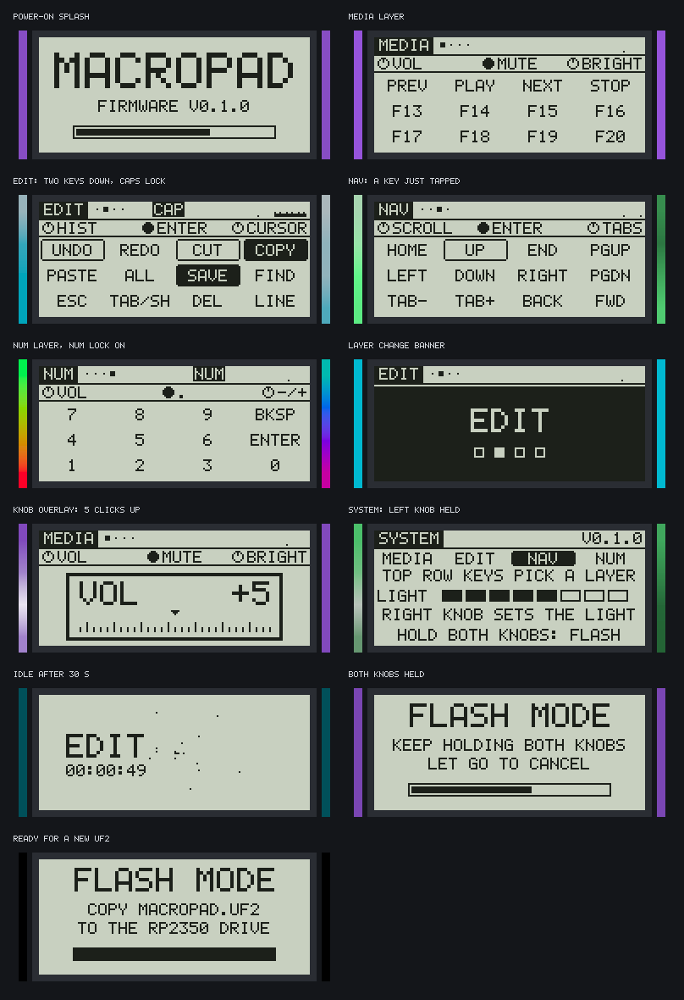

# Customising the keymap

How to change what the keys, the knobs, the display labels and the lights do.

The keymap is Rust code in one file: [`firmware/core/src/keymap.rs`](../firmware/core/src/keymap.rs).
There is no configuration tool and no host software. You edit the file, the tests check it, the
simulator shows it, and you flash the result.

The full reference, with every helper, the key code tables and a longer worked example, is
[firmware/KEYMAP.md](../firmware/KEYMAP.md). This page is the short path.

Not tried on hardware. Steps 1 to 5 run on a PC and were run for this page.

## The stock keymap



Keys are numbered row by row from the back left:

```
 (left knob)   [ display ]   (right knob)

   0    1    2    3
   4    5    6    7
   8    9   10   11
```

| Layer | Colour, effect | Keys 0 to 3 | Keys 4 to 7 | Keys 8 to 11 |
|---|---|---|---|---|
| MEDIA | Purple, breathing | PREV, PLAY, NEXT, STOP | F13, F14, F15, F16 | F17, F18, F19, F20 |
| EDIT | Cyan, solid | Undo, redo, cut, copy | Paste, select all, save, find | ESC, TAB (Shift when held), DEL, select line |
| NAV | Green, wave | HOME, UP, END, PGUP | LEFT, DOWN, RIGHT, PGDN | Previous tab, next tab, back, forward |
| NUM | Orange, rainbow | 7, 8, 9, backspace | 4, 5, 6, ENTER | 1, 2, 3, 0 |

| Layer | Left knob turn | Right knob turn | Right knob press |
|---|---|---|---|
| MEDIA | Volume | Screen brightness | Mute |
| EDIT | Undo, redo | Cursor left, right | ENTER |
| NAV | Up, down arrow | Previous, next tab | ENTER |
| NUM | Volume | Minus, plus | Period |

The left knob's press is not bindable. A tap is "next layer". A hold opens the pad's own functions:
with a top-row key it jumps to a layer, with the right knob it sets the LED brightness.

F13 to F20 do nothing by themselves. They are free keys: bind them to actions in your operating
system or in an application's shortcut settings.

## Change a key, step by step

The example turns the last key of the MEDIA layer into Ctrl+Shift+M and makes the layer solid red.

1. Open `firmware/core/src/keymap.rs` and find `const MEDIA: Layer`.

2. Replace the last entry of `keys`:

   ```rust
   // before
   tap("F20", key::F20),
   // after
   chord("MICMUT", modifier::CTRL | modifier::SHIFT, key::M),
   ```

   The first argument is the label on the display. Six characters fit. Capitals, digits and common
   punctuation only.

3. Change the light:

   ```rust
   color: Rgb::new(255, 0, 60),
   effect: Effect::Solid,
   ```

   Effects are `Solid`, `Breathing`, `Rainbow` and `Wave`.

4. Check it. In `firmware/`:

   ```sh
   make test
   ```

   The tests fail on a label that is too long, a character the font lacks, a macro that does not
   fit, a media code out of range and a few more. The table of mistakes and tests is in
   [firmware/KEYMAP.md](../firmware/KEYMAP.md).

5. Look at it. In `firmware/` (needs ImageMagick, about one minute):

   ```sh
   make ui-images
   ```

   This redraws `docs/images/ui/` with your keymap. Open `media.png` and read your label.
   Do not commit these pictures unless you want your keymap in the documentation: the case render
   also uses `media.png` for its display.

6. Build and flash. In `firmware/`:

   ```sh
   make
   ```

   Then hold both knobs for one second and copy `dist/macropad.uf2` to the `RP2350` drive.
   More: [flashing.md](flashing.md).

## The helpers

| Helper | Sends |
|---|---|
| `tap("F13", key::F13)` | One key, held as long as you hold the pad's key |
| `ctrl("COPY", key::C)` | Ctrl + key |
| `chord("REOPEN", modifier::CTRL \| modifier::SHIFT, key::T)` | Any modifiers + key |
| `media("PLAY", consumer::PLAY_PAUSE)` | A media or system key |
| `sequence("LINE", &SELECT_LINE)` | Several strokes typed one after another, 16 at most |
| `tap_hold("TAB/SH", Stroke::plain(key::TAB), Stroke::modifiers(modifier::SHIFT))` | One thing when tapped, another while held |
| `knob("ZOOM", counter_clockwise, clockwise)` | One short tap per knob click |

Key codes are in [`firmware/core/src/hid.rs`](../firmware/core/src/hid.rs). A code names a key
position on a US layout. On a German layout `key::Z` types `y`.

## Things to know before you change more

- **Some tests use the stock keymap as their fixture.** Changing key 4 of MEDIA (F13) makes the
  engine test `plain_keys_and_a_media_key_stay_down_together` fail, although your keymap is fine.
  The simulator tests look for the layer named `EDIT`. If a test fails on a name or a key you
  changed on purpose, update what that test expects.
- **Four layers.** A fifth needs `LAYER_COUNT` raised. The left-knob layer jump reaches the first
  four; tapping the left knob reaches all.
- **A key with modifiers is released when the next key arrives.** Otherwise a held UNDO would lend
  its Ctrl to the next key. Plain keys add up, six at most.
- **macOS.** The stock EDIT layer sends Ctrl shortcuts. For macOS replace `ctrl(...)` with
  `chord(..., modifier::GUI, ...)`.
- **Nothing is stored on the pad.** The active layer and the LED brightness reset at power-on.

## Other settings

| What | Where | Stock value |
|---|---|---|
| Tap-hold time | `TAP_HOLD_MS` in `firmware/core/src/engine.rs` | 200 ms (a guess) |
| Tap length for knob clicks and macros | `TAP_PRESS_MS`, `TAP_GAP_MS` in `firmware/core/src/engine.rs` | 8 ms each |
| LED current cap, ripple, idle dimming | constants in `firmware/core/src/lighting.rs` and `firmware/core/src/led.rs` | 200 mA cap |
| Display orientation, knob detent type | `firmware/fw/src/board.rs` | See [flashing.md](flashing.md#troubleshooting) |
| USB name and IDs | `firmware/fw/src/usb.rs` | `worxbend` / `macropad`, test IDs `1209:0001` |
| Screens and their timing | `firmware/core/src/ui/` | See [firmware/README.md](../firmware/README.md#display) |

Pins are not a setting. They live in `board.toml` and in the PCB; `tools/check_pins.py` fails when
the firmware disagrees.
