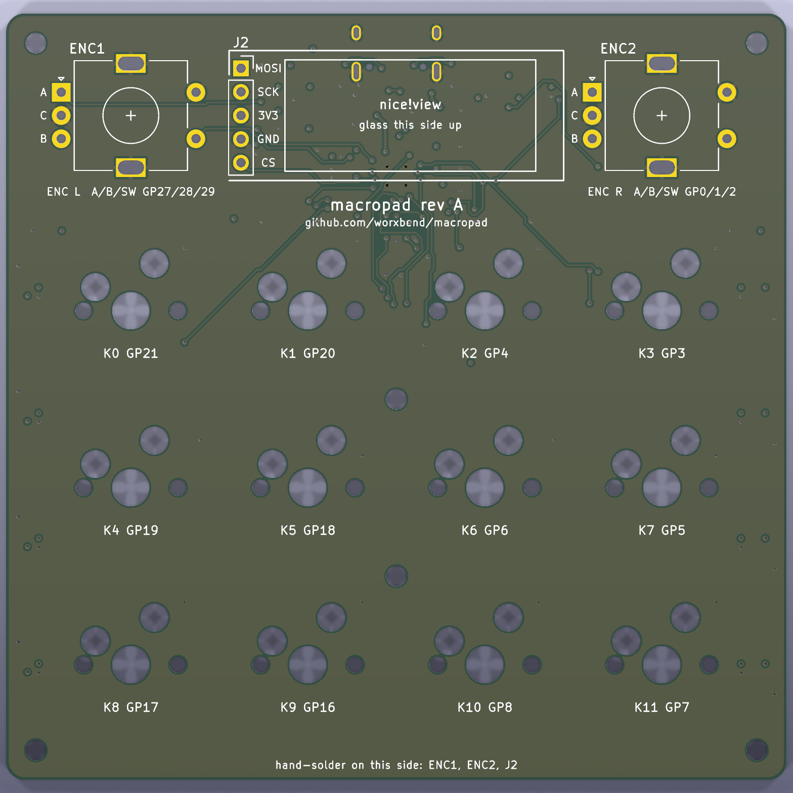
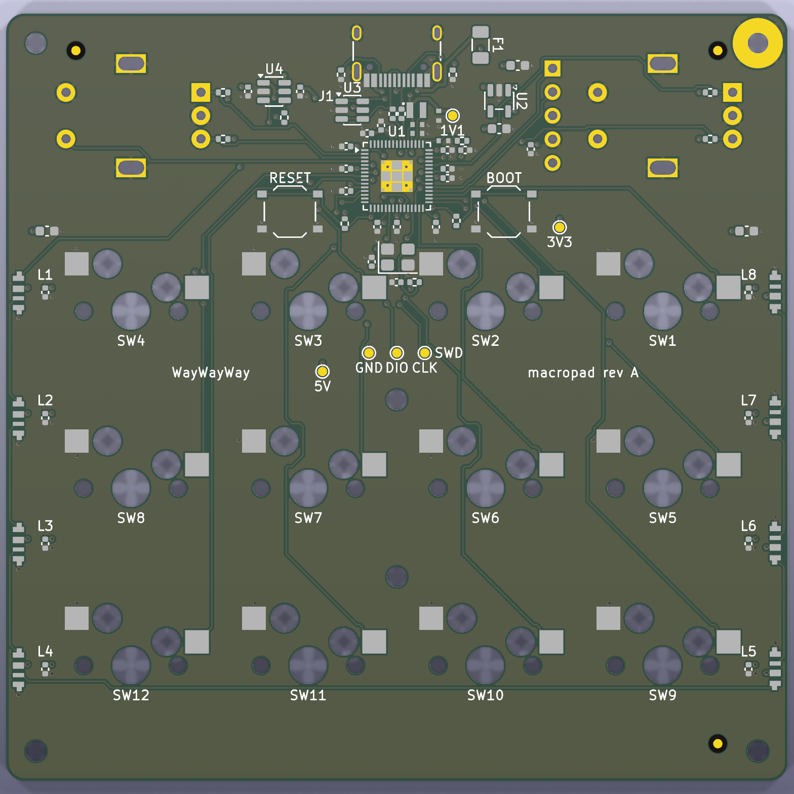

# Ordering the board from JLCPCB

How to order assembled boards with the files in `pcb/fab/`.

**Nobody has placed this order yet.** The steps follow the files in this repository and JLCPCB's
order form as remembered in November 2026. Menu names on their site may differ. The first order is
a prototype run: order the smallest quantity.

Read [Before you order](../README.md#before-you-order) first. Parts and stock: [parts.md](parts.md).

## What you send

| File | What it is |
|---|---|
| `pcb/fab/macropad-gerbers.zip` | 11 Gerber layers and 2 drill files |
| `pcb/fab/bom-jlcpcb.csv` | Bill of materials: 22 lines, 71 parts, each with its JLCPCB part number |
| `pcb/fab/cpl-jlcpcb.csv` | Placement list: position, side and rotation of the 71 parts |

The files in the repository belong to the board in `pcb/kicad/`. `make pcb-fab` checks that: every
Gerber is newer than the board file, the drill file has one hole per via, and the BOM, the placement
list and the circuit name the same parts.

## 1. Check the files (optional, needs Docker)

Skip this if you did not change anything.

1. Run `make pcb-check`. It must end with `Found 0 violations` and `Found 0 unconnected items`.
2. Run `make pcb-fab`. It must end with
   `assembly files: 71 machine-placed parts; Gerbers, drill file, BOM and placement list agree`.
3. Open `pcb/kicad/macropad.kicad_pcb` in KiCad 9 and look at it. A person's eyes are a check too.

## 2. Upload the Gerbers

1. Go to the JLCPCB quote page and upload `macropad-gerbers.zip`.
2. Check what the site detected: **4 layers, 84 x 82.5 mm**. If it shows something else, stop.
3. Look at the preview of both faces. Compare with these pictures.

 

## 3. Board options

| Option | Choose | Why |
|---|---|---|
| Layers | 4 | Detected from the files |
| Quantity | 5 (the minimum) | First run |
| Thickness | 1.6 mm | The case model assumes it (`board.thickness` in `board.toml`) |
| Colour | Any; black if the case matters to you | The PCB edge shows inside the USB opening. Black solder mask hides it; the case pictures draw it black. Green works the same. |
| Surface finish | ENIG if the price is acceptable, otherwise HASL | ENIG is flatter, which is kinder to the 0.4 mm pitch QFN-60 |
| Copper weight | Default (1 oz outer) | No high-current track |
| Impedance control | No | Full-speed USB over 15 mm. No impedance was calculated for this board. |
| Order number mark | "Specify a location" | The bottom silkscreen has the text `JLCJLCJLCJLC` for it |
| Everything else | Default | |

The board uses 0.15 mm tracks and gaps and 0.3 mm via drills. That is inside JLCPCB's standard
4-layer rules as recorded in `pcb/gen/layout.py`. Those limits were not looked up again for this guide.

## 4. Assembly options

1. Switch on **PCB Assembly**.
2. Side: **Bottom**. Every machine-placed part is on the bottom face.
3. Quantity: 2 or 5. Two assembled boards are enough for a first test.
4. Tooling holes: let JLCPCB add them. The board has three fiducials on the bottom face.
5. If the form asks for an assembly type: pick the one that accepts all parts. Guess: the QFN-60,
   the USB-C receptacle and the hot-swap sockets may need the standard type, not the economic one.
   The site says so when you confirm the parts.

## 5. Upload the BOM and the placement list

1. Upload `bom-jlcpcb.csv` as the BOM. Its columns are `Comment, Designator, Footprint, LCSC Part #`.
2. Upload `cpl-jlcpcb.csv` as the placement file. Its columns are
   `Designator, Mid X, Mid Y, Layer, Rotation`.
3. On the parts page, every one of the 22 lines must be matched and in stock.
4. If a part is short, do not let the site pick a replacement on its own. Look at
   [parts.md](parts.md#substitutions-i-made-and-what-to-check) first. Three parts have no drop-in
   replacement: the RP2354A, the SK6812 SIDE-A and the hot-swap socket.

## 6. Check every part in the placement preview

This step matters most. The placement list carries KiCad's rotation of each footprint. JLCPCB's
library often uses another zero angle, most often for bottom-side parts, SOT-23 packages and LEDs.
Nobody has seen this board in their preview yet.

Compare the preview with the bottom assembly drawing:

| Part | What must be right |
|---|---|
| U1 (RP2354A) | Pin 1 dot on the board's pin 1 mark |
| U2 (AP2112K), U3 (USBLC6), U4 (74LVC1T45) | Pin 1. A SOT-23 turned by 180° still fits its pads and is wrong. |
| LED1 to LED8 | The light-emitting side faces out of the board edge. The pad order of this footprint is a community footprint (`MEASURE`): compare with the SK6812 SIDE-A datasheet. |
| L1 (inductor) | The marked end faces VREG_LX. Check against Raspberry Pi's "Hardware design with RP2350". Not verified here. |
| J1 (USB-C) | Mouth at the board edge, shell pins in their slots |
| Y1 (crystal) | Pads 1 and 3 on the crystal nets, 2 and 4 on ground |
| SW1 to SW12 (hot-swap sockets) | The two contacts on their two large pads, the body between the holes |
| SW13, SW14 (buttons) | All four legs on their pads, as in the drawing |

Fix a wrong rotation in JLCPCB's preview. Write down what you changed and open an issue: the lasting
fix belongs in `pcb/gen/fab.py`, not in a hand-edited CSV. The CSV is generated.

## 7. Before you pay

1. The layer count, the size and the quantities are right.
2. Assembly side is Bottom.
3. All 22 BOM lines are confirmed.
4. You looked at every row of the table in step 6.
5. You accept that this is an untested design.

## 8. Order the rest

JLCPCB does not place these. Buy them yourself. Numbers and notes are in [parts.md](parts.md).

1. 2 x Alps EC11E18244AU encoder.
2. 1 x 5-pin socket for the display, or use the one that comes with the nice!view.
3. 1 x nice!view.
4. 12 x MX-style switches and 12 x 1u keycaps.
5. 6 x M2 socket-head cap screws (M2 x 10 for a printed case, never 12; M2 x 8 for a milled one), a
   1.0 mm cover glass lens with a printed black mask, thin double-sided tape, a 5 mm foam pad and six
   0.8 mm foam rings. The feet are printed.
6. A milled case: send `cad/exports/cnc/*.step` and the two CNC sheets. Proposed material and finish:
   6061-T6, fine bead blast, Type II anodise 10 to 15 µm (a guess) dyed clear or grey, the six tapped
   M2 holes masked or chased after anodising. Nothing has been milled yet.

JLCPCB can also solder the encoders and the socket as through-hole parts. They sit on the top face,
so that makes it a two-sided assembly order. This repository's placement list does not include them.

## Other board houses

PCBWay and others take the same Gerbers. Their turnkey assembly buys parts from distributors, so the
JLCPCB part numbers in the BOM do not apply; send the part names from [parts.md](parts.md).

Next: [assembly.md](assembly.md).
