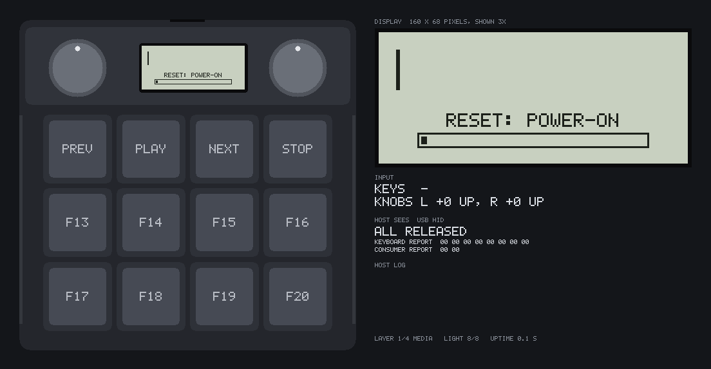
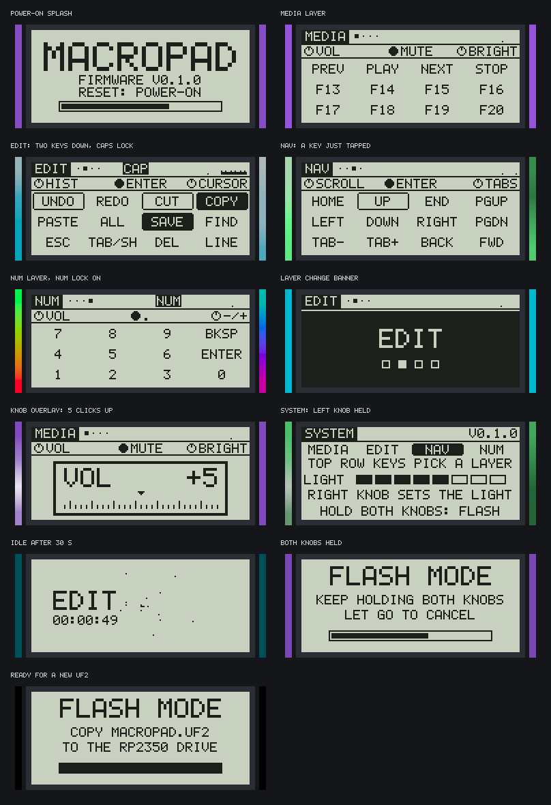
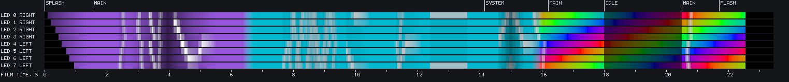
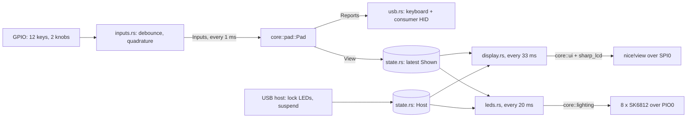
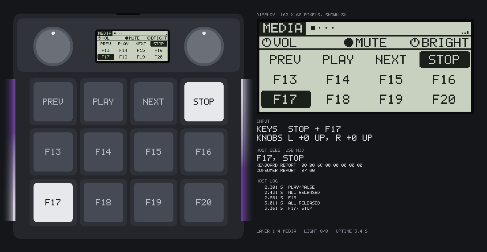

# Firmware

Custom Rust firmware for the macropad (RP2354A, [embassy](https://embassy.dev)).

**Nothing here has run on real hardware yet.** The logic is unit-tested on a PC, the pictures below
come from the same code running in a simulator, and the image builds. No board exists to flash it
on. Read [Untested](#untested) before you trust it.



*Simulator output, not a photo. Left: the pad from above, to scale, with the real display code
and the real LED code running. Right: the display enlarged, the scripted input, and the USB
reports the host would get. 20 frames per second; the idle wait is cut.*

## Contents

1. [What it does](#what-it-does)
2. [Controls](#controls)
3. [Display](#display)
4. [Lighting](#lighting)
5. [Build and flash](#build-and-flash)
6. [Hardware test mode](#hardware-test-mode)
7. [Debug probe](#debug-probe)
8. [Change the keymap](#change-the-keymap)
9. [How it is built](#how-it-is-built)
10. [Timing and protocols](#timing-and-protocols)
11. [Checks](#checks)
12. [What the review found](#what-the-review-found)
13. [Untested](#untested)

## What it does

- 12 keys and two knobs become a USB keyboard plus media keys. No driver needed.
- Four layers: MEDIA, EDIT, NAV, NUM. Each gives all 12 keys, both knobs and the right knob's
  press their own function.
- The display shows the layer, every key's label, the knob functions, caps/num lock and a
  typing-rate graph. It animates: power-on splash, layer banner, knob overlay, idle screen.
- The side LEDs show the layer's colour and react: a ring of light runs outward from a pressed
  key, a dot follows the knob, layers cross-fade, an idle pad dims.
- Hold the left knob for the pad's own functions: jump to a layer, set the LED brightness.
- Tap-hold keys: one key when tapped, another (or Shift, Ctrl, ...) while held.
- Caps lock on the host turns the two back corner LEDs white.
- Safety nets: LED current capped at 200 mA, LEDs off while the host sleeps, a watchdog that
  restarts a hung pad, and a UF2 converter that refuses an image the chip could not boot.
- The splash screen names why the chip started (power-on, reset pin, debugger, watchdog), so a
  watchdog reboot loop is visible without a probe.
- A hardware test mode for a new board: hold K0 while plugging in.
- An optional `probe` build logs over a debug probe.

## Controls

| Input | Does |
| --- | --- |
| Key | Sends the active layer's binding. A held key keeps its binding if the layer changes under it. |
| Tap-hold key (`TAB/SH` on EDIT) | Let go within 0.2 s: the tap (TAB), sent on release. Held longer, or with another key or a knob click meanwhile: the hold (Shift). Hold it and turn CURSOR to select text. |
| Two keys at once | Plain keys add up, six at most. A key with modifiers (COPY is Ctrl+C) is let go when the next key or knob click arrives, so its Ctrl never lands on that one. A media key is let go when the next media code arrives. |
| Turn a knob | Sends the layer's binding for that knob, one tap per click. |
| Tap the left knob | Next layer. |
| Press the right knob | Sends the layer's binding for it (MUTE, ENTER, ...). |
| Hold the left knob + a top-row key | Jump to layer 1, 2, 3 or 4. Nothing is sent to the host. |
| Hold the left knob + turn the right knob | LED brightness, 8 steps down to off. Not stored: full again after power-on. |
| Hold both knobs for 1 s | Restart as a USB drive for a new firmware file. Let go earlier to cancel. |
| Hold K0 (top left) while plugging in | [Hardware test mode](#hardware-test-mode). Unplug to leave. |

## Display

Every picture is rendered by `core/src/ui/` through the simulator. `make ui-images` rebuilds them.



| Screen | When | Shows |
| --- | --- | --- |
| Splash | First 1.6 s | Title wiped in from the left, firmware version, reset cause from the first frame, progress bar. |
| Main | Normally | Layer tab and one pip per layer, CAP/NUM badges, typing-rate graph, knob functions, key legends. A held key is filled; a tapped key keeps an outline for 0.3 s. |
| Layer banner | 0.8 s after a layer change | A dark band opens from the middle with the new layer's name. |
| Knob overlay | 0.9 s after a knob click | The knob's function, net clicks of this run, and a dial that moves one tick per click. |
| System | Left knob held 0.25 s | Layer list, brightness bar, reminders for the two-knob hold. |
| Idle | 30 s without input, or host asleep | Layer name and uptime drifting slowly around the panel, stars flying outward behind them. |
| Flash | Both knobs held | Hold progress, then what to copy where. The panel keeps this picture in the bootloader. |
| Hardware test | K0 held at plug-in | Raw contacts and the lit LED. See [Hardware test mode](#hardware-test-mode). |

The splash's reset line:

| Text | Cause | Read from |
| --- | --- | --- |
| `RESET: POWER-ON` | Plugged in, or a brown-out | POWMAN CHIP_RESET HAD_POR, HAD_BOR |
| `RESET: RESET PIN` | The RUN pin was pulled low | HAD_RUN_LOW |
| `RESET: DEBUGGER` | A debug probe reset the chip | HAD_DP_RESET_REQ, HAD_RESCUE, HAD_HZD_SYS_RESET_REQ |
| `RESET: WATCHDOG` | The scan loop stopped for 500 ms: a hang or a panic | WATCHDOG REASON.TIMER |
| `RESET: RESTART` | Something triggered the watchdog on purpose | WATCHDOG REASON.FORCE |
| `RESET: UNKNOWN` | None of these flags set | |

`WATCHDOG` on every start means a reboot loop. What a restart after a flash shows (`RESTART` is
likely, from the boot ROM's reboot) and the order when two flags are set are guesses until a board
shows them. The logic is `core/src/reset.rs`; the register read is `fw/src/reset.rs`.

The knob overlay shows clicks, not a volume level: the pad cannot ask the host what its volume is.

## Lighting

Each layer names a colour and a base effect in the keymap: `Solid`, `Breathing`, `Rainbow` or
`Wave` (a bright spot that runs around the pad). `core/src/lighting.rs` adds, in this order:

| Stage | What it does |
| --- | --- |
| Power-on wipe | The 8 LEDs come on one after another, 120 ms apart. |
| Layer cross-fade | 300 ms from the old layer's frame to the new one. |
| Key ripple | A ring of white light leaves the pressed key at 0.2 mm/ms and fades within 0.6 s. Uses the real key and LED positions from `board.toml`. |
| Knob comet | The LED the knob "points at" flashes white, its neighbours a quarter as much. Each click moves it one LED; clockwise on the knob is clockwise around the pad. |
| Caps lock | While the host's caps lock is on, the two LEDs at the back corners are two thirds white. |
| Current cap | The whole frame is scaled down if it would draw more than 200 mA. |
| Brightness and idle | User level (0 to 8), then a fade to 19 % after 30 s idle. |
| Lights out | Everything off while the host sleeps or the pad restarts into the bootloader. |

Dimming comes after the cap, so no setting can exceed the budget. A test checks every layer,
with every highlight and caps lock active, in 7 ms steps over 600 ms.



*The 8 LEDs over the demo above. Top: which screen the display shows. Bottom: film time. In
order: power-on wipe, MEDIA breathing with key ripples and the knob comet, cross-fade to EDIT,
white corners for caps lock, brightness down and up, NUM rainbow, idle dimming, wake-up, dark
for flash mode. Colours are brightened for the screen.*

## Build and flash

```sh
rustup target add thumbv8m.main-none-eabihf
make            # tests, lint, board check, and dist/macropad.uf2
```

Single steps: `make test`, `make lint`, `make uf2`, `make ui-images` (needs ImageMagick for the GIF).

Both ways to flash go through the one USB-C port. The pad shows up as a USB drive named `RP2350`;
copy `dist/macropad.uf2` onto it and it restarts with the new firmware.

1. **First flash, or a bricked pad:** hold the BOOT button (through the hole in the case floor)
   while you plug in the cable.
2. **Later:** hold both knobs down for one second.

With the pad in that drive mode, Raspberry Pi's `picotool load -v -x dist/macropad.uf2` writes,
reads back to verify, and starts the firmware. Installing picotool, and a one-time cross-check of
this converter against `picotool uf2 convert`: [flashing.md](../docs/flashing.md#check-a-flash-with-picotool).

## Hardware test mode

For a freshly built board. Hold key K0 (top left), plug in the cable, and let go once the test
screen shows. `core/src/hardware_test.rs` decides: K0 must read closed in each of the first 5
one-millisecond samples after start. No picture of this screen yet: the simulator does not film it.

- **Keys.** A 3 x 4 grid as the keys sit on the pad. A filled box is a closed contact. `KEYS`
  below it is the same bitmap in hexadecimal, bit 0 for K0.
- **Knobs.** A, B and SW of each knob, as the pins read them, without debouncing. Turn a knob
  slowly: A changes once per click and stays put at rest. B may rest either way.
- **LEDs.** One LED at a time, red, then green, then blue, half a second each, at channel value
  32 of 255 (about 11 mA by the cap's estimate). The top right corner names the LED and colour
  that should be lit, `LED1 RED` first. LED1 is the chain's first LED, at the back of the right
  side. Another colour means the colour order is wrong; another LED means the chain order is.

The pad sends nothing to the host and does not start USB. The two-knob flash hold does not work
here. Unplug to leave.

## Debug probe

`make probe` builds the firmware with the `probe` cargo feature: defmt log lines over RTT, and
`panic-probe`, which prints a panic there instead of halting quietly. Versions follow embassy's
`examples/rp235x` for embassy-rp 0.10: defmt 1.0, defmt-rtt 1.0, panic-probe 1.0. The feature
adds `-Tdefmt.x` to the link (`fw/build.rs`). The default build, the UF2 and `make firmware`
leave it off.

```sh
cd fw
cargo run --release --features probe   # flashes over SWD and prints the log
```

The runner is `probe-rs run --chip RP235x`, set in `fw/.cargo/config.toml`, as in embassy's
examples. `DEFMT_LOG` there is `info`. Install probe-rs and wire the probe:
[flashing.md](../docs/flashing.md#debug-probe-optional).

It logs: the firmware version at start, the reset cause, hardware test mode if entered, USB
bus reset, enable, address, configuration and suspend, the first display frame and the first LED
frame. `fw/src/log.rs` holds the `info!` macro; without the feature it compiles to nothing.

`make probe` writes the same ELF path as the default build. `make uf2` rebuilds without the
feature first, so a probe build never ends up in `dist/macropad.uf2`.

## Change the keymap

Edit the layers in [`core/src/keymap.rs`](core/src/keymap.rs), then run `make`.
[KEYMAP.md](KEYMAP.md) has the helpers, the key codes and worked examples.
Tests fail when a label is too long, a macro does not fit, or a media code is out of range.

## How it is built

| Crate | Runs on | Contents |
| --- | --- | --- |
| `core` | PC and pad | Everything that decides something: debounce, knob decoder, keymap engine, activity tracking, lighting, display UI, LCD wire format, reset cause, hardware test mode. `no_std`, no dependencies. |
| `fw` | pad | Pins, USB, SPI, LED output, watchdog, the 1 kHz scan loop. No decisions. |
| `sim` | PC | Drives `core` with scripted input and renders the pad, its display, its LEDs and its USB reports to PNG. See [Simulator](#simulator). |
| `uf2` | PC | ELF to UF2 with the RP2350 family id, plus the bootability check. |



`Pad` bundles the engine (what to send), the activity tracker (what happened how long ago) and the
typing-rate meter. The firmware and the simulator both tick the same `Pad`, so the pictures in
this file cannot drift from what the pad would draw.

Pins live in [`fw/src/board.rs`](fw/src/board.rs) and must match `../board.toml`. So must the knob
type and the key and LED positions used by the ripple. `make lint` runs
[`../tools/check_pins.py`](../tools/check_pins.py), which fails on any difference.

## Simulator

`make ui-images` runs `sim` and rebuilds everything in `../docs/images/ui/`.

- It ticks the same `Pad` state machine as the firmware, 1 ms at a time, from a script in
  [`sim/src/scenes.rs`](sim/src/scenes.rs). Edit the script to film your own keymap.
- The display picture is not copied from the frame buffer. The firmware encodes it for SPI, and
  a model of the panel ([`sim/src/panel.rs`](sim/src/panel.rs), written from the datasheet's
  description of the serial format) decodes it again. A wrong bit order or line address would
  show as a scrambled picture and fail a test. The model checks the format, not a real panel.
- The pad drawing takes its positions from `board.toml` values that the board check guards.
  Keycap and knob cap sizes are not in `board.toml`; they are picture-only guesses.
- "Host sees" is the pad's two HID reports, as bytes and decoded. The host log lists every
  change with the pad's uptime.



## Timing and protocols

| What | Value | Why |
| --- | --- | --- |
| Scan period | 1 ms | Matches the 1 ms USB poll. |
| Debounce | 5 equal samples (5 ms) | Press and release alike. |
| Knob decoding | 1 click per edge of contact A | The EC11E18244AU has 36 detents and 18 pulses per turn, and Alps' output-wave figure says the rest position "cannot be identified in phase B": A is settled at rest, B may sit on its edge. A is debounced like a key (5 ms; Alps: chattering 3 ms max, bounce 2 ms max). B gives the direction, read once when A first leaves its rest level; later bounces of the same edge do not read it again. A click arrives 5 ms after A's last bounce. A needs 5 ms at each level, so up to 200 clicks per second (5.5 turns) can be followed. |
| Knob pull-ups | 3.3 kΩ on the board, internal on too | 1 mA through a closed contact at 3.3 V, Alps' minimum operating current. The internal pull-ups change nothing next to them and keep a board without the resistors working. |
| Queued tap | 8 ms down, 8 ms up | Knob clicks, macro strokes and the tap of a tap-hold key. Spans several USB polls so the host sees both edges. |
| Tap-hold | 200 ms | Shorter is a tap, longer a hold. Another key or a knob click decides "hold" at once. A guess; `TAP_HOLD_MS` in `core/src/engine.rs`. |
| Tap queue | 16 taps | A knob spun faster than the host can follow loses clicks instead of lagging. A macro is dropped whole if it does not fit. |
| Display frame | 33 ms | 1498 bytes at 1 MHz take 12 ms. Every frame flips the panel's VCOM bit. |
| LED frame | 20 ms | 240 µs on the wire; the rest is the latch gap. |
| Watchdog | 500 ms | Fed by the scan loop. |

**USB.** Two HID interfaces: a boot-protocol keyboard (8-byte report, 6-key rollover, 1-byte lock
LED output report) and a consumer-control interface (one 16-bit usage, 0 when idle). The IDs
`1209:0001` are the pid.codes test pair. Get a real PID before you give boards to other people.

**Display.** Sharp LS011B7DH03, SPI mode 0, MSB first, chip select active high with 6 µs setup and
2 µs hold. One frame is a command byte (`0x80` write, `0x40` VCOM), then 68 lines of
`address, 20 pixel bytes, 0x00`, then a final `0x00`. Line addresses count from 1 and go out
least significant bit first, so they are bit-reversed on the MSB-first bus. A set pixel bit is a
light pixel. The nice!view ties EXTMODE low, so VCOM must toggle in software.

**LEDs.** embassy-rp's WS2812 PIO program at 800 kHz, green-red-blue order. Its timing against the
SK6812 SIDE datasheet windows (figures from datasheet copies found online; check the sheet for
your batch):

| Phase | Driver | Datasheet window |
| --- | --- | --- |
| 0-bit high | 0.25 µs | 0.2 to 0.4 µs |
| 0-bit low | 1.0 µs | at least 0.8 µs |
| 1-bit high | 0.875 µs | 0.58 to 1.0 µs |
| 1-bit low | 0.375 µs | at least 0.2 µs |
| Bit period | 1.25 µs | at least 1.2 µs |
| Latch gap | 19.7 ms | more than 80 µs (one revision says 200 µs) |

**Clock.** embassy-rp's default: 12 MHz crystal, startup delay multiplier 128 (the Pico SDK uses
64 for Raspberry Pi's reference crystal). The board's crystal is not the reference part, so the
longer delay is deliberate slack, not a measured need.

**Image.** embassy-rp links the RP2350 image definition block (secure Arm executable) right after
the vector table. `macropad-uf2` checks that it is there, well-formed, inside the first 4 kB, and
that the vector table has a stack pointer in RAM and a Thumb reset address in flash. It refuses to
write a UF2 otherwise.

## Checks

`make` runs all of these. Counts are from the last run in this repository.

| Check | What it proves |
| --- | --- |
| `cargo test`: 192 tests in `core` | Debounce, knob decoding (both methods), reset cause, hardware test mode and its screen, engine (held keys, chords, tap-hold, taps, gestures), activity, lighting and its current cap, every screen and overlay, LCD wire format, keymap sanity. |
| 38 tests in `sim` | The firmware's LCD frames decode to the same picture in the panel model. The demo visits every screen, is deterministic and shows the tap-hold key and the caps lock LEDs. The pad drawing, host readout and LED timeline. |
| 18 tests in `uf2` | UF2 block layout, flash bounds, vector table and image definition checks. |
| `tools/check_pins.py` | 22 GPIOs, the knob detent type, the key grid, 8 LED positions and the positions the simulator draws match `board.toml`. The debounce window is longer than the encoder's chatter. |
| `tools/check_hid.py` | Parses the two HID report descriptors as a host would. Report sizes, the modifier byte, the 6-key array, the lock LEDs and the highest key and media codes match what the firmware sends. |
| `cargo fmt --check`, `cargo clippy -D warnings` | Host crates and the `thumbv8m.main-none-eabihf` binary, with and without the `probe` feature. |
| `make uf2` | The firmware links and the image passes the bootability check. |

## What the review found

A fresh pass over the first version of this firmware, and what changed.

| Finding | Fix |
| --- | --- |
| The knob decoder expected 4 edges per click. The EC11E18244AU clicks every 2 edges (36 detents, 18 pulses), so every other click would have done nothing. | `Detents::PerHalfCycle`, set in `board.rs`, with regression tests. The board check ties it to the encoder part in `board.toml`. |
| The LEDs stayed at up to 200 mA while the host slept. A suspended USB bus allows a device 2.5 mA. | The USB task records suspend and resume; LEDs go off. See [Untested](#untested) for what is still above the limit. |
| A panic or a hang left the last key report "held" on the host until the cable was pulled. | Watchdog, fed by the scan loop, restarts the chip after 500 ms. |
| The lock badges kept their last state after a host reboot. | A USB bus reset clears them. |
| Nothing checked that the UF2 was bootable. | `check_bootable` in the converter. The current image passes. |
| The pad restarted into the bootloader with keys possibly held and the LEDs lit. | It first sends an empty report, shows the flash screen and turns the LEDs off. |

A second pass found two more, both in how held keys share a report:

| Finding | Fix |
| --- | --- |
| A held media key came back after a newer one ended. PLAY held across a volume click was sent twice, so playback toggled back. PREV and NEXT held together, NEXT let go: PREV again. | A newer media code releases the held media key for good. Two regression tests. |
| A held chord lent its modifiers to everything else. UNDO (Ctrl+Z) held plus ESC reached the host as Ctrl+ESC; COPY held plus a CURSOR click as Ctrl+RIGHT. | A newer stroke or knob click releases the held chord. Plain keys still add up. Two regression tests. |

All four regression tests fail with the fix switched off.

A third pass, against Alps' output-wave figure for the EC11E18244AU:

| Finding | Fix |
| --- | --- |
| `Detents::PerHalfCycle` reported a click only when both contacts were back at a rest level. The figure says B may rest on its own edge, so clicks could get lost or arrive late. | `Detents::PerEdgeOfA`: one click per debounced edge of A, direction from B. Set in `board.rs`; the board check ties it to the part. A regression test shows the old method losing the click. |

Reviewed and left as they were: the HID report descriptors (now also parsed by
`tools/check_hid.py`), the tap queue timing, the Sharp LCD frame format (now also decoded by the
simulator's panel model), the SK6812 bit timing (table above) and the clock setup.

## Untested

These are assumptions until a board is built:

- **Display orientation and pixel polarity.** Upside down: set `DISPLAY_ORIENTATION` to
  `Rotated180` in `fw/src/board.rs`.
- **Display refresh at 30 Hz.** The panel's VCOM then alternates at 15 Hz. If the panel flickers,
  raise `FRAME_PERIOD` in `fw/src/display.rs`.
- **Knob direction.** Assumes contact A leads on a clockwise turn. Wrong way: swap `a` and `b` in
  `KnobScanner::rotation` in `fw/src/inputs.rs`.
- **The knob decoder on a real EC11E18244AU.** It follows Alps' figure and its chatter figures.
  Hardware test mode shows the raw A and B to compare.
- **The reset cause.** Register names are from rp-pac; which flags a real start sets is unknown.
- **Hardware test mode** and the **probe build.** Both build; neither has run. No probe has been
  attached to a board.
- **LED colour order** (assumed green-red-blue, the SK6812 default) and **LED order** along the
  chain. The ripple and the comet depend on the chain order in `core/src/geometry.rs`.
- **LED current.** The cap assumes at most 20 mA per colour channel.
- **How the effects look through the diffuser strips.** Ripple speed, comet length and the idle
  level are guesses made on a monitor.
- **USB enumeration**, the lock-LED report, suspend detection and the bootloader restart.
- **Hosts that poll slower than asked.** The pad asks for 1 ms. A tap lasts 8 ms; a host, hub
  or KVM that polls every 10 ms or slower could miss one. Raise `TAP_PRESS_MS` and `TAP_GAP_MS`
  in `core/src/engine.rs` if knob clicks get lost.
- **The tap-hold time** (200 ms) and whether "another key decides hold" feels right.
- **Suspend current.** With the LEDs off the MCU still runs at full speed, well above 2.5 mA.
  A host that enforces the limit could cut power. Putting the chip to sleep is not done.
- **The watchdog** through a restart into the bootloader. The boot ROM uses the same watchdog to
  restart; that this hand-over works is an assumption.
- **The flash screen staying visible** in the bootloader. Nothing toggles VCOM there. A memory LCD
  keeps its picture, but leaving it for hours is not good for the panel.
- **UF2 on older chips.** The file has no RP2350-E10 workaround block. RP2354A does not need it;
  an early RP2350 A2 chip might.

Not done, on purpose:

- **Settings in flash.** Brightness and the active layer reset at power-on. Writing flash on a
  chip that executes from the same flash needs care that cannot be tested without a board.
- **Key combos** (two keys pressed together acting as a third). Tap-hold is done; only keys
  bound with `tap_hold` wait for their release, all other keys still send at once.
- **Waking a sleeping host with a key press** (USB remote wakeup). embassy-rp 0.10's USB driver
  returns `Unsupported` for it, so it would need a driver change.
