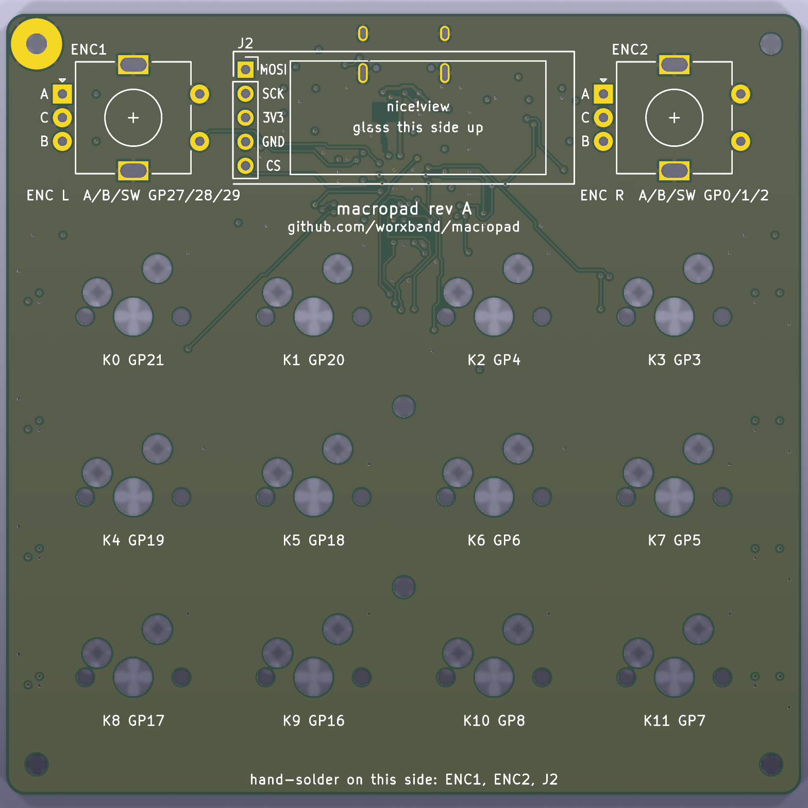
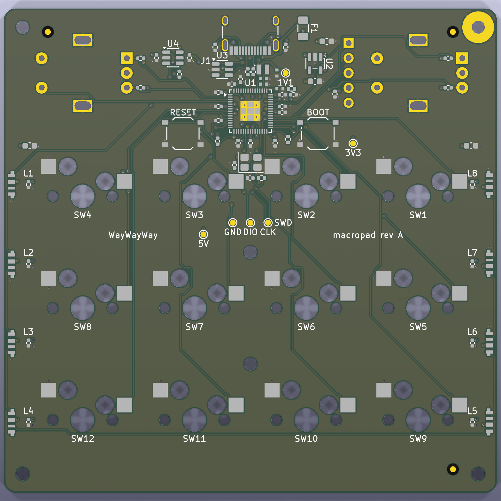
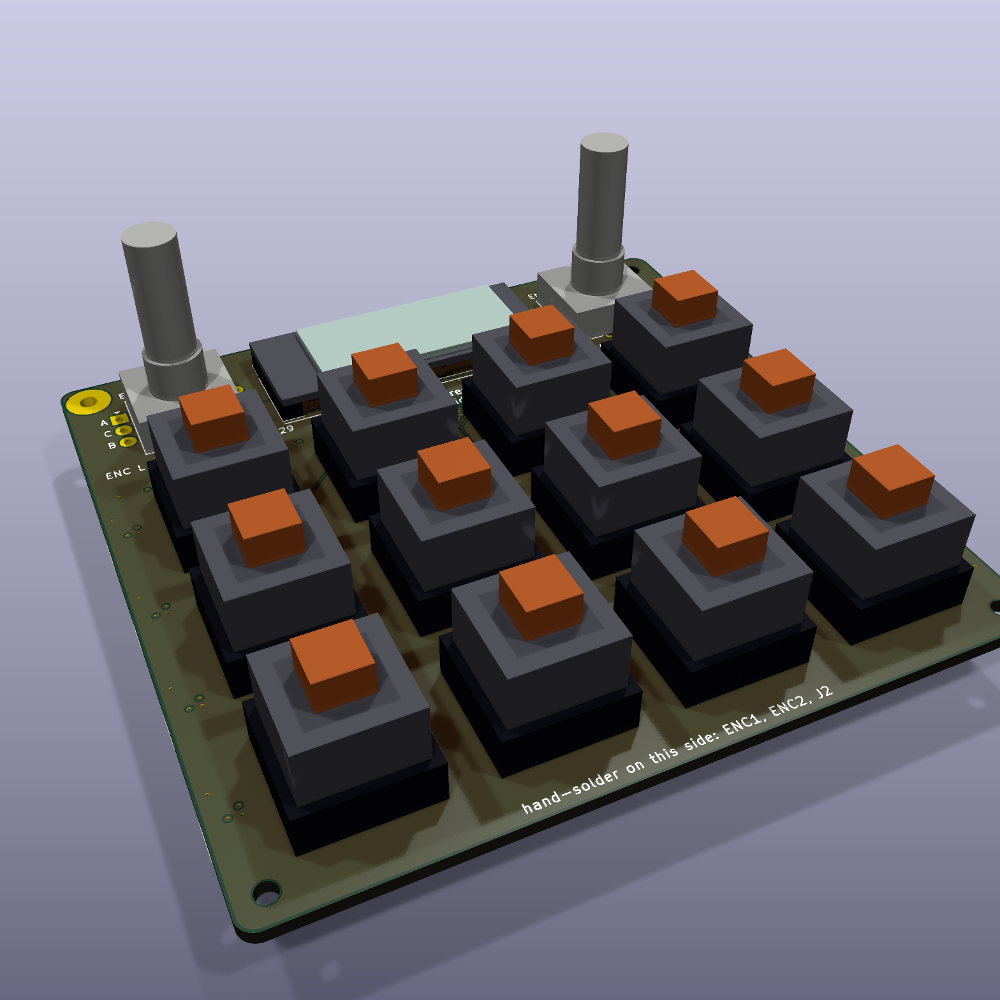
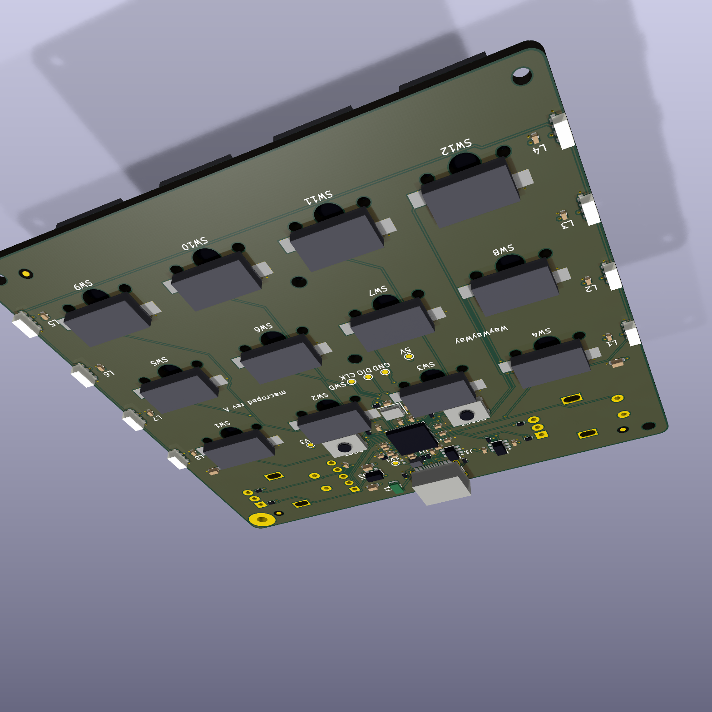

# PCB

The board is generated. Nothing in `pcb/kicad/` is drawn by hand: `make pcb-place` writes the
schematic, the placed and routed board, and the pictures in `docs/images/pcb/` from two inputs,
`board.toml` (positions, GPIOs) and `pcb/gen/circuit.py` (parts and nets).

**Not built.** No board has been ordered, assembled or powered. Everything below is what the design
files say and what the automatic checks confirm, nothing more.

 

Bare-board renders (KiCad 9). Left: top face with the keys, knobs and display header. Right: bottom
face with every machine-placed part.

 

The same board with its parts. The parts are block models: boxes and cylinders that `gen/models.py`
draws from each footprint's outline, with nominal heights. They show where things are and which face
they are on. They are not the manufacturers' models. Straight-on views:
[top](../docs/images/pcb/assembled-top.png), [bottom](../docs/images/pcb/assembled-bottom.png).

## Commands

| Command | What it does |
|---|---|
| `make pcb-place` | Place, route, pour, write the schematic, check it, export the pictures. About 2 minutes. Fails when a pad is left unrouted, after writing `routing.txt`. |
| `make pcb-check` | KiCad design-rule check of the routed board. Fails on any error or unconnected item. |
| `make pcb-fab` | Gerbers, drill files, JLCPCB and PCBWay BOMs and placement files into `pcb/fab/`, then a check that they agree. |
| `make pcb-test` | `python3 -m unittest discover -s pcb/gen -p 'test_*.py'`: router, schematic-writer and order-file tests (37). Plain Python, no KiCad needed. CI runs it. |
| `pcb/kicad.sh python3 pcb/gen/build.py order` | Search for a routing order again. Needed after moving parts or pins. About 10 minutes. |

All KiCad work runs in the pinned container `kicad/kicad:9.0.9` through `pcb/kicad.sh`.

## Files

| Path | What |
|---|---|
| `gen/circuit.py` | The circuit: every part, its JLCPCB number, position, rotation, nets and do-not-populate mark. Pure Python. |
| `gen/layout.py` | Footprints, board outline, planes, design rules (also written into `kicad/macropad.kicad_pro`), the MCU footprint's paste windows, placement self-checks. |
| `gen/router.py` | Two-layer grid router. Pure Python, tested in `gen/test_router.py`. |
| `gen/route.py` | The routing plan: what is routed in which order, and the hand-placed vias. |
| `gen/route_order.txt` | MCU nets that are routed before the others. Written by `build.py order`. |
| `gen/silk.py` | Silkscreen text. |
| `gen/models.py` | Block 3D models of the parts, written to `lib/3d/`. |
| `gen/schematic.py` | Writes the KiCad schematic from `circuit.py`, with KiCad's library symbols. |
| `gen/sheet_layout.py` | Where each part sits on the schematic sheet and which wires are drawn. Data only. |
| `gen/symlib.py`, `gen/sexpr.py` | Read KiCad symbol libraries; draw the two symbols KiCad has none for. |
| `gen/test_schematic.py` | Tests of the schematic writer. |
| `gen/test_order_files.py` | The committed board and order files belong together: no unrouted pad, Gerbers not older than the board, board hash as `make pcb-fab` recorded it. |
| `gen/fab.py` | JLCPCB and PCBWay BOMs, JLCPCB placement list, PCBWay centroid file, and their checks. |
| `kicad/` | Generated KiCad 9 project: board, schematic, symbol library, library tables. |
| `routing.txt` | Generated report: track length and via count per net. |
| `netlist.txt` | Generated netlist: `python3 pcb/gen/circuit.py > pcb/netlist.txt`. |
| `lib/` | The project footprints and where they come from (`lib/SOURCES.txt`). The MCU footprint with windowed exposed-pad paste is generated by `gen/layout.py`. `lib/3d/` holds the generated block models. |
| `fab/` | Generated order files: `macropad-gerbers.zip`, `bom-jlcpcb.csv`, `cpl-jlcpcb.csv`, `bom-pcbway.csv`, `centroid-pcbway.csv`, and `board-sha256.txt` (the board they were made from). |

## Schematic

`kicad/macropad.kicad_sch` opens in KiCad 9. One A3 sheet, thirteen blocks.
[PDF](../docs/images/pcb/schematic.pdf), [SVG](../docs/images/pcb/schematic.svg).

It is a drawing of `circuit.py`, not a second source of truth:

- **Symbols come from KiCad's own libraries** (`Device:R`, `MCU_RaspberryPi:RP2354A`,
  `Regulator_Linear:AP2112K-3.3`, `Power_Protection:USBLC6-2SC6`, `Logic_LevelTranslator:SN74LVC1T45DBV`,
  `Connector:USB_C_Receptacle_USB2.0_16P` and so on). Pin numbers, pin names and pin types are
  therefore KiCad's, not typed here. Two parts have no KiCad symbol and are drawn as boxes: the
  side LED and the display header.
- **`sheet_layout.py` places the parts and lists the drawn wires.** Every other pin gets its supply
  symbol or its net label by rule. A drawn wire names its net, and the build refuses a wire that
  touches a pin of another net.

Checks on every `make pcb-place`:

1. `circuit.py` against KiCad's RP2354A symbol: each GPIO on its pin, each supply pin on its rail,
   the five pins of the flash inside the package open. Each chip's footprint against the footprint
   KiCad's symbol names.
2. `kicad-cli sch erc` at every severity: no error, no warning. That includes KiCad comparing each
   symbol on the sheet with its library.
3. KiCad exports the schematic's netlist; every pin's net is compared with `circuit.py`.
4. `kicad-cli pcb drc --schematic-parity`: every footprint, value and pad net on the board equals
   the schematic.

What this does not prove: KiCad's RP2354A symbol is itself someone's reading of the datasheet. It
is an independent one, and it agrees with `circuit.py` on all 61 pins. The SK6812 SIDE-A and
nice!view pin orders are still `MEASURE` items; no library covers them.

## Layers

| Layer | Use |
|---|---|
| F.Cu | Signals that cross the chip area, ground pour, the bare case ground ring at H1 |
| In1.Cu | 5 V plane. Inside it a 3.3 V island under the MCU, the display header and the USB pair, with a tongue out to the left encoder's pull-ups. Inside that a 1.1 V island under the chip |
| In2.Cu | Ground plane, unbroken except under the regulator inductor and the VREG_LX track |
| B.Cu | All machine-placed parts, most signals (1067 of 1308 mm of track), ground pour |

Drawings of each layer: [top](../docs/images/pcb/copper-top.svg),
[ground](../docs/images/pcb/copper-ground.svg), [power](../docs/images/pcb/copper-power.svg),
[bottom](../docs/images/pcb/copper-bottom.svg). Assembly drawings:
[top](../docs/images/pcb/assembly-top.svg), [bottom, mirrored](../docs/images/pcb/assembly-bottom.svg).

## Design rules

| Rule | Value | Note |
|---|---|---|
| Track width | 0.15 mm signals, 0.3 mm supply where it fits | |
| Clearance | 0.15 mm | The router keeps 0.17 mm to allow for its 0.1 mm grid |
| Via | 0.6 mm pad, 0.3 mm drill | No vias in pads, except four in the MCU's exposed pad. Every via is tented on the top face; on the bottom face all are tented except those four, which sit in the pad's mask opening and get no paste |
| Copper to board edge | 0.3 mm | |
| Copper to hole | 0.2 mm | Hole to hole 0.25 mm |
| Paste to via hole | 0.15 mm | No solder-paste aperture comes closer than this to a drilled via hole |

These are inside JLCPCB's published 4-layer limits as the previous author recorded them in
`layout.py`. PCBWay's capability page (read 2026-11-14) gives 0.1 mm track and space, 0.15 mm
minimum drill and 0.15 mm minimum via annular ring for its standard boards; the 0.6 / 0.3 mm via
has exactly 0.15 mm. Check them against the board house's page on the day you order.

KiCad 9 keeps the design rules in `kicad/macropad.kicad_pro`, not in the board file, and saving the
board from Python does not write that file. Until this change the file was the one written on
12 November and never touched by the build; its values happened to match. Now `make pcb-place`
writes `layout.DRC_RULES` and the default net class into it, and proves that `kicad-cli pcb drc`
reads them: a copy of the board with a project file that asks for 0.2 mm minimum track width must
fail on track width (199 findings on this board).

**Exposed-pad paste.** The MCU's exposed pad carries four 0.3 mm ground vias. KiCad's stock QFN-60
prints paste over them, so solder would wick into the holes. The board uses a project copy of the
stock footprint (`lib/macropad.pretty/QFN-60-1EP_7x7mm_P0.4mm_EP3.4x3.4mm_ViaWindows`, written by
`layout.py`) with the copper unchanged and the paste as nine windows: a 1.1 mm square in the middle,
four 0.95 x 1.1 mm arms between the vias and four 0.33 mm corner squares. They cover 50 % of the
pad and stay 0.15 mm clear of each via's 0.6 mm copper ring (0.3 mm from the hole). The vias are
tented on the top face. Nobody has checked the result with X-ray or a cut board; the corner squares
are small for a 0.12 mm stencil (area ratio about 0.69; the stencil thickness is a guess, ask the
board house).

## How the routing works

There is no autorouter program. `router.py` is a small grid router and `route.py` tells it what to
do, in this order:

1. **Four ground vias** in the MCU's exposed pad, between its paste windows.
2. **1.1 V regulator**, in Raspberry Pi's RP2350A Minimal pattern (RP2350 datasheet 6.3.8), mirrored
   for the bottom face. CIN (C11) sits across VREG_VIN (pin 49) and PGND (pin 47), COUT (C12) right
   behind it; their ground pads are joined and share two hand-placed vias. VREG_LX runs from pin 48
   between the pads of both capacitors to the inductor beyond them. VREG_FB runs from pin 50 to
   COUT. A 0.3 mm link takes the output from the inductor's +1V1 pad over the chip on the top layer
   into the 1.1 V island. Rule areas keep copper off the top and both inner layers under the
   inductor and the VREG_LX node, and keep the bottom ground pour out from between the inductor's
   pads. The VREG_LX rule areas are drawn after routing, round pin 48 and each routed VREG_LX segment
   with 0.2 mm to spare, so they follow the track wherever the router put it. Then USB D+ and D-, which squeeze past the regulator to their series resistors.
3. **MCU supply pins.** Each pin runs to its own 100 nF capacitor. The supply via sits between the
   pin and the capacitor, the ground via behind the capacitor, all on one line pointing away from
   the chip. These vias are placed by hand-computed geometry (`circuit.py`: `DECOUPLING_DISTANCE`,
   `SUPPLY_VIA_DISTANCE`, `GROUND_VIA_DISTANCE`), so they stay out of the lanes the neighbouring
   signal pins need.
4. **Crystal ground vias**, then **RUN**, then **SWCLK and SWDIO** out of the chip.
5. **Sensitive nets**, while the board is still empty: the USB lines from the connector, the crystal
   nets, VREG_AVDD. Then QSPI_SS, BOOT and VBUS.
6. **One via to the plane** for every remaining supply and ground pad.
7. **MCU signals**, one pin at a time: first a track out of the 16 mm square around the chip, then
   the rest of the net. Pins next to a capacitor go first. `route_order.txt` moves some nets to the
   front.
8. **Everything else**, shortest net first.

The router has no rip-up. When a net ends up walled in, `build.py order` routes the whole board
again with that net moved to the front, until every net connects. The order it finds is stored in
`route_order.txt`, so `make pcb-place` is one deterministic pass.

## Checks

| Check | Where | Fails the build |
|---|---|---|
| Every net has at least two pads | `circuit.py` | yes |
| Flips and rotations: MCU pins, hot-swap sockets, USB mouth, LED direction, capacitor orientation, crystal near XIN, fiducials on the assembly face | `layout.py:check_placement` | yes |
| Router: clearance to pads, tracks, vias, holes and the edge; vias; fan-out; escapes; determinism (15 tests) | `test_router.py` | yes, in `make pcb-test` and CI |
| Hand-placed vias have room | `router.py:add_via` | yes |
| Every net connects through tracks, vias and inner planes alone, before the outer ground pours are added | `build.py` | yes |
| Length limits: VREG_LX, USB_DM, USB_DP, XIN, XOUT, VREG_AVDD, VREG_FB to COUT; USB pair mismatch under 2 mm; no via on VREG_LX, on USB D+ from connector to chip, or on D- after its resistor; VREG_AVDD at least 0.75 mm from VREG_LX | `route.py:check_sensitive_lengths` | yes |
| No via and no top-layer track under the regulator inductor or the VREG_LX track | `route.py:check_regulator_keepout` | yes |
| No filled pour on the top or inner layers under the VREG_LX tracks, pin 48 or the inductor's pads, read back from the filled board | `route.py:check_no_pour_under_regulator` | yes |
| L1's polarity dot on B.SilkS and B.Fab sits at its +1V1 pad | `layout.py:check_placement` | yes |
| Encoder pull-ups R10-R13: on the bottom face, within 3 mm of their encoder pin, signal pad toward the pin | `layout.py:check_placement` | yes |
| Case ground ring at H1: on GND, at `mounting.ground_bond_hole`, `mounting.ground_bond_pad_diameter` wide, 2.2 mm hole, bare on the top face; no pad, track or via of another net within 0.15 mm | `layout.py:check_ground_bond`, after placement and after routing | yes |
| The MCU footprint's copy has exactly the stock footprint's copper pads; its paste windows stay inside the exposed pad, 0.15 mm clear of each via's copper ring, and cover 50 to 70 % of the pad | `layout.py:check_derived_footprints`, `check_paste_windows` | yes |
| Board-wide: no paste aperture within 0.15 mm of a via hole; every via tented on the top face | `layout.py:check_paste_clear_of_vias` | yes |
| `kicad-cli pcb drc` reads the rules from `macropad.kicad_pro`: a stricter project file must make it fail | `build.py:_check_rules_reach_drc` | yes |
| No pad left unrouted; `routing.txt` is written first | `build.py:place` | yes |
| Silkscreen: every visible text, footprint references included, at least 1.0 mm high with a 0.15 mm stroke; every stroked line at least 0.15 mm wide (the generator widens the stock footprints' 0.12 mm lines) | `silk.py:check_minimums` | yes |
| Every real part has a JLCPCB number, a manufacturer and a manufacturer part number | `circuit.py:check_sourcing` | yes, in `make pcb-test` |
| KiCad DRC at every severity: no warning either (loose track end, silkscreen over a pad or the edge). One named exception: J1 differs from its library copy, because its silkscreen is cut at the board edge | `build.py:_check_no_warnings` | yes |
| Every real part has a 3D model; no bottom-side model is taller than the gap to the case floor | `layout.py:write_models` | yes |
| Order files: all 11 Gerbers present and newer than the board, drill file has one hole per via, both BOMs, the JLCPCB placement list and the PCBWay centroid file name the same 75 parts as `circuit.py`, every BOM line has a JLCPCB number and a manufacturer part number, PCBWay quantities match the designators, side and rotation match the board, every placement point lies inside its part's courtyard | `fab.py:check_outputs` | yes, in `make pcb-fab` |
| Do-not-populate parts are exactly `fab.DNP_PARTS` (C13), keep footprint and pads, carry KiCad's DNP mark, and are in no BOM and no placement file | `fab.py:_check_dnp` | yes, in `make pcb-fab` |
| Committed order files fit the committed board: `routing.txt` says `unrouted pads 0`, no Gerber older than the board (10 s slack for a fresh checkout), board SHA-256 equals `fab/board-sha256.txt` | `test_order_files.py` | yes, in `make pcb-test` and CI |
| Schematic ERC at every severity, and schematic netlist equals `circuit.py` | `build.py:write_schematic` | yes |
| `circuit.py` pins against KiCad's library symbols; chip footprints against the symbols' footprints | `schematic.py` | yes |
| Board equals schematic: footprints, values, pad nets (`--schematic-parity`) | `build.py:_check_no_warnings` | yes |
| Schematic writer: library reading, pin positions under rotation, wire splitting, junction dots, sheet layout (19 tests) | `test_schematic.py` | yes, in `make pcb-test` and CI |
| KiCad DRC: zero errors, zero unconnected | `make pcb-check` | yes |

## What a person still has to look at

- **USB pair.** Routed as two short tracks, not as a tuned differential pair. Lengths are in
  `routing.txt` (D+ 14.9 mm, D- 14.1 mm). From the series resistors to the chip both run on the
  bottom layer with no via. Near the connector D- changes layer twice: a USB-C receptacle has two
  pads per line and one line has to cross the other. No impedance was calculated. This is normal for
  full-speed USB (12 Mbit/s) over 15 mm; it would not be for high-speed.
- **Capacitance on VBUS.** About 7.5 µF sits behind the fuse on the 5 V rail (three 2.2 µF: C17,
  C22, C23, and nine 100 nF). The USB 2.0 specification allows a device 10 µF at plug-in. The LED
  rows now have 2.2 µF each instead of 10 µF; the firmware caps LED current at about 200 mA.
  Nobody has looked at the 5 V rail with a scope while the LEDs switch.
- **Decoupling.** Each MCU supply pin has its own capacitor: 100 nF, except 4.7 µF (C5) at DVDD pin 23, the core pin furthest from the regulator (RP2350 datasheet 6.1.3). Ten sit 2 mm in front of their pin.
  Two do not fit there: C33 (QSPI_IOVDD, pin 54) sits beside C10 and is tracked to it; C32
  (ADC_AVDD, pin 44) sits 4 mm away behind C9 and connects through the 3.3 V plane. Pins 44 and 54
  are also tracked to the pin beside them, so each reaches that pin's capacitor.
- **Test pads.** Six 1 mm pads on the bottom face, each named in silkscreen: SWCLK, SWDIO, GND
  (between the first two key rows), 5V (next to them), 3V3 (right of the BOOT button, seen from the
  bottom) and 1V1 (beside the inductor). The 1V1 pad hangs on the regulator output track. Nobody has
  put a probe on them.
- **Regulator loop.** The placement follows Raspberry Pi's reference and the checks above hold it.
  Seen from the bottom face, the pins read FB, VIN, LX, PGND, AVDD as in the datasheet's Fig. 26, so
  the layout is not a mirror image of the reference. One departure: VREG_LX is 3.9 mm long, because it runs between the
  pads of both capacitors to the inductor. C13, a 4.7 µF footprint at the probe pad end of the
  output track, is **do not populate**: datasheet 6.3.8 wants COUT at 4.7 µF ±20 %, and a fitted
  C13 would double it. The footprint and its pads stay, marked DNP on the board and on the
  schematic, and it is in neither BOM nor placement file. Its pads still get paste from the stencil.
  The datasheet's second 4.7 µF at DVDD pin 23 is that pin's own decoupling capacitor (C5,
  `circuit.py: BULK_DECOUPLED_PIN`), in the 0402 spot in front of the pin where the 100 nF was. The footprint (Raspberry
  Pi's, see `lib/SOURCES.txt`) puts a dot on the +1V1 pad on silkscreen and fabrication layers, as
  Raspberry Pi's datasheet (Figs. 26, 28) and its Minimal board do. Abracon's own drawing labels the
  dot "+" with current entering there, the opposite sense; the papers disagree, and this board
  follows Raspberry Pi. Check the dot in the assembler's preview. Nobody has measured the 1.1 V ripple.
- **R4 (BOOT to QSPI_SS).** It sits next to the BOOT button, so QSPI_SS, the flash chip-select
  inside the package, carries a 12.9 mm stub to it. Three tries put R4 beside pin 60: at (47.1, 13.3)
  with two routing-order searches, and at (46.6, 12.9) with the BOOT track pinned to two hand-placed
  vias. Each left KEY4, KEY8 or DISP_CS with no way out of the chip, and the last one also overlapped
  U3's courtyard. The stub is short against the flash clock rate; nobody has looked at it with a scope.
- **Crystal.** It sits 5 mm below XIN, as close as the two hot-swap sockets allow. It is Raspberry
  Pi's reference part (ABM8-272-T3) with the reference 15 pF load capacitors and 1 kΩ. The
  oscillator is not measured.
- **LED data.** R9 (330 Ω) sits in series at the level shifter's output, as the SK6812 SIDE-A
  datasheet asks. The value is a choice inside the reviewed 33 to 470 Ω range; nobody has looked at
  the edge with a scope.
- **Thermal reliefs** are on for through-hole pads only (encoders, display header, USB shell).
- **No teardrops.** KiCad 9's Python interface can switch teardrops on per via, but only the editor
  draws them: tried here, a filled and saved board had none. Open the board in KiCad and run
  Edit > Edit Teardrops if you want them; that is a hand edit the next `make pcb-place` removes.
- **Fiducials.** Three 1 mm marks on the bottom face. The board house adds its own tooling holes; none are
  drawn here.
- **Silkscreen** was checked in the renders above, not on a printed board. KiCad reports no
  silkscreen warning. The bottom face carries `WayWayWay` right of centre, between the first two
  key rows: PCBWay's help page "Notes of Product No on Your PCB" says to put that text where the
  product number should go and to choose "Specify a location" when ordering. Without that choice
  PCBWay may print the number elsewhere and leave `WayWayWay` on the board.
- **Case ground.** H1 (back left) is a plated 2.2 mm hole with a bare 5.4 mm GND ring on both faces
  (`board.toml` `mounting.ground_bond_hole`, `ground_bond_pad_diameter`). The aluminium case's
  corner boss seats on the top ring. The other five holes are unplated and float. Nobody has
  measured the bond's resistance or looked at ESD with it.
- **Encoder pull-ups.** R10-R13, 3.3 kΩ 0402 (UNI-ROYAL 0402WGF3301TCE, JLCPCB C25890), pull ENC_L_A,
  ENC_L_B, ENC_R_A and ENC_R_B to 3.3 V, 2.4 mm from each encoder pin on the bottom face: 1 mA
  through each closed contact. Alps EC11 sheets give 1 mA at 5 V as the minimum rating; the
  EC11E18244AU's own sheet was not read for this, and one secondary sheet gives 0.5 mA. The push
  switches (ENC_x_SW) keep the chip's internal pull-up. The left pair reaches 3.3 V through a tongue
  of the 3.3 V island; the right pair sits at the island's right edge. If the firmware also turns on
  the internal pull-ups, they sit in parallel and do no harm.
- **3D models** are block models with heights typed from memory of the datasheets. Use them to see
  the layout, not to measure. The case model has its own clearance checks.
- **Placement files.** `fab/cpl-jlcpcb.csv` and `fab/centroid-pcbway.csv` put each part at the
  centre of its body outline and carry KiCad's rotation unchanged, also on the bottom face. Whether
  the assembler wants that or (180 - r) on the bottom is not settled; community exporters disagree.
  The JLCPCB file has Y negative (KiCad's Y flipped); the PCBWay file measures from the board's lower
  left corner, Y up, bottom-face parts seen from the top. Its columns (Designator, Footprint, Mid X,
  Mid Y, Layer, Rotation, Comment) follow PCBWay's sample centroid file, which names the side `T` or
  `B` in a `TB` column; PCBWay's assembly file page asks for "Top or Bottom", which this file writes.
  Nobody at PCBWay has seen it yet. Check every part in the assembler's placement preview before
  paying (`docs/ordering.md` has the checklist).
- **Schematic layout.** The sheet is generated. It passes KiCad's checks and was looked at as a
  picture, but nobody has reviewed it as an engineer would review a hand-drawn schematic.
- **Net names.** On the board, signal nets carry KiCad's leading slash (`/KEY3`), supply nets do not
  (`GND`, `+3V3`). Each open pin has KiCad's one-pad net (`unconnected-(U1-GPIO10-Pad14)`). This is
  what KiCad itself writes when it updates a board from a schematic.
